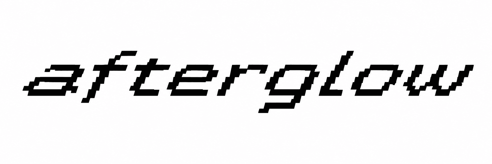
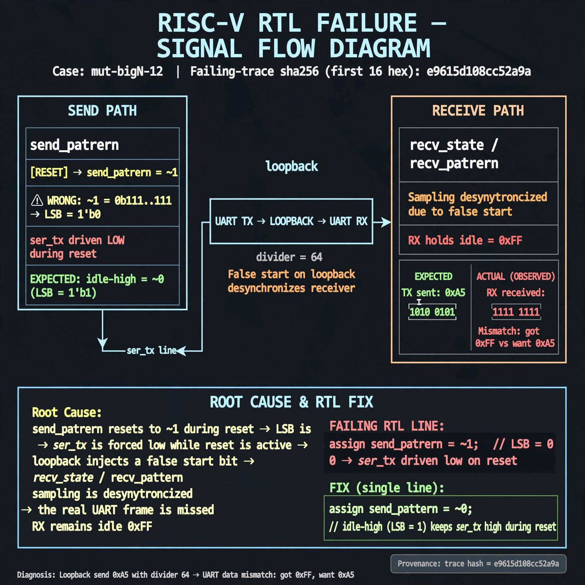
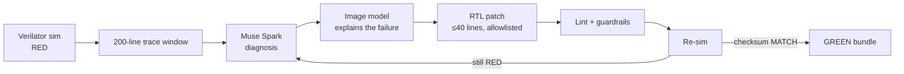
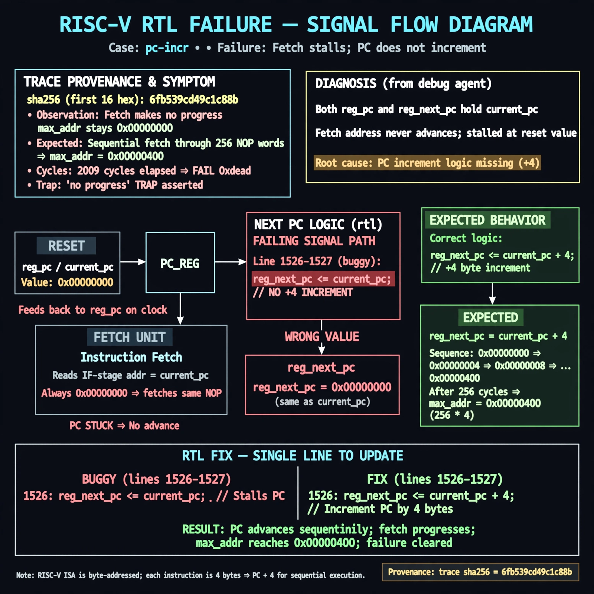

<p align="center">
  
</p>

<p align="center">
  <em>Silicon doesn't lie. Neither do we.</em><br>
  I got tired of chatbots guessing at my RTL. So I built one that has to prove it: red sim in, green sim out, zero hand edits.
</p>

<p align="center">
  <a href="eval/results.md">locked 3/3 · full 8/8</a> ·
  <a href="eval/mutant_board_100.md">72-fault board</a> ·
  <a href="eval/ablation-waveform.md">text+waveform beats text alone</a>
</p>

---

## Try it in 30 seconds

```bash
git clone <this-repo> && cd afterglow
./install.sh        # deps, TUI build, .env stub, then doctor as proof
./afterglow demo    # triage-only run of the fastest locked case (~44s, patch withheld)
```

With a key in `.env`, the real thing:

```bash
./afterglow run sim/targets/picosoc-uart-div.yaml
# RED → COLLECT → DIAGNOSE → EXPLAIN → PATCH → RESIM → VERIFY
# GREEN: case picosoc-uart-div fixed (model-verbatim, 4 patch lines)
```

On a terminal you get the Rust TUI. Piped or on CI it's plain text. Same loop either way.

## How it actually works

- **RED first.** The sim fails. The agent gets a 200-line window around the failure, not the whole dump.
- **Text decides, image explains.** Muse Spark reads the trace and writes the diagnosis; Muse draws the failure so a human can sanity-check it. Bad patches get rejected by the guardrails (40-line cap, allowlisted RTL, lint must pass).
- **Re-sim is the whole game.** A fix only counts if the checksum flips to MATCH. Every run lands in `runs/<id>/`: the trace, the raw API requests, the diff, before/after checksums. If it's not in the bundle, it didn't happen.

## Receipts

| claim | where to look |
|---|---|
| locked 3/3, full 8/8 | `eval/results.md` (generated from bundles, never hand-edited) |
| 72 fresh faults, all RED-proven then fixed | `eval/mutant_board_100.md` (seed 777, quarantined from older families) |
| median 54s / ~$0.07 a fix | `eval/impact.md`, `eval/tournament.md` (costs logged per run) |
| text+waveform beats text alone | `eval/ablation-waveform.md` (preregistered, converted a real RED) |

Suite: `python3 -m unittest discover -s tests` → OK (2 honest skips: needs a key, needs a VCD flag). Gate: `bash scripts/ci.sh` → `CI GATE: ALL PASS`.

## What a fix looks like

Every run ends the same way: a proof bundle, or a loud refusal. Here's a real one — a UART loopback mutant where the reset value drove the TX line low and desynchronized the receiver:



The image isn't decoration. It's rendered from the failing trace hash plus the model's verbatim diagnosis, saved into the bundle *before* the patch runs — so a human can sanity-check the machine's reading of the failure before silicon is on the line. The patch that followed was 2 lines; the re-sim checksum matched.

The loop itself, end to end:



And here's the same story on a harder case — a program-counter fault where the diagnosis has to survive a 3-attempt budget:



What the loop *won't* do is also on the record: 4 injected faults genuinely beat it (the board keeps them RED and visible), and when the model API flakes, the run triages loud with the patch withheld instead of inventing a diagnosis. The receipts table above links every number to the bundle or board that backs it — if a claim isn't in `runs/` or `eval/`, it didn't happen.

## Bring your own RTL

The loop isn't welded to PicoRV32. A new case is three things:

1. **A testbench** that prints a `tohost: PASS` / `tohost: FAIL` oracle line (any Verilator TB works — see `sim/tb/`).
2. **A spec** (`sim/targets/<name>.yaml`): which RTL files, which TB, the oracle strings, the seed. Copy `sim/targets/picosoc-uart-div.yaml` and change the paths.
3. **Run it**: `./afterglow run sim/targets/<name>.yaml --auto` (TUI on a terminal, plain text when piped).

The stranger cases prove the point: SERV (a bit-serial CPU the loop never saw during development) and a SPI flash controller both went RED→GREEN through the same loop with zero loop changes — new TB plus new spec, nothing else. Quarantine rules keep stranger faults separated from the training families so a "new design" claim actually means new.

Cost model, measured: the median fix burns ~54 seconds and ~$0.07 of Meta Model API credit (Spark diagnosis + image explanation). Every run logs its own spend in `meta.json`; the suite refuses to invent results when the API is unreachable — those runs exit loud, not green.

First time here? `./afterglow doctor` checks your toolchain (Python, Verilator, Rust, key) and tells you exactly what's missing. `./afterglow demo` runs the fastest locked case as a triage-only preview — one model call, patch withheld, so you can watch the loop think before spending anything real.

<details>
<summary>Repo map</summary>

- `afterglow` — CLI: `run` (TUI on a terminal, plain text when piped), `demo`, `explain`, `init`, `watch`, `doctor`
- `agent/` — the loop, guardrails, prompts, waveform renderer, open-weights client
- `tui-rs/` — the Rust terminal UI (built by `install.sh`; missing binary = plain-text fallback, nothing breaks)
- `sim/` — Verilator harness on pinned PicoRV32 + hand-written testbenches
- `eval/` — boards, preregs, tournament + impact writeups (generated, not hand-edited)
- `repro/` — one-command Docker repro + `EXPECTED.md` checksums
- `runs/` — immutable proof bundles

</details>

## Foundation

PicoRV32 is someone else's (YosysHQ, pinned by hash in `targets.pin` — we don't take credit for it). Everything else here was written Oct 27–Nov 4 and committed in that window; nothing predates it.
