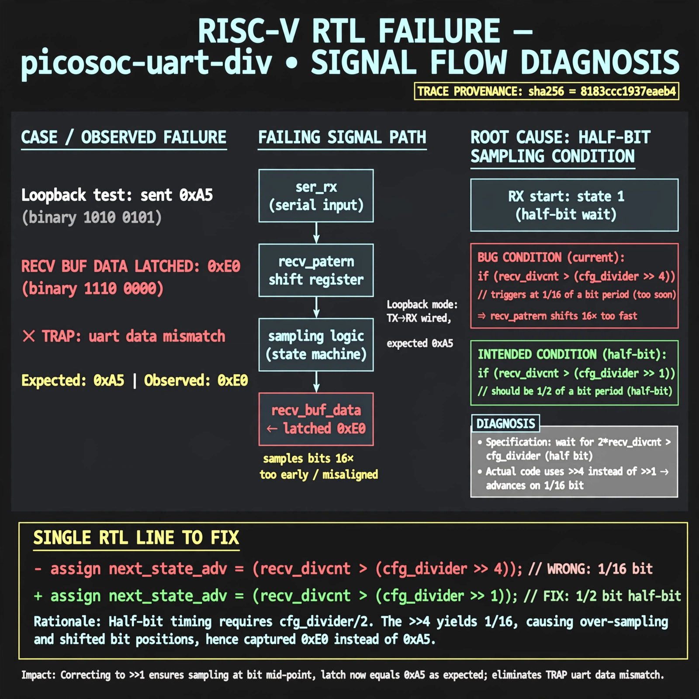

# Afterglow run report: ablate-v2-uartdiv

case `picosoc-uart-div` | status **GREEN** | mode `live` | seed `42`

wall start `2026-10-27T01:08:23Z` | wall end `2026-10-27T01:09:16Z` | time-to-green `53.4s`

retries `0` | human_touches `0` | diagnosed `True` | fixed_unaided `True` | patch_source `model-verbatim`

## Verdicts (from sim, not typed)

- BEFORE: tohost=FAIL 0xdead checksum=27ee482b473c74db5dce8b5ab1a233084cce3055c317a1f2045faa6dbc13a1c6 cycles=2112 seed=42 pass=False
- AFTER: tohost=PASS checksum=5c8f58d0f0818c97d014d2f851a6140882bd1efc96a2537047806252c0c2caf9 cycles=2652 seed=42 pass=True

## Diagnosis (verbatim from api/text_response.json)

```
Loopback sent 0xa5 but recv_buf_data latched 0xe0, causing TRAP uart data mismatch. RX start half-bit in state 1 waits 2*recv_divcnt > cfg_divider (half bit), but states default/10 advance when recv_divcnt > (cfg_divider >> 4), i.e. 1/16 of a bit period, so recv_pattern shifts ser_rx 16x too fast and samples wrong bit positions.
```

expected re-sim signal: tohost: PASS, loopback recv 0xa5 matches send 0xa5 with no uart data mismatch trap

## Patch (4 lines, guard-checked)

```diff
diff --git a/picosoc/simpleuart.v b/picosoc/simpleuart.v
--- a/picosoc/simpleuart.v
+++ b/picosoc/simpleuart.v
@@ -89,14 +89,14 @@
 				10: begin
-					if (recv_divcnt > (cfg_divider >> 4)) begin
+					if (recv_divcnt > cfg_divider) begin
 						recv_buf_data <= recv_pattern;
 						recv_buf_valid <= 1;
 						recv_state <= 0;
 					end
 				end
 				default: begin
-					if (recv_divcnt > (cfg_divider >> 4)) begin
+					if (recv_divcnt > cfg_divider) begin
 						recv_pattern <= {ser_rx, recv_pattern[7:1]};
 						recv_state <= recv_state + 1;
 						recv_divcnt <= 0;
 					end
 				end

```

## Provenance (judge checks)

- prompt file `/home/tuncay/afterglow/agent/prompts/v2.txt` sha256 `d31e1ef6b74ddf52ee59e790ebff2f3defa9b03be82e699f45ef620cf8e27a6e`
- input_trace.txt sha256 `8183ccc1937eaeb46c869e947280a29b3929f5537f3e42779b8eaa1275a88447` (9 lines, 68 tokens)
- prompt tokens `802` (cap 2500)
- text model `muse-spark-1.3-contributor` latency `39203ms` request `chatcmpl-01a17ae7-532b-73d6-862c-019cc225380a`
- image model `muse-image-1.0` latency `13664ms` request `7135e89d-d015-441e-bb4b-ab3e5db8dfa7` status `ok`
- image prompt sha256 `22d6b3847bc4b634bccd35d789cd8aaea1ee0d1619ecfba070ee07c1b1ff4039`, trace sha `8183ccc1937eaeb46c869e947280a29b3929f5537f3e42779b8eaa1275a88447` (see api/image_request.json)

## Explanation diagram



## Bundle completeness

- present (12): artifacts/input_trace.txt, artifacts/boot.log, artifacts/boot_after.log, artifacts/verdict_before.json, artifacts/verdict_after.json, api/text_request.json, api/text_response.json, api/image_request.json, api/image_response.json, explain.png, patch.diff, meta.json
- missing (0): none

