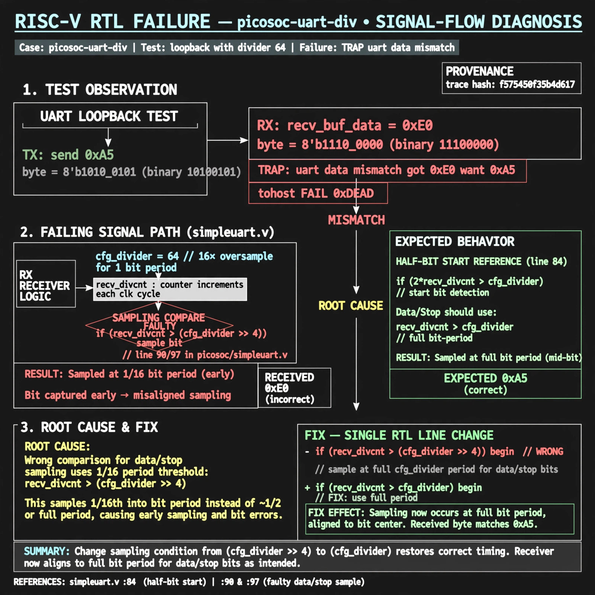

# Afterglow run report: ablate-v3-uartdiv

case `picosoc-uart-div` | status **GREEN** | mode `live` | seed `42`

wall start `2026-10-27T01:09:17Z` | wall end `2026-10-27T01:10:06Z` | time-to-green `49.3s`

retries `0` | human_touches `0` | diagnosed `True` | fixed_unaided `True` | patch_source `model-verbatim`

## Verdicts (from sim, not typed)

- BEFORE: tohost=FAIL 0xdead checksum=27ee482b473c74db5dce8b5ab1a233084cce3055c317a1f2045faa6dbc13a1c6 cycles=2112 seed=42 pass=False
- AFTER: tohost=PASS checksum=5c8f58d0f0818c97d014d2f851a6140882bd1efc96a2537047806252c0c2caf9 cycles=2652 seed=42 pass=True

## Diagnosis (verbatim from api/text_response.json)

```
Loopback with divider 64 sent 0xa5 but recv_buf_data returned 0xe0, causing TRAP: uart data mismatch got 0xe0 want 0xa5 and tohost FAIL 0xdead. Root cause in picosoc/simpleuart.v:90 and :97 is bit timing compare `recv_divcnt > (cfg_divider >> 4)` sampling at 1/16 bit period versus half-bit start reference `2*recv_divcnt > cfg_divider` at :84. Fix restores full `cfg_divider` period for data/stop sampling.
```

expected re-sim signal: tohost PASS (no TRAP, uart loopback 0xa5 matches, FAIL 0xdead cleared)

## Patch (4 lines, guard-checked)

```diff
diff --git a/picosoc/simpleuart.v b/picosoc/simpleuart.v
--- a/picosoc/simpleuart.v
+++ b/picosoc/simpleuart.v
@@ -89,14 +89,14 @@
 				10: begin
-					if (recv_divcnt > (cfg_divider >> 4)) begin
+					if (recv_divcnt > cfg_divider) begin
 						recv_buf_data <= recv_pattern;
 						recv_buf_valid <= 1;
 						recv_state <= 0;
 					end
 				end
 				default: begin
-					if (recv_divcnt > (cfg_divider >> 4)) begin
+					if (recv_divcnt > cfg_divider) begin
 						recv_pattern <= {ser_rx, recv_pattern[7:1]};
 						recv_state <= recv_state + 1;
 						recv_divcnt <= 0;
 					end
 				end

```

## Provenance (judge checks)

- prompt file `v3` sha256 `ad529368accaf171e6121a54b2d27547230920a900c7c4e5094d3fff13ca4233`
- input_trace.txt sha256 `f575450f35b4d6174661f7e475123250b990be4bdc33c16b3371e4a59cbd9794` (9 lines, 68 tokens)
- prompt tokens `753` (cap 2500)
- text model `muse-spark-1.3-contributor` latency `32107ms` request `chatcmpl-01a17ae8-0826-7058-b771-27e3b551da15`
- image model `muse-image-1.0` latency `16656ms` request `40e8c0b4-0f5f-4b14-84d7-4623119e054b` status `ok`
- image prompt sha256 `3deccbe4ec9bd2758187a372ca9701ca758bd7959e980ed9e03c8dd7927bf9bc`, trace sha `f575450f35b4d6174661f7e475123250b990be4bdc33c16b3371e4a59cbd9794` (see api/image_request.json)

## Explanation diagram



## Bundle completeness

- present (12): artifacts/input_trace.txt, artifacts/boot.log, artifacts/boot_after.log, artifacts/verdict_before.json, artifacts/verdict_after.json, api/text_request.json, api/text_response.json, api/image_request.json, api/image_response.json, explain.png, patch.diff, meta.json
- missing (0): none

