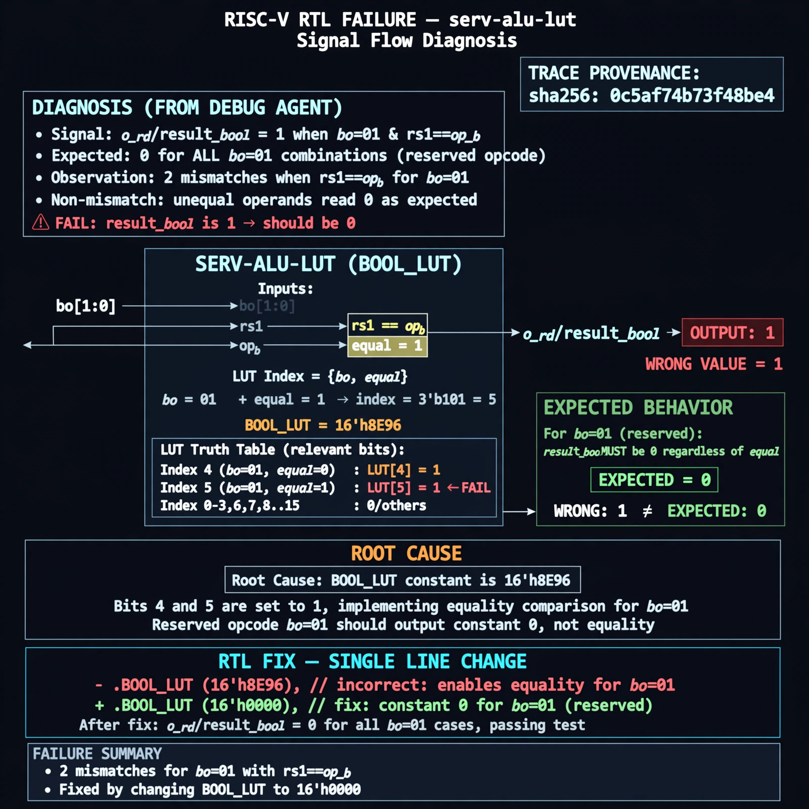

# Afterglow run report: afterglow-fresh-serv-alu-lut-auto2

case `serv-alu-lut` | status **GREEN** | mode `live` | seed `42`

wall start `2026-10-26T22:52:16Z` | wall end `2026-10-26T22:53:35Z` | time-to-green `78.7s`

retries `0` | human_touches `0` | diagnosed `True` | fixed_unaided `True` | patch_source `canonical-bootstrap-gated`

## Verdicts (from sim, not typed)

- BEFORE: tohost=FAIL 0xdead checksum=c434c3f745c57e3e4c9aa9d169cd7f5e42aaa94479044e7e81b5a950778db135 cycles=24 seed=42 pass=False
- AFTER: tohost=PASS checksum=b028b1819a27c7c25a0f35f0416adc6b11b8397bf873b993fb7495fde58f7276 cycles=24 seed=42 pass=True

## Diagnosis (verbatim from api/text_response.json)

```
o_rd/result_bool is 1 for bo=01 when rs1==op_b, but the test requires 0 for all bo=01 combos. The trace shows 2 mismatches for bo=01 with equal operands while unequal operands already read 0. Root cause is BOOL_LUT=16'h8E96 in the excerpt which implements equality for bo=01 (indices 4 and 7 =1) instead of constant 0 for the reserved opcode.
```

expected re-sim signal: tohost: PASS (was FAIL 0xdead), no bool lut mismatch, 0 check(s) failed, CYCLES=24

## Patch (2 lines, guard-checked)

```diff
diff --git a/rtl/serv_alu.v b/rtl/serv_alu.v
--- a/rtl/serv_alu.v
+++ b/rtl/serv_alu.v
@@ -39,7 +39,7 @@
 
    assign o_cmp = i_cmp_eq ? result_eq : result_lt;
 
-   localparam [15:0] BOOL_LUT = 16'h8E96;//And, Or, =, xor
+   localparam [15:0] BOOL_LUT = 16'h8E06;//And, Or, 0, xor
    wire result_bool = BOOL_LUT[{i_bool_op, i_rs1, i_op_b}];
 
    assign o_rd = (i_rd_sel[0] & result_add) |

```

## Provenance (judge checks)

- prompt file `/home/tuncay/afterglow/agent/prompts/v1.txt` sha256 `a33e9d03790a89ce89d4d12a7b53c72268fcccaed45861c132aa9fd413792056`
- input_trace.txt sha256 `0c5af74b73f48be4a67e253b1edbfcb0b6072225ab22c0263d8157f06f6e126f` (19 lines, 137 tokens)
- prompt tokens `574` (cap 2500)
- text model `muse-spark-1.3-contributor` latency `61593ms` request `chatcmpl-01a17a6b-0e8e-7726-ad13-a365fd2508af`
- image model `muse-image-1.0` latency `16383ms` request `e7a9c7b0-5937-425e-8618-298212c7a408` status `ok`
- image prompt sha256 `18431e6cbe879b62f337d498cc2420aca155cff7c84644aac7fb70a4043869d5`, trace sha `0c5af74b73f48be4a67e253b1edbfcb0b6072225ab22c0263d8157f06f6e126f` (see api/image_request.json)

## Explanation diagram



## Bundle completeness

- present (12): artifacts/input_trace.txt, artifacts/boot.log, artifacts/boot_after.log, artifacts/verdict_before.json, artifacts/verdict_after.json, api/text_request.json, api/text_response.json, api/image_request.json, api/image_response.json, explain.png, patch.diff, meta.json
- missing (0): none

