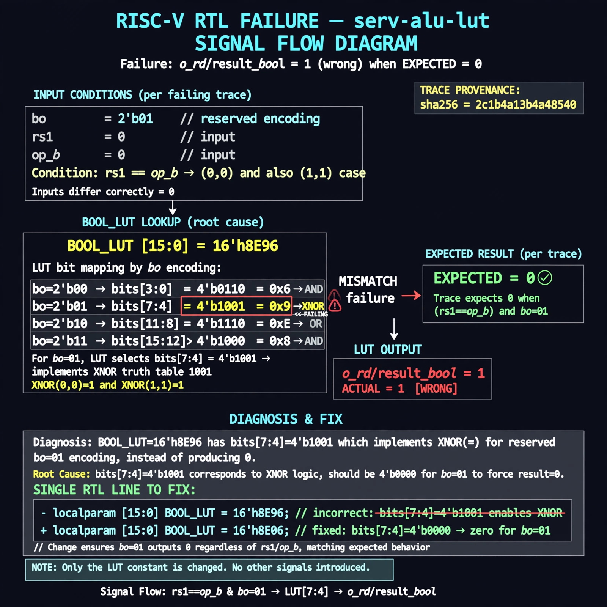

# Afterglow run report: afterglow-fresh-serv-alu-lut-triage

case `serv-alu-lut` | status **TRIAGE** | mode `triage` | seed `42`

wall start `2026-10-26T22:48:29Z` | wall end `2026-10-26T22:49:35Z` | time-to-green `65.9s`

retries `0` | human_touches `0` | diagnosed `True` | fixed_unaided `False` | patch_source `none`

## Verdicts (from sim, not typed)

- BEFORE: tohost=FAIL 0xdead checksum=c434c3f745c57e3e4c9aa9d169cd7f5e42aaa94479044e7e81b5a950778db135 cycles=24 seed=42 pass=False
- AFTER: MISSING

## Diagnosis (verbatim from api/text_response.json)

```
o_rd/result_bool reads 1 for bo=01 with rs1==op_b (0,0 and 1,1) while trace expects 0, with differing inputs correctly 0. This matches XNOR truth table 1001. Root cause is BOOL_LUT=16'h8E96 whose bits [7:4]=4'b1001 implement '=' (XNOR) for reserved bo=01 encoding instead of zero.
```

expected re-sim signal: tohost: PASS (vs FAIL 0xdead) with zero 'bool lut mismatch' TRAPs, tb_serv_alu seed 42 passes

## Patch (0 lines, guard-checked)

```diff
(no patch applied)
```

## Provenance (judge checks)

- prompt file `/home/tuncay/afterglow/agent/prompts/v1.txt` sha256 `a33e9d03790a89ce89d4d12a7b53c72268fcccaed45861c132aa9fd413792056`
- input_trace.txt sha256 `2c1b4a13b4a48540e274fea87ffa9b3778ca5c5d05134bcdc999c277de47ed29` (19 lines, 137 tokens)
- prompt tokens `574` (cap 2500)
- text model `muse-spark-1.3-contributor` latency `48446ms` request `chatcmpl-01a17a67-62fe-7756-b139-3746ac9cc7fd`
- image model `muse-image-1.0` latency `16738ms` request `382f4695-1cdb-4575-a600-ef3e73d3efdd` status `ok`
- image prompt sha256 `4377d5acffe0b07e3dc9f669373de395d5d395981169e25f8dc0ecea29e0da94`, trace sha `2c1b4a13b4a48540e274fea87ffa9b3778ca5c5d05134bcdc999c277de47ed29` (see api/image_request.json)

## Explanation diagram



## Bundle completeness

- present (10): artifacts/input_trace.txt, artifacts/boot.log, artifacts/verdict_before.json, api/text_request.json, api/text_response.json, api/image_request.json, api/image_response.json, explain.png, patch.diff, meta.json
- missing (2): artifacts/boot_after.log, artifacts/verdict_after.json

