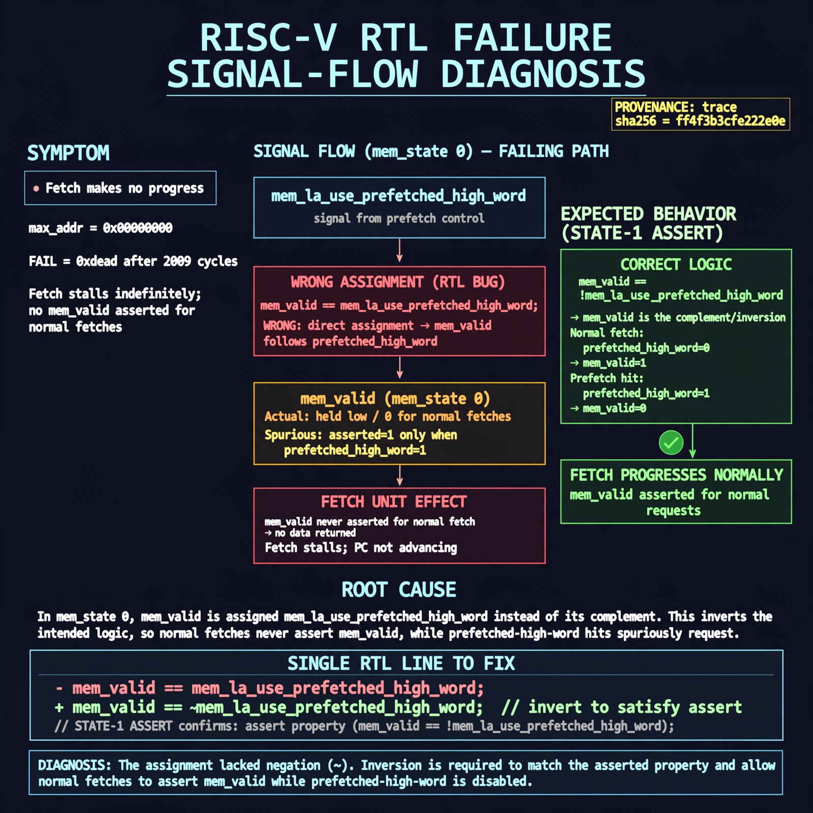

# Afterglow run report: fetch-highword-20261102T223653Z

case `fetch-highword` | status **GREEN** | mode `live` | seed `42`

wall start `2026-11-02T22:36:53Z` | wall end `2026-11-02T22:38:01Z` | time-to-green `67.8s`

retries `0` | human_touches `0` | diagnosed `True` | fixed_unaided `True` | patch_source `model-verbatim`

## Verdicts (from sim, not typed)

- BEFORE: tohost=FAIL 0xdead checksum=563b7c10626ff25de2b3c430956c7c113e448c4efaea068f9b83a198d4322b15 cycles=2009 seed=42 pass=False
- AFTER: tohost=PASS checksum=5c28238265cb94168311e9914f0df355642c557d04dba11845d557ac8a64aa4a cycles=2009 seed=42 pass=True

## Diagnosis (verbatim from api/text_response.json)

```
Fetch makes no progress (max_addr 0x00000000, FAIL 0xdead after 2009 cycles). In mem_state 0 mem_valid is assigned mem_la_use_prefetched_high_word instead of its complement, so normal fetches never assert mem_valid while prefetched-high-word hits spuriously request. The state-1 assert mem_valid == !mem_la_use_prefetched_high_word confirms the inversion, explaining the stall.
```

expected re-sim signal: tohost PASS (not FAIL 0xdead) with fetch progress max_addr>0x00000000 and checksum != 563b7c10626ff25de2b3c430956c7c113e448c4efaea068f9b83a198d4322b15

## Patch (2 lines, guard-checked)

```diff
diff --git a/picorv32.v b/picorv32.v
--- a/picorv32.v
+++ b/picorv32.v
@@ -582,6 +582,6 @@
 				0: begin
 					if (mem_do_prefetch || mem_do_rinst || mem_do_rdata) begin
-						mem_valid <= mem_la_use_prefetched_high_word;
+						mem_valid <= !mem_la_use_prefetched_high_word;
 						mem_instr <= mem_do_prefetch || mem_do_rinst;
 						mem_wstrb <= 0;
 						mem_state <= 1;

```

## Provenance (judge checks)

- prompt file `/home/tuncay/afterglow/agent/prompts/v2.txt` sha256 `d31e1ef6b74ddf52ee59e790ebff2f3defa9b03be82e699f45ef620cf8e27a6e`
- input_trace.txt sha256 `ff4f3b3cfe222e0ea03b44931da864f31f91bff7adc3abac19cabdd33fab0542` (9 lines, 69 tokens)
- prompt tokens `606` (cap 2500)
- text model `muse-spark-1.3-contributor` latency `57080ms` request `chatcmpl-01a19e69-6961-768d-8c48-fe276e8e0bb9`
- image model `muse-image-1.0` latency `10223ms` request `6ac1bfed-f055-45bc-add4-78f8eeaf3a1e` status `ok`
- image prompt sha256 `93d6e1519413bc300df68cc8279cb028a64b774c0a9a971b0ef8a8b7bfd4d2a2`, trace sha `ff4f3b3cfe222e0ea03b44931da864f31f91bff7adc3abac19cabdd33fab0542` (see api/image_request.json)

## Explanation diagram



## Bundle completeness

- present (12): artifacts/input_trace.txt, artifacts/boot.log, artifacts/boot_after.log, artifacts/verdict_before.json, artifacts/verdict_after.json, api/text_request.json, api/text_response.json, api/image_request.json, api/image_response.json, explain.png, patch.diff, meta.json
- missing (0): none

