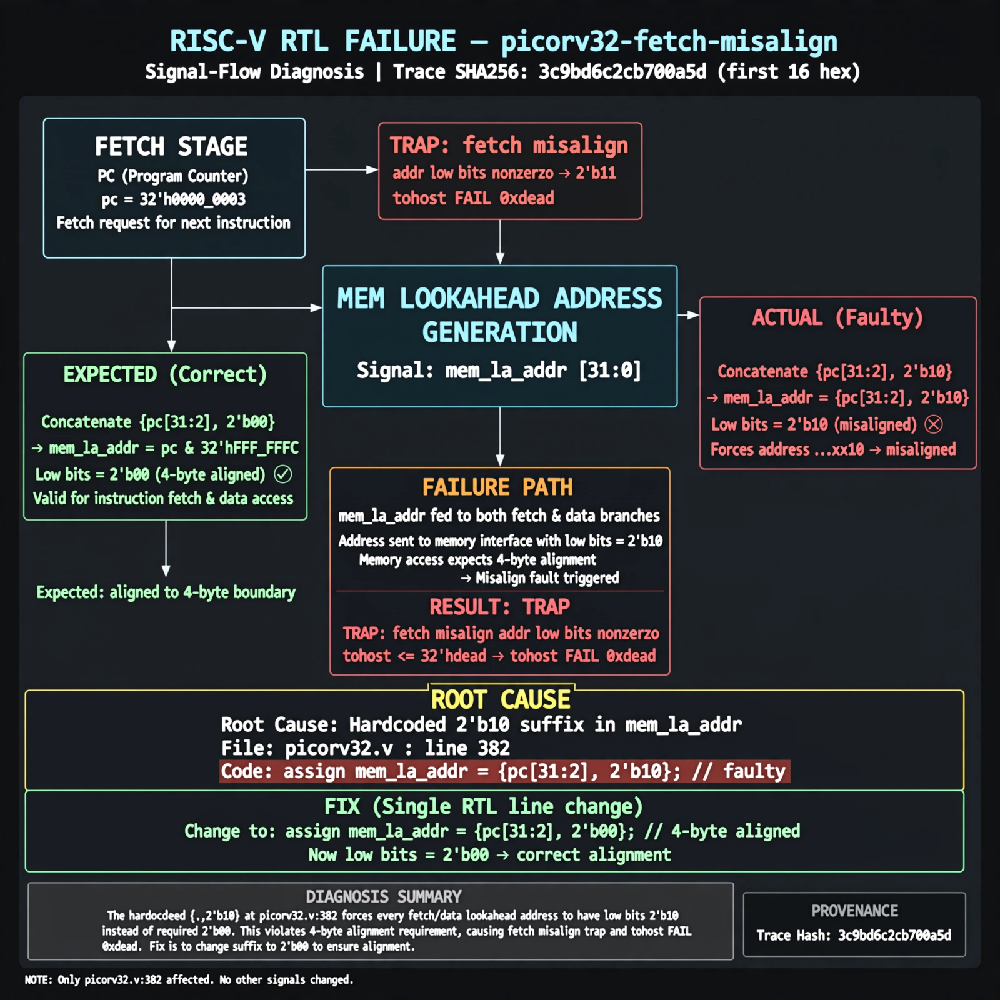

# Afterglow run report: fetch-misalign-v5-02

case `picorv32-fetch-misalign` | status **GREEN** | mode `live` | seed `42`

wall start `2026-10-27T23:56:41Z` | wall end `2026-10-27T23:57:14Z` | time-to-green `33.1s`

retries `0` | human_touches `0` | diagnosed `True` | fixed_unaided `True` | patch_source `model-verbatim`

## Verdicts (from sim, not typed)

- BEFORE: tohost=FAIL 0xdead checksum=a29998cd8e81501b64b44a66e009c12b297662db5ef5369b12ef3feae608e5d5 cycles=2009 seed=42 pass=False
- AFTER: tohost=PASS checksum=5c28238265cb94168311e9914f0df355642c557d04dba11845d557ac8a64aa4a cycles=2009 seed=42 pass=True

## Diagnosis (verbatim from api/text_response.json)

```
Trace ends with TRAP: fetch misalign addr low bits nonzero and tohost FAIL 0xdead. Expected mem lookahead address to be 4-byte aligned with low bits 2'b00, but picorv32.v:382 forces 2'b10 in both fetch and data branches. Root cause is hardcoded {..,2'b10} suffix in mem_la_addr at picorv32.v:382, making every fetch misaligned.
```

expected re-sim signal: tohost PASS (no TRAP: fetch misalign addr low bits nonzero, no FAIL 0xdead)

## Patch (2 lines, guard-checked)

```diff
diff --git a/picorv32.v b/picorv32.v
--- a/picorv32.v
+++ b/picorv32.v
@@ -382,1 +382,1 @@
-	assign mem_la_addr = (mem_do_prefetch || mem_do_rinst) ? {next_pc[31:2] + mem_la_firstword_xfer, 2'b10} : {reg_op1[31:2], 2'b10};
+	assign mem_la_addr = (mem_do_prefetch || mem_do_rinst) ? {next_pc[31:2] + mem_la_firstword_xfer, 2'b00} : {reg_op1[31:2], 2'b00};

```

## Provenance (judge checks)

- prompt file `v3` sha256 `ad529368accaf171e6121a54b2d27547230920a900c7c4e5094d3fff13ca4233`
- input_trace.txt sha256 `3c9bd6c2cb700a5d1247e48362615cba800f5b7977ccc093dcbb1b2afc207028` (9 lines, 72 tokens)
- prompt tokens `780` (cap 2500)
- text model `muse-spark-1.3-contributor` latency `18229ms` request `chatcmpl-01a17fcb-b88c-7212-b34c-98891abb309b`
- image model `muse-image-1.0` latency `13965ms` request `206d6475-df84-4d4f-9b29-3717364124db` status `ok`
- image prompt sha256 `4c634147ab2d0b1afc1d79a7b9cf4cc65b2da2b26a2bee25581178a3a0c3c56e`, trace sha `3c9bd6c2cb700a5d1247e48362615cba800f5b7977ccc093dcbb1b2afc207028` (see api/image_request.json)

## Explanation diagram



## Bundle completeness

- present (12): artifacts/input_trace.txt, artifacts/boot.log, artifacts/boot_after.log, artifacts/verdict_before.json, artifacts/verdict_after.json, api/text_request.json, api/text_response.json, api/image_request.json, api/image_response.json, explain.png, patch.diff, meta.json
- missing (0): none

