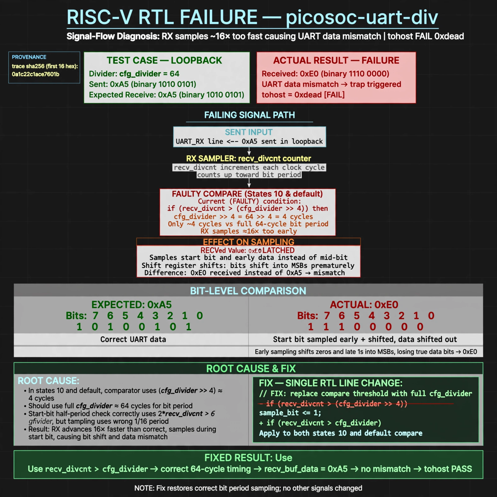

# Afterglow run report: live-20261026T174854Z-picosoc-uart-div

case `picosoc-uart-div` | status **GREEN** | mode `live` | seed `42`

wall start `2026-10-26T17:48:54Z` | wall end `2026-10-26T17:50:26Z` | time-to-green `92.6s`

retries `0` | human_touches `0` | diagnosed `True` | fixed_unaided `True` | patch_source `model-verbatim`

## Verdicts (from sim, not typed)

- BEFORE: tohost=FAIL 0xdead checksum=27ee482b473c74db5dce8b5ab1a233084cce3055c317a1f2045faa6dbc13a1c6 cycles=2112 seed=42 pass=False
- AFTER: tohost=PASS checksum=5c8f58d0f0818c97d014d2f851a6140882bd1efc96a2537047806252c0c2caf9 cycles=2652 seed=42 pass=True

## Diagnosis (verbatim from api/text_response.json)

```
Loopback with divider 64 sent 0xa5 but recv_buf_data latched 0xe0, causing uart data mismatch trap and tohost FAIL 0xdead. States 10 and default in the excerpt compare recv_divcnt > (cfg_divider >> 4) (~4 cycles) instead of the full bit period cfg_divider (~64) used by the start-bit half-period check 2*recv_divcnt > cfg_divider, so RX advances ~16x too fast and samples the start bit. This shifts zeros with late data-bit ones into MSBs yielding 0xe0; fixing both compares to cfg_divider restores correct bit timing.
```

expected re-sim signal: tohost PASS (instead of FAIL 0xdead), no uart data mismatch trap, loopback shows got 0xa5 want 0xa5

## Patch (4 lines, guard-checked)

```diff
diff --git a/picosoc/simpleuart.v b/picosoc/simpleuart.v
--- a/picosoc/simpleuart.v
+++ b/picosoc/simpleuart.v
@@ -89,14 +89,14 @@
 				10: begin
-					if (recv_divcnt > (cfg_divider >> 4)) begin
+					if (recv_divcnt > cfg_divider) begin
 						recv_buf_data <= recv_pattern;
 						recv_buf_valid <= 1;
 						recv_state <= 0;
 					end
 				end
 				default: begin
-					if (recv_divcnt > (cfg_divider >> 4)) begin
+					if (recv_divcnt > cfg_divider) begin
 						recv_pattern <= {ser_rx, recv_pattern[7:1]};
 						recv_state <= recv_state + 1;
 						recv_divcnt <= 0;
 					end
 				end

```

## Provenance (judge checks)

- prompt file `agent/prompts/v1.txt` sha256 `a33e9d03790a89ce89d4d12a7b53c72268fcccaed45861c132aa9fd413792056`
- input_trace.txt sha256 `0a1c22c1ace7601b3a9c48218f1bedacf53c90711d3af053d9ac5747e8ce0a15` (9 lines, 68 tokens)
- prompt tokens `497` (cap 2500)
- text model `muse-spark-1.3-contributor` latency `61735ms` request `chatcmpl-01a17955-4e04-709a-bf85-7c9c67546b69`
- image model `muse-image-1.0` latency `30418ms` request `0d81f8fe-0ca0-4baf-a837-6115c6b02aac` status `ok`
- image prompt sha256 `05fdcc2ac4b86cafeb7a06d3e36c6a7571eafa92737b77ec651942a9227f544a`, trace sha `0a1c22c1ace7601b3a9c48218f1bedacf53c90711d3af053d9ac5747e8ce0a15` (see api/image_request.json)

## Explanation diagram



## Bundle completeness

- present (12): artifacts/input_trace.txt, artifacts/boot.log, artifacts/boot_after.log, artifacts/verdict_before.json, artifacts/verdict_after.json, api/text_request.json, api/text_response.json, api/image_request.json, api/image_response.json, explain.png, patch.diff, meta.json
- missing (0): none

