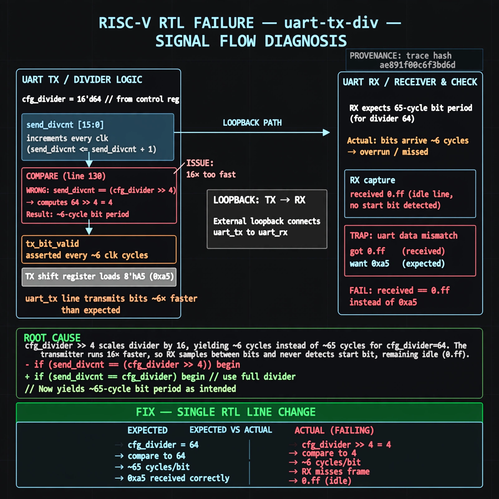

# Afterglow run report: live-20261026T180408Z-uart-tx-div

case `uart-tx-div` | status **GREEN** | mode `live` | seed `42`

wall start `2026-10-26T18:04:08Z` | wall end `2026-10-26T18:05:19Z` | time-to-green `71.0s`

retries `0` | human_touches `0` | diagnosed `True` | fixed_unaided `True` | patch_source `model-verbatim`

## Verdicts (from sim, not typed)

- BEFORE: tohost=FAIL 0xdead checksum=e251d79bc7250f734efe026d9d7f036e818ad243c9428000f5cdb2c1fd8b03c6 cycles=2652 seed=42 pass=False
- AFTER: tohost=PASS checksum=5c8f58d0f0818c97d014d2f851a6140882bd1efc96a2537047806252c0c2caf9 cycles=2652 seed=42 pass=True

## Diagnosis (verbatim from api/text_response.json)

```
Loopback TX of 0xa5 was received as 0xff (idle) with TRAP uart data mismatch got 0xff want 0xa5. send_divcnt increments every clk but line 130 compares with (cfg_divider >> 4), giving ~6-cycle bit period for divider 64 instead of ~65 cycles. This 16x-too-fast TX breaks RX bit timing so the receiver misses the frame and stays idle.
```

expected re-sim signal: tohost PASS 0x1, no TRAP, uart data got 0xa5 want 0xa5

## Patch (2 lines, guard-checked)

```diff
diff --git a/picosoc/simpleuart.v b/picosoc/simpleuart.v
--- a/picosoc/simpleuart.v
+++ b/picosoc/simpleuart.v
@@ -125,7 +125,7 @@
 			send_bitcnt <= 10;
 			send_divcnt <= 0;
 			end else
-			if (send_divcnt > (cfg_divider >> 4) && send_bitcnt) begin
+			if (send_divcnt > cfg_divider && send_bitcnt) begin
 				send_pattern <= {1'b1, send_pattern[9:1]};
 				send_bitcnt <= send_bitcnt - 1;
 				send_divcnt <= 0;

```

## Provenance (judge checks)

- prompt file `agent/prompts/v1.txt` sha256 `a33e9d03790a89ce89d4d12a7b53c72268fcccaed45861c132aa9fd413792056`
- input_trace.txt sha256 `ae891f00c6f3bd6d1260c085c36b29b59749f295b0c9ac883bc2b8729c8c4226` (9 lines, 68 tokens)
- prompt tokens `508` (cap 2500)
- text model `muse-spark-1.3-contributor` latency `32609ms` request `chatcmpl-01a17962-cd64-7212-8aa3-67b3788a47c5`
- image model `muse-image-1.0` latency `37953ms` request `40d5dba0-14fc-49ec-b850-6a4a90923fee` status `ok`
- image prompt sha256 `fadef458f812b81a5f09b13709c629bab386118a7ce810232f98c4a988e6db4a`, trace sha `ae891f00c6f3bd6d1260c085c36b29b59749f295b0c9ac883bc2b8729c8c4226` (see api/image_request.json)

## Explanation diagram



## Bundle completeness

- present (12): artifacts/input_trace.txt, artifacts/boot.log, artifacts/boot_after.log, artifacts/verdict_before.json, artifacts/verdict_after.json, api/text_request.json, api/text_response.json, api/image_request.json, api/image_response.json, explain.png, patch.diff, meta.json
- missing (0): none

