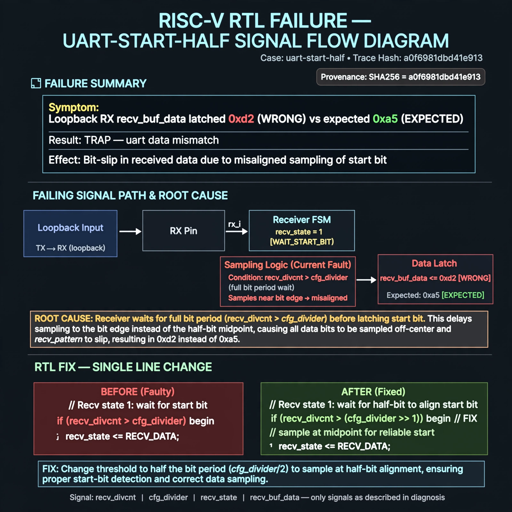

# Afterglow run report: live-20261026T180519Z-uart-start-half

case `uart-start-half` | status **GREEN** | mode `live` | seed `42`

wall start `2026-10-26T18:05:19Z` | wall end `2026-10-26T18:06:11Z` | time-to-green `51.9s`

retries `0` | human_touches `0` | diagnosed `True` | fixed_unaided `True` | patch_source `model-verbatim`

## Verdicts (from sim, not typed)

- BEFORE: tohost=FAIL 0xdead checksum=7ead7d9c1ebd862283bf0991c6a01fd4f7dad63f24f2be953b7f57e1f7edd073 cycles=2684 seed=42 pass=False
- AFTER: tohost=PASS checksum=5c8f58d0f0818c97d014d2f851a6140882bd1efc96a2537047806252c0c2caf9 cycles=2652 seed=42 pass=True

## Diagnosis (verbatim from api/text_response.json)

```
Loopback RX recv_buf_data latched 0xd2 instead of expected 0xa5, causing TRAP uart data mismatch. Receiver in recv_state 1 waits `recv_divcnt > cfg_divider` for the start bit, i.e. a full bit period instead of half-bit alignment. This offsets all subsequent data samples in default state toward bit edges causing bit-slip from recv_pattern to recv_buf_data.
```

expected re-sim signal: tohost PASS (replacing FAIL 0xdead), TRAP gone / uart data got 0xa5 want 0xa5, checksum changes from 7ead7d9c1ebd862283bf0991c6a01fd4f7dad63f24f2be953b7f57e1f7edd073

## Patch (2 lines, guard-checked)

```diff
diff --git a/picosoc/simpleuart.v b/picosoc/simpleuart.v
--- a/picosoc/simpleuart.v
+++ b/picosoc/simpleuart.v
@@ -83,5 +83,5 @@
 				1: begin
-					if (recv_divcnt > cfg_divider) begin
+					if (recv_divcnt > (cfg_divider >> 1)) begin
 						recv_state <= 2;
 						recv_divcnt <= 0;
 					end

```

## Provenance (judge checks)

- prompt file `agent/prompts/v1.txt` sha256 `a33e9d03790a89ce89d4d12a7b53c72268fcccaed45861c132aa9fd413792056`
- input_trace.txt sha256 `a0f6981dbd41e9135378cfb0d34bf1e868500f319914fc675819496dac7a0ef0` (9 lines, 68 tokens)
- prompt tokens `497` (cap 2500)
- text model `muse-spark-1.3-contributor` latency `34215ms` request `chatcmpl-01a17963-e927-7259-88c9-4b9aa2ba6afb`
- image model `muse-image-1.0` latency `16586ms` request `3828a2ba-88c0-495c-8086-592fd889cffc` status `ok`
- image prompt sha256 `eb21e005763b854a175d6c032590fbefda8c8036ab5321ceff92d086636812aa`, trace sha `a0f6981dbd41e9135378cfb0d34bf1e868500f319914fc675819496dac7a0ef0` (see api/image_request.json)

## Explanation diagram



## Bundle completeness

- present (12): artifacts/input_trace.txt, artifacts/boot.log, artifacts/boot_after.log, artifacts/verdict_before.json, artifacts/verdict_after.json, api/text_request.json, api/text_response.json, api/image_request.json, api/image_response.json, explain.png, patch.diff, meta.json
- missing (0): none

