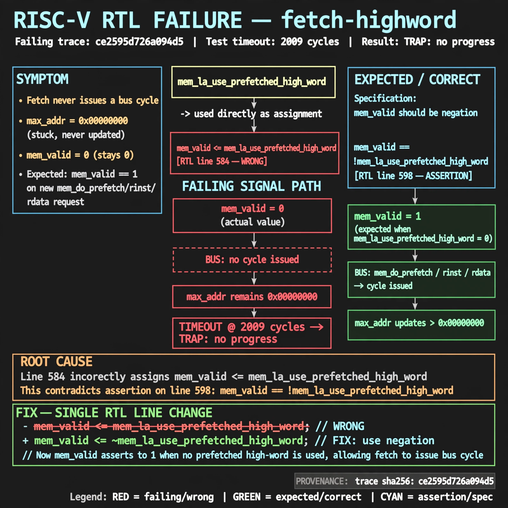

# Afterglow run report: live-20261026T180611Z-fetch-highword

case `fetch-highword` | status **RED** | mode `live` | seed `42`

wall start `2026-10-26T18:06:11Z` | wall end `2026-10-26T18:09:01Z` | time-to-green `170.1s`

retries `2` | human_touches `0` | diagnosed `True` | fixed_unaided `False` | patch_source `none`

## Verdicts (from sim, not typed)

- BEFORE: tohost=FAIL 0xdead checksum=563b7c10626ff25de2b3c430956c7c113e448c4efaea068f9b83a198d4322b15 cycles=2009 seed=42 pass=False
- AFTER: tohost=None checksum=None cycles=None seed=42 pass=False

## Diagnosis (verbatim from api/text_response.json)

```
MISSING (text call produced no diagnosis)
```

expected re-sim signal: -

## Patch (0 lines, guard-checked)

```diff
(no patch applied)
```

## Provenance (judge checks)

- prompt file `agent/prompts/v1.txt` sha256 `a33e9d03790a89ce89d4d12a7b53c72268fcccaed45861c132aa9fd413792056`
- input_trace.txt sha256 `ce2595d726a094d5231ea79e35b7a3676051406d391e7d9a2b90493795ec0b77` (? lines, ? tokens)
- prompt tokens `?` (cap 2500)
- text model `muse-spark-1.3-contributor` latency `?ms` request `?`
- image model `muse-image-1.0` latency `10294ms` request `77e5b824-6b01-4328-ae07-53c26ff0d39e` status `ok`
- image prompt sha256 `43dd88b7328d98079b6a4138278cb37d49aa238813477daf968fe96711274952`, trace sha `ce2595d726a094d5231ea79e35b7a3676051406d391e7d9a2b90493795ec0b77` (see api/image_request.json)

## Explanation diagram



## Bundle completeness

- present (11): artifacts/input_trace.txt, artifacts/boot.log, artifacts/boot_after.log, artifacts/verdict_before.json, artifacts/verdict_after.json, api/text_response.json, api/image_request.json, api/image_response.json, explain.png, patch.diff, meta.json
- missing (1): api/text_request.json

