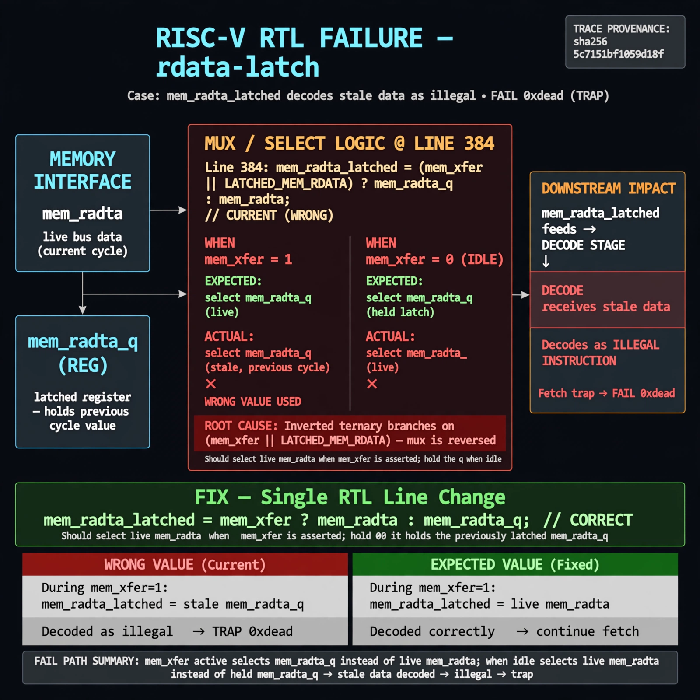

# Afterglow run report: live-20261026T180901Z-rdata-latch

case `rdata-latch` | status **GREEN** | mode `live` | seed `42`

wall start `2026-10-26T18:09:01Z` | wall end `2026-10-26T18:10:34Z` | time-to-green `92.9s`

retries `0` | human_touches `0` | diagnosed `True` | fixed_unaided `True` | patch_source `model-verbatim`

## Verdicts (from sim, not typed)

- BEFORE: tohost=FAIL 0xdead checksum=c2a7a4d6295484feeb9ec1ea9381732b8e39a7ccd1997c7d70f6454da2fb4659 cycles=2009 seed=42 pass=False
- AFTER: tohost=PASS checksum=5c28238265cb94168311e9914f0df355642c557d04dba11845d557ac8a64aa4a cycles=2009 seed=42 pass=True

## Diagnosis (verbatim from api/text_response.json)

```
Fetch fails with TRAP and FAIL 0xdead because mem_rdata_latched decodes stale data as illegal. During mem_xfer line 384 selects mem_rdata_q (previous cycle) instead of live mem_rdata, and when idle selects live mem_rdata instead of held q. Root cause is inverted ternary branches on (mem_xfer || LATCHED_MEM_RDATA) at line 384.
```

expected re-sim signal: tohost PASS (not FAIL 0xdead), TRAP deasserted, fetch progress without trap; checksum != c2a7a4d6295484feeb9ec1ea9381732b8e39a7ccd1997c7d70f6454da2fb4659

## Patch (2 lines, guard-checked)

```diff
diff --git a/picorv32.v b/picorv32.v
--- a/picorv32.v
+++ b/picorv32.v
@@ -382,7 +382,7 @@
 	assign mem_la_addr = (mem_do_prefetch || mem_do_rinst) ? {next_pc[31:2] + mem_la_firstword_xfer, 2'b00} : {reg_op1[31:2], 2'b00};
 
-	assign mem_rdata_latched_noshuffle = (mem_xfer || LATCHED_MEM_RDATA) ? mem_rdata_q : mem_rdata;
+	assign mem_rdata_latched_noshuffle = (mem_xfer || LATCHED_MEM_RDATA) ? mem_rdata : mem_rdata_q;
 
 	assign mem_rdata_latched = COMPRESSED_ISA && mem_la_use_prefetched_high_word ? {16'bx, mem_16bit_buffer} :

```

## Provenance (judge checks)

- prompt file `agent/prompts/v1.txt` sha256 `a33e9d03790a89ce89d4d12a7b53c72268fcccaed45861c132aa9fd413792056`
- input_trace.txt sha256 `5c7151bf1059d18fd85244a82375b8ee3cabc3d37d8cb9e365e16848a9c9b1ba` (9 lines, 69 tokens)
- prompt tokens `579` (cap 2500)
- text model `muse-spark-1.3-contributor` latency `50824ms` request `chatcmpl-01a17967-8dc7-7528-8353-5567812b99ce`
- image model `muse-image-1.0` latency `41677ms` request `fff1a550-c4d2-49e8-a9f9-5d9a41cb44a4` status `ok`
- image prompt sha256 `79521ea95659888fc0cc26031405434bcae974886054cb1c89220b9b7ac9c723`, trace sha `5c7151bf1059d18fd85244a82375b8ee3cabc3d37d8cb9e365e16848a9c9b1ba` (see api/image_request.json)

## Explanation diagram



## Bundle completeness

- present (12): artifacts/input_trace.txt, artifacts/boot.log, artifacts/boot_after.log, artifacts/verdict_before.json, artifacts/verdict_after.json, api/text_request.json, api/text_response.json, api/image_request.json, api/image_response.json, explain.png, patch.diff, meta.json
- missing (0): none

