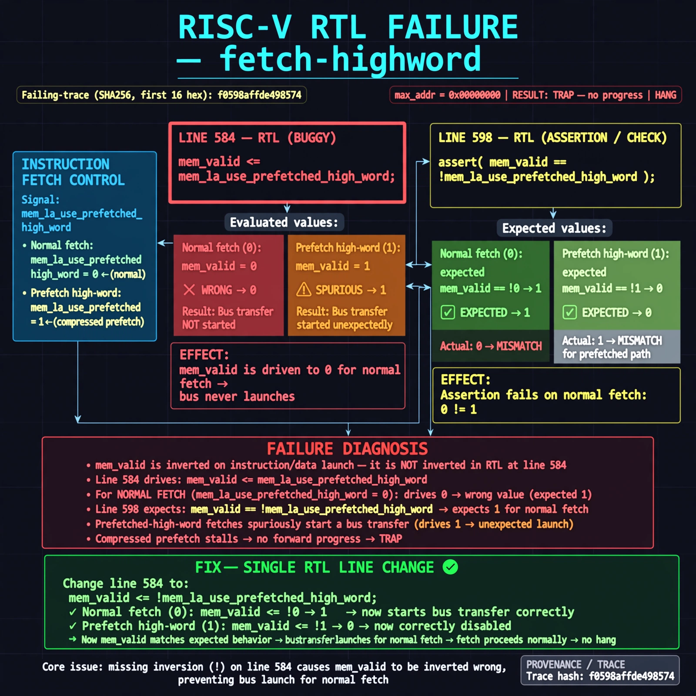

# Afterglow run report: live-20261026T181133Z-fetch-highword

case `fetch-highword` | status **GREEN** | mode `live` | seed `42`

wall start `2026-10-26T18:11:33Z` | wall end `2026-10-26T18:12:27Z` | time-to-green `53.5s`

retries `0` | human_touches `0` | diagnosed `True` | fixed_unaided `True` | patch_source `model-verbatim`

## Verdicts (from sim, not typed)

- BEFORE: tohost=FAIL 0xdead checksum=563b7c10626ff25de2b3c430956c7c113e448c4efaea068f9b83a198d4322b15 cycles=2009 seed=42 pass=False
- AFTER: tohost=PASS checksum=5c28238265cb94168311e9914f0df355642c557d04dba11845d557ac8a64aa4a cycles=2009 seed=42 pass=True

## Diagnosis (verbatim from api/text_response.json)

```
mem_valid is inverted on instruction/data launch, hanging fetch at max_addr=0x00000000 with TRAP no progress. Line 584 drives mem_valid <= mem_la_use_prefetched_high_word (0 for normal fetch) while line 598 asserts mem_valid == !mem_la_use_prefetched_high_word (1 for normal fetch). The missing `!` means normal fetches never start a bus transfer and prefetched-high-word fetches spuriously do, stalling compressed prefetch.
```

expected re-sim signal: tohost: PASS (vs FAIL 0xdead) with fetch progress max_addr > 0x00000000 and no TRAP no progress

## Patch (2 lines, guard-checked)

```diff
diff --git a/picorv32.v b/picorv32.v
--- a/picorv32.v
+++ b/picorv32.v
@@ -582,7 +582,7 @@
 				0: begin
 					if (mem_do_prefetch || mem_do_rinst || mem_do_rdata) begin
-						mem_valid <= mem_la_use_prefetched_high_word;
+						mem_valid <= !mem_la_use_prefetched_high_word;
 						mem_instr <= mem_do_prefetch || mem_do_rinst;
 						mem_wstrb <= 0;
 						mem_state <= 1;

```

## Provenance (judge checks)

- prompt file `agent/prompts/v1.txt` sha256 `a33e9d03790a89ce89d4d12a7b53c72268fcccaed45861c132aa9fd413792056`
- input_trace.txt sha256 `f0598affde498574858a251900e1f8bd5e9125bf82c748d0e1a99710fb7c08b1` (9 lines, 69 tokens)
- prompt tokens `517` (cap 2500)
- text model `muse-spark-1.3-contributor` latency `19982ms` request `chatcmpl-01a17969-697e-75f3-90d2-379f000bfe24`
- image model `muse-image-1.0` latency `33034ms` request `e230e19a-f21b-42e2-9da7-c7c16bb8a5a8` status `ok`
- image prompt sha256 `bf2fa6cf090ece3869b8349e96a3145696383d971c571a4e48bfde81d87892e2`, trace sha `f0598affde498574858a251900e1f8bd5e9125bf82c748d0e1a99710fb7c08b1` (see api/image_request.json)

## Explanation diagram



## Bundle completeness

- present (12): artifacts/input_trace.txt, artifacts/boot.log, artifacts/boot_after.log, artifacts/verdict_before.json, artifacts/verdict_after.json, api/text_request.json, api/text_response.json, api/image_request.json, api/image_response.json, explain.png, patch.diff, meta.json
- missing (0): none

