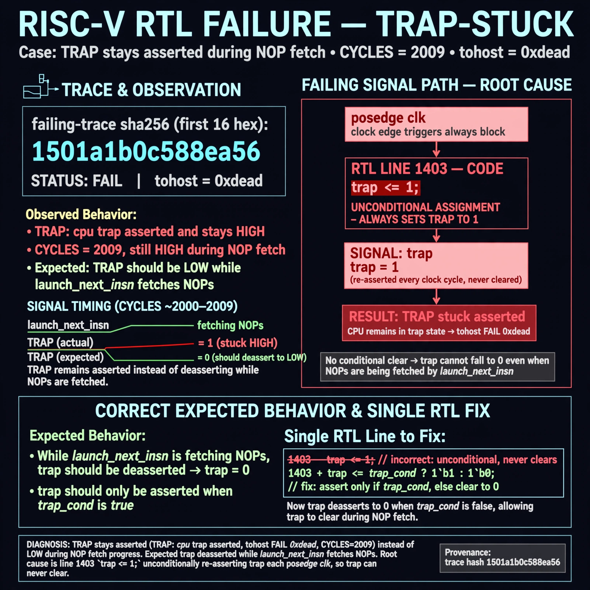

# Afterglow run report: live-20261026T181227Z-trap-stuck

case `trap-stuck` | status **GREEN** | mode `live` | seed `42`

wall start `2026-10-26T18:12:27Z` | wall end `2026-10-26T18:13:42Z` | time-to-green `75.3s`

retries `0` | human_touches `0` | diagnosed `True` | fixed_unaided `True` | patch_source `model-verbatim`

## Verdicts (from sim, not typed)

- BEFORE: tohost=FAIL 0xdead checksum=c2a7a4d6295484feeb9ec1ea9381732b8e39a7ccd1997c7d70f6454da2fb4659 cycles=2009 seed=42 pass=False
- AFTER: tohost=PASS checksum=5c28238265cb94168311e9914f0df355642c557d04dba11845d557ac8a64aa4a cycles=2009 seed=42 pass=True

## Diagnosis (verbatim from api/text_response.json)

```
TRAP stays asserted (TRAP: cpu trap asserted, tohost FAIL 0xdead, CYCLES=2009) instead of low during NOP fetch progress. Expected trap deasserted while launch_next_insn fetches NOPs. Root cause is line 1403 `trap <= 1;` unconditionally re-asserting trap each posedge clk, so trap can never clear.
```

expected re-sim signal: tohost PASS with trap deasserted and fetch progress, checksum changes from c2a7a4d6295484feeb9ec1ea9381732b8e39a7ccd1997c7d70f6454da2fb4659, no TRAP: cpu trap asserted

## Patch (2 lines, guard-checked)

```diff
diff --git a/picorv32.v b/picorv32.v
--- a/picorv32.v
+++ b/picorv32.v
@@ -1402,6 +1402,6 @@
 	always @(posedge clk) begin
-		trap <= 1;
+		trap <= 0;
 		reg_sh <= 'bx;
 		reg_out <= 'bx;
 		set_mem_do_rinst = 0;
 		set_mem_do_rdata = 0;

```

## Provenance (judge checks)

- prompt file `agent/prompts/v1.txt` sha256 `a33e9d03790a89ce89d4d12a7b53c72268fcccaed45861c132aa9fd413792056`
- input_trace.txt sha256 `1501a1b0c588ea56165ed9816e56d021f992cd9de00889a8f62ce3672da83f4e` (9 lines, 69 tokens)
- prompt tokens `513` (cap 2500)
- text model `muse-spark-1.3-contributor` latency `50934ms` request `chatcmpl-01a1796a-b3aa-7207-ac1c-6e0383a92b15`
- image model `muse-image-1.0` latency `23881ms` request `94981f48-8076-4879-9c34-ca5375f03d3d` status `ok`
- image prompt sha256 `282aacd3f16cf37b47653728c2dbeda3ccd632cc5f648b6e79aff423ae548201`, trace sha `1501a1b0c588ea56165ed9816e56d021f992cd9de00889a8f62ce3672da83f4e` (see api/image_request.json)

## Explanation diagram



## Bundle completeness

- present (12): artifacts/input_trace.txt, artifacts/boot.log, artifacts/boot_after.log, artifacts/verdict_before.json, artifacts/verdict_after.json, api/text_request.json, api/text_response.json, api/image_request.json, api/image_response.json, explain.png, patch.diff, meta.json
- missing (0): none

