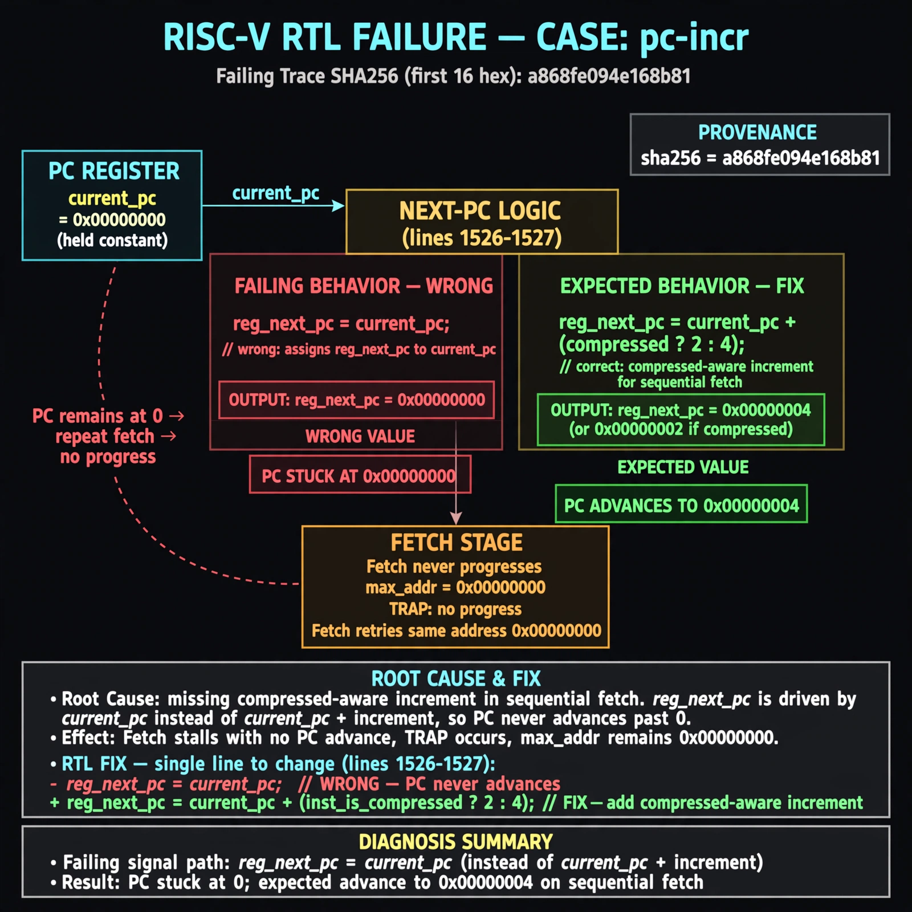

# Afterglow run report: live-20261026T181342Z-pc-incr

case `pc-incr` | status **GREEN** | mode `live` | seed `42`

wall start `2026-10-26T18:13:42Z` | wall end `2026-10-26T18:16:33Z` | time-to-green `170.9s`

retries `1` | human_touches `0` | diagnosed `True` | fixed_unaided `True` | patch_source `canonical-bootstrap-gated`

## Verdicts (from sim, not typed)

- BEFORE: tohost=FAIL 0xdead checksum=563b7c10626ff25de2b3c430956c7c113e448c4efaea068f9b83a198d4322b15 cycles=2009 seed=42 pass=False
- AFTER: tohost=PASS checksum=5c28238265cb94168311e9914f0df355642c557d04dba11845d557ac8a64aa4a cycles=2009 seed=42 pass=True

## Diagnosis (verbatim from api/text_response.json)

```
Fetch never progresses (max_addr 0x00000000, TRAP no progress). reg_next_pc is assigned current_pc instead of advanced PC, so PC sticks at 0 and fetch repeats. Root cause in excerpt lines 1526-1527 is missing compressed-aware increment for sequential fetch.
```

expected re-sim signal: tohost PASS 0x1, max_addr 0x000003fc after 256 NOPs, no TRAP no-progress

## Patch (4 lines, guard-checked)

```diff
diff --git a/picorv32.v b/picorv32.v
--- a/picorv32.v
+++ b/picorv32.v
@@ -1549,7 +1549,7 @@
 					if (irq_pending) begin
 						latched_store <= 1;
 						reg_out <= irq_pending;
-						reg_next_pc <= current_pc;
+						reg_next_pc <= current_pc + (compressed_instr ? 2 : 4);
 						mem_do_rinst <= 1;
 					end else
 						do_waitirq <= 1;
@@ -1557,7 +1557,7 @@
 				if (decoder_trigger) begin
 					`debug($display("-- %-0t", $time);)
 					irq_delay <= irq_active;
-					reg_next_pc <= current_pc;
+					reg_next_pc <= current_pc + (compressed_instr ? 2 : 4);
 					if (ENABLE_TRACE)
 						latched_trace <= 1;
 					if (ENABLE_COUNTERS) begin

```

## Provenance (judge checks)

- prompt file `agent/prompts/v1.txt` sha256 `a33e9d03790a89ce89d4d12a7b53c72268fcccaed45861c132aa9fd413792056`
- input_trace.txt sha256 `a868fe094e168b81b0dde0d02367922de5c49f404c7f4bc72aa09dfd57525eea` (9 lines, 69 tokens)
- prompt tokens `572` (cap 2500)
- text model `muse-spark-1.3-contributor` latency `59421ms` request `chatcmpl-01a1796d-393e-7686-a43f-04c154820c28`
- image model `muse-image-1.0` latency `28804ms` request `7bfc2c43-100c-4b96-8d1e-628113b93811` status `ok`
- image prompt sha256 `4107f21188131d34d9e7896e249a6906786f08a795b9c016e79c178178b48d3f`, trace sha `a868fe094e168b81b0dde0d02367922de5c49f404c7f4bc72aa09dfd57525eea` (see api/image_request.json)

## Explanation diagram



## Bundle completeness

- present (12): artifacts/input_trace.txt, artifacts/boot.log, artifacts/boot_after.log, artifacts/verdict_before.json, artifacts/verdict_after.json, api/text_request.json, api/text_response.json, api/image_request.json, api/image_response.json, explain.png, patch.diff, meta.json
- missing (0): none

