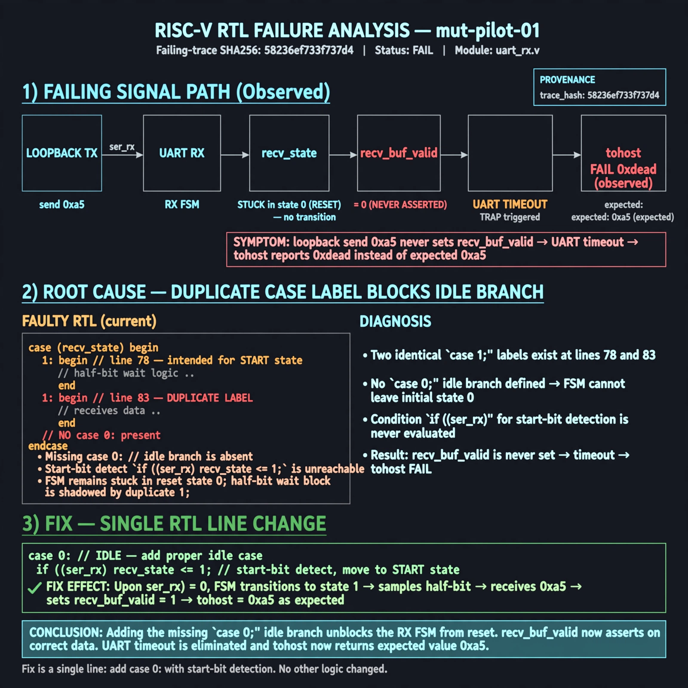

# Afterglow run report: mut-live-01-v2

case `mut-pilot-01` | status **GREEN** | mode `live` | seed `42`

wall start `2026-10-27T01:23:30Z` | wall end `2026-10-27T01:24:33Z` | time-to-green `62.8s`

retries `0` | human_touches `0` | diagnosed `True` | fixed_unaided `True` | patch_source `model-verbatim`

## Verdicts (from sim, not typed)

- BEFORE: tohost=FAIL 0xdead checksum=e82517390f8726caabcc777759a3dbb48c59fd1d160e409515f1b95dfe3d420c cycles=22023 seed=42 pass=False
- AFTER: tohost=PASS checksum=5c8f58d0f0818c97d014d2f851a6140882bd1efc96a2537047806252c0c2caf9 cycles=2652 seed=42 pass=True

## Diagnosis (verbatim from api/text_response.json)

```
Loopback send 0xa5 never sets recv_buf_valid, causing TRAP uart timeout and tohost FAIL 0xdead vs expected received byte. Excerpt shows duplicate `1:` labels at lines 78 and 83 with no `0:` idle branch, so start-bit detect `if (!ser_rx) recv_state <= 1` is unreachable and half-bit wait is shadowed. Root cause is mistyped idle case label blocking RX FSM out of reset state 0.
```

expected re-sim signal: tohost PASS loopback 0xa5 received, no uart timeout TRAP

## Patch (2 lines, guard-checked)

```diff
diff --git a/picosoc/simpleuart.v b/picosoc/simpleuart.v
--- a/picosoc/simpleuart.v
+++ b/picosoc/simpleuart.v
@@ -77,3 +77,3 @@
 			case (recv_state)
-				1: begin
+				0: begin
 					if (!ser_rx)

```

## Provenance (judge checks)

- prompt file `/home/tuncay/afterglow/agent/prompts/v2.txt` sha256 `d31e1ef6b74ddf52ee59e790ebff2f3defa9b03be82e699f45ef620cf8e27a6e`
- input_trace.txt sha256 `58236ef733f737d4647a4ae09754330e1b2ed190bbd2554d934d98812d74d270` (9 lines, 66 tokens)
- prompt tokens `599` (cap 2500)
- text model `muse-spark-1.3-contributor` latency `37106ms` request `chatcmpl-01a17af5-2337-73b0-bbff-7ac14bc0c9c3`
- image model `muse-image-1.0` latency `25167ms` request `5b932ea7-b7e1-4604-9de8-d7089155ef8c` status `ok`
- image prompt sha256 `ebb250b8b8482094dee9aeda67df06da8ab0f708717d66023267a54a00028cab`, trace sha `58236ef733f737d4647a4ae09754330e1b2ed190bbd2554d934d98812d74d270` (see api/image_request.json)

## Explanation diagram



## Bundle completeness

- present (12): artifacts/input_trace.txt, artifacts/boot.log, artifacts/boot_after.log, artifacts/verdict_before.json, artifacts/verdict_after.json, api/text_request.json, api/text_response.json, api/image_request.json, api/image_response.json, explain.png, patch.diff, meta.json
- missing (0): none

