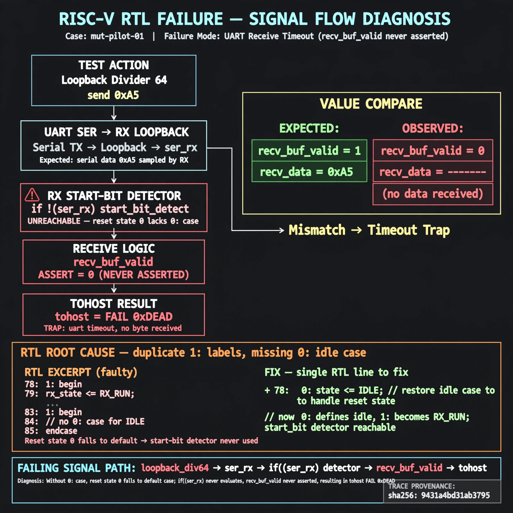

# Afterglow run report: mut-live-01-v3

case `mut-pilot-01` | status **GREEN** | mode `live` | seed `42`

wall start `2026-10-27T01:34:58Z` | wall end `2026-10-27T01:35:52Z` | time-to-green `54.1s`

retries `0` | human_touches `0` | diagnosed `True` | fixed_unaided `True` | patch_source `model-verbatim`

## Verdicts (from sim, not typed)

- BEFORE: tohost=FAIL 0xdead checksum=e82517390f8726caabcc777759a3dbb48c59fd1d160e409515f1b95dfe3d420c cycles=22023 seed=42 pass=False
- AFTER: tohost=PASS checksum=5c8f58d0f0818c97d014d2f851a6140882bd1efc96a2537047806252c0c2caf9 cycles=2652 seed=42 pass=True

## Diagnosis (verbatim from api/text_response.json)

```
Loopback divider 64 send 0xa5 traps with `TRAP: uart timeout, no byte received` and tohost FAIL 0xdead, meaning recv_buf_valid never asserted vs expected 0xa5 received. Excerpt shows duplicate `1:` labels at lines 78 and 83 with no `0:` idle case, so reset state 0 falls to default and the `if (!ser_rx)` start-bit detector is unreachable. CONE_SLICE offers no simpleuart provenance, so trace wins.
```

expected re-sim signal: tohost PASS with byte 0xa5 received, no TRAP timeout — re-sim must not show FAIL 0xdead

## Patch (2 lines, guard-checked)

```diff
diff --git a/picosoc/simpleuart.v b/picosoc/simpleuart.v
--- a/picosoc/simpleuart.v
+++ b/picosoc/simpleuart.v
@@ -77,7 +77,7 @@
 			case (recv_state)
-				1: begin
+				0: begin
 					if (!ser_rx)
 						recv_state <= 1;
 					recv_divcnt <= 0;
 				end
 				1: begin

```

## Provenance (judge checks)

- prompt file `v3` sha256 `ad529368accaf171e6121a54b2d27547230920a900c7c4e5094d3fff13ca4233`
- input_trace.txt sha256 `9431a4bd31ab379516d84c3c51fb830febb0504de91e6523787e116753abee8f` (9 lines, 66 tokens)
- prompt tokens `932` (cap 2500)
- text model `muse-spark-1.3-contributor` latency `37167ms` request `chatcmpl-01a17aff-a049-75b5-baf4-9963ce76c612`
- image model `muse-image-1.0` latency `16458ms` request `542bd052-3dec-45fe-be13-50be0ddb703d` status `ok`
- image prompt sha256 `e50eabab05cbfde4543956cc6b3cd759de29563308533d6b34d220e9d1d39721`, trace sha `9431a4bd31ab379516d84c3c51fb830febb0504de91e6523787e116753abee8f` (see api/image_request.json)

## Explanation diagram



## Bundle completeness

- present (12): artifacts/input_trace.txt, artifacts/boot.log, artifacts/boot_after.log, artifacts/verdict_before.json, artifacts/verdict_after.json, api/text_request.json, api/text_response.json, api/image_request.json, api/image_response.json, explain.png, patch.diff, meta.json
- missing (0): none

