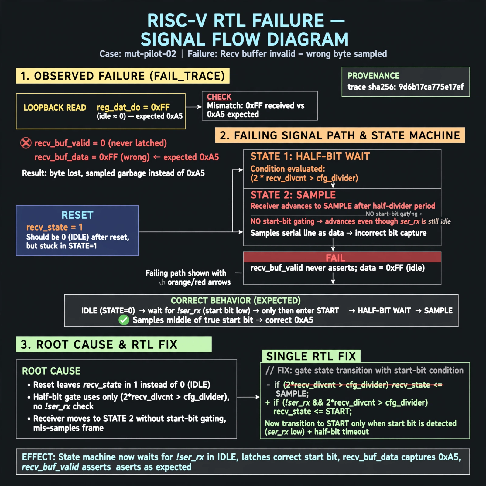

# Afterglow run report: mut-live-02-v2

case `mut-pilot-02` | status **GREEN** | mode `live` | seed `42`

wall start `2026-10-27T01:24:33Z` | wall end `2026-10-27T01:25:27Z` | time-to-green `53.7s`

retries `0` | human_touches `0` | diagnosed `True` | fixed_unaided `True` | patch_source `model-verbatim`

## Verdicts (from sim, not typed)

- BEFORE: tohost=FAIL 0xdead checksum=9e1b73c13d0a095f6b9512137fc937a720f9b8a80231ffc4b660d6d1459f6985 cycles=2024 seed=42 pass=False
- AFTER: tohost=PASS checksum=5c8f58d0f0818c97d014d2f851a6140882bd1efc96a2537047806252c0c2caf9 cycles=2652 seed=42 pass=True

## Diagnosis (verbatim from api/text_response.json)

```
Loopback read via reg_dat_do returned 0xff (idle ~0) instead of 0xa5, showing recv_buf_valid never latched correct recv_buf_data. Reset leaves recv_state in 1, the half-bit wait gated by 2*recv_divcnt > cfg_divider, instead of idle state 0 that waits for !ser_rx. Without start-bit gating the receiver advances to state 2 after half a divider period and mis-samples the frame, so the byte is lost.
```

expected re-sim signal: tohost PASS (not FAIL 0xdead), no uart data mismatch trap, loopback got 0xa5 want 0xa5

## Patch (2 lines, guard-checked)

```diff
diff --git a/picosoc/simpleuart.v b/picosoc/simpleuart.v
--- a/picosoc/simpleuart.v
+++ b/picosoc/simpleuart.v
@@ -66,7 +66,7 @@
 	always @(posedge clk) begin
 		if (!resetn) begin
-			recv_state <= 1;
+			recv_state <= 0;
 			recv_divcnt <= 0;
 			recv_pattern <= 0;
 			recv_buf_data <= 0;
 			recv_buf_valid <= 0;

```

## Provenance (judge checks)

- prompt file `/home/tuncay/afterglow/agent/prompts/v2.txt` sha256 `d31e1ef6b74ddf52ee59e790ebff2f3defa9b03be82e699f45ef620cf8e27a6e`
- input_trace.txt sha256 `9d6b17ca775e17ef60d5f427308d171a129bfc51bd9def81d651b1c1baba47c9` (9 lines, 68 tokens)
- prompt tokens `696` (cap 2500)
- text model `muse-spark-1.3-contributor` latency `37347ms` request `chatcmpl-01a17af6-19b3-7661-b571-181f428affa2`
- image model `muse-image-1.0` latency `15825ms` request `dbbbb357-aabd-42af-a8ff-c7fd0c411a14` status `ok`
- image prompt sha256 `918021c92091f75cdd8c7717a6372e80071d9d1373fc1c2985719278230fa47e`, trace sha `9d6b17ca775e17ef60d5f427308d171a129bfc51bd9def81d651b1c1baba47c9` (see api/image_request.json)

## Explanation diagram



## Bundle completeness

- present (12): artifacts/input_trace.txt, artifacts/boot.log, artifacts/boot_after.log, artifacts/verdict_before.json, artifacts/verdict_after.json, api/text_request.json, api/text_response.json, api/image_request.json, api/image_response.json, explain.png, patch.diff, meta.json
- missing (0): none

