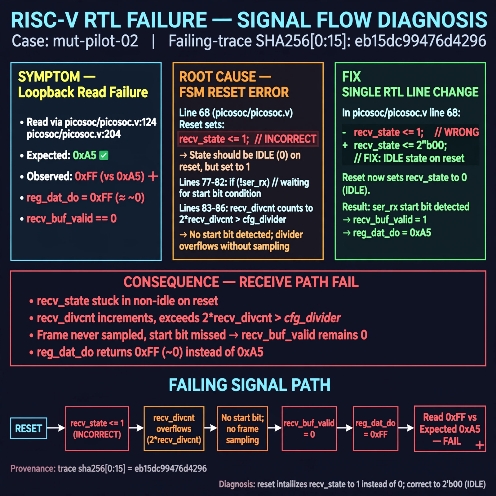

# Afterglow run report: mut-live-02-v3

case `mut-pilot-02` | status **GREEN** | mode `live` | seed `42`

wall start `2026-10-27T01:35:52Z` | wall end `2026-10-27T01:36:39Z` | time-to-green `46.7s`

retries `0` | human_touches `0` | diagnosed `True` | fixed_unaided `True` | patch_source `model-verbatim`

## Verdicts (from sim, not typed)

- BEFORE: tohost=FAIL 0xdead checksum=9e1b73c13d0a095f6b9512137fc937a720f9b8a80231ffc4b660d6d1459f6985 cycles=2024 seed=42 pass=False
- AFTER: tohost=PASS checksum=5c8f58d0f0818c97d014d2f851a6140882bd1efc96a2537047806252c0c2caf9 cycles=2652 seed=42 pass=True

## Diagnosis (verbatim from api/text_response.json)

```
Loopback read via picosoc/picosoc.v:124 / picosoc/picosoc.v:204 got 0xff vs expected 0xa5, i.e. `reg_dat_do` returned `~0` per line 53 so `recv_buf_valid==0`. Root cause in excerpt line 68: reset sets `recv_state <= 1` instead of idle 0 (lines 77-82 `if (!ser_rx)`), so `recv_divcnt` counts to `2*recv_divcnt > cfg_divider` (lines 83-86) without a start bit and the true frame is missed, never setting `recv_buf_valid`.
```

expected re-sim signal: tohost PASS (no FAIL 0xdead, no TRAP: uart data mismatch got 0xff want 0xa5, loopback 0xa5 matches)

## Patch (2 lines, guard-checked)

```diff
diff --git a/picosoc/simpleuart.v b/picosoc/simpleuart.v
--- a/picosoc/simpleuart.v
+++ b/picosoc/simpleuart.v
@@ -66,7 +66,7 @@
 	always @(posedge clk) begin
 		if (!resetn) begin
-			recv_state <= 1;
+			recv_state <= 0;
 			recv_divcnt <= 0;
 			recv_pattern <= 0;
 			recv_buf_data <= 0;

```

## Provenance (judge checks)

- prompt file `v3` sha256 `ad529368accaf171e6121a54b2d27547230920a900c7c4e5094d3fff13ca4233`
- input_trace.txt sha256 `eb15dc99476d4296365d573e01e12473d0b1be66e698df735aa33f17c2cd6c0b` (9 lines, 68 tokens)
- prompt tokens `825` (cap 2500)
- text model `muse-spark-1.3-contributor` latency `19197ms` request `chatcmpl-01a17b00-2d98-7205-8e7d-270ea35ecb97`
- image model `muse-image-1.0` latency `26982ms` request `844d6336-4d8c-4460-8fcc-f539ab9323d6` status `ok`
- image prompt sha256 `cf7452a9f17c09c428db832193ab70f59786a1967e68180f7c655c191e04e87e`, trace sha `eb15dc99476d4296365d573e01e12473d0b1be66e698df735aa33f17c2cd6c0b` (see api/image_request.json)

## Explanation diagram



## Bundle completeness

- present (12): artifacts/input_trace.txt, artifacts/boot.log, artifacts/boot_after.log, artifacts/verdict_before.json, artifacts/verdict_after.json, api/text_request.json, api/text_response.json, api/image_request.json, api/image_response.json, explain.png, patch.diff, meta.json
- missing (0): none

