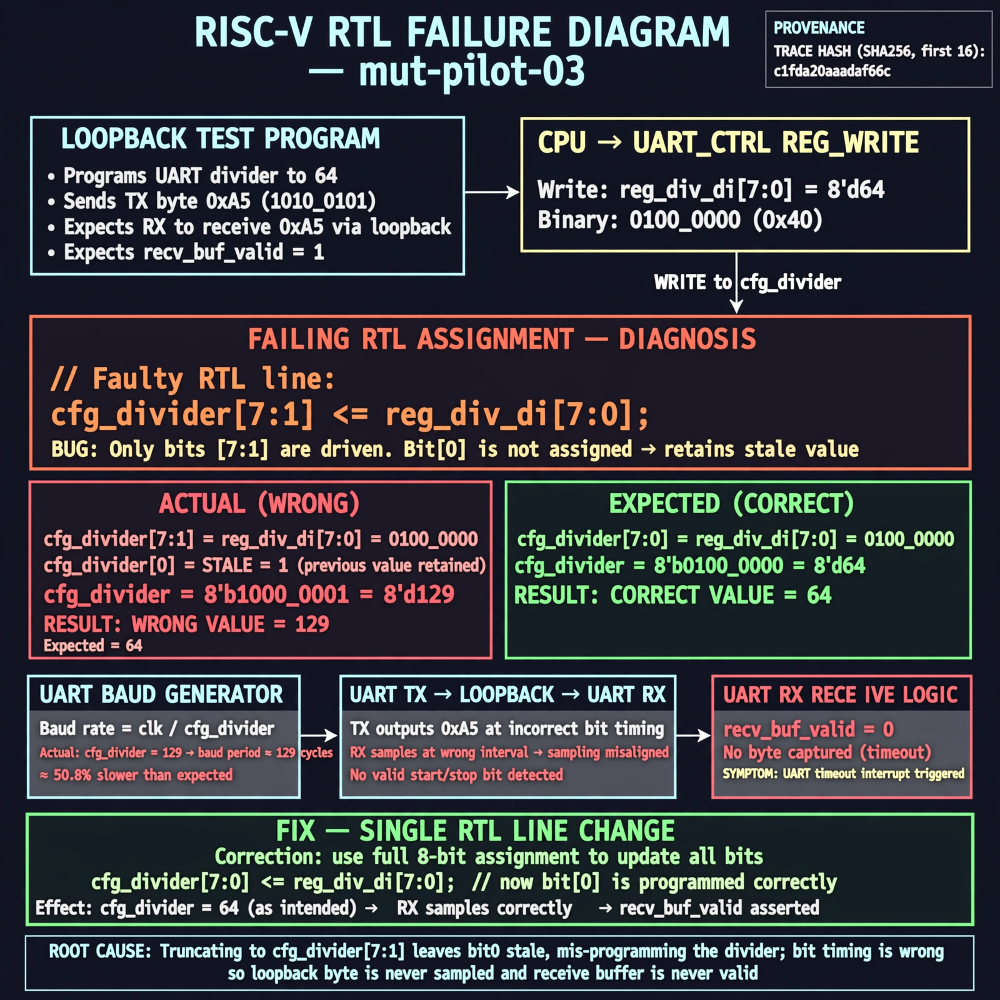

# Afterglow run report: mut-live-03-v2

case `mut-pilot-03` | status **GREEN** | mode `live` | seed `42`

wall start `2026-10-27T01:25:27Z` | wall end `2026-10-27T01:27:41Z` | time-to-green `134.4s`

retries `0` | human_touches `0` | diagnosed `True` | fixed_unaided `True` | patch_source `model-verbatim`

## Verdicts (from sim, not typed)

- BEFORE: tohost=FAIL 0xdead checksum=e82517390f8726caabcc777759a3dbb48c59fd1d160e409515f1b95dfe3d420c cycles=22023 seed=42 pass=False
- AFTER: tohost=PASS checksum=5c8f58d0f0818c97d014d2f851a6140882bd1efc96a2537047806252c0c2caf9 cycles=2652 seed=42 pass=True

## Diagnosis (verbatim from api/text_response.json)

```
Loopback test programs divider 64 then sends 0xa5 but traps on uart timeout with no byte received, so recv_buf_valid never asserted. Expected cfg_divider=64 but byte-0 write uses cfg_divider[ 7: 1] <= reg_div_di[ 7: 0], truncating the LSB and leaving bit0 stale. This mis-programmed divider in the excerpt breaks TX/RX bit timing so the loopback byte is never sampled.
```

expected re-sim signal: tohost PASS with loopback 0xa5 received, no uart timeout

## Patch (2 lines, guard-checked)

```diff
diff --git a/picosoc/simpleuart.v b/picosoc/simpleuart.v
--- a/picosoc/simpleuart.v
+++ b/picosoc/simpleuart.v
@@ -55,7 +55,7 @@
 		if (!resetn) begin
 			cfg_divider <= DEFAULT_DIV;
 		end else begin
-			if (reg_div_we[0]) cfg_divider[ 7: 1] <= reg_div_di[ 7: 0];
+			if (reg_div_we[0]) cfg_divider[ 7: 0] <= reg_div_di[ 7: 0];
 			if (reg_div_we[1]) cfg_divider[15: 8] <= reg_div_di[15: 8];
 			if (reg_div_we[2]) cfg_divider[23:16] <= reg_div_di[23:16];
 			if (reg_div_we[3]) cfg_divider[31:24] <= reg_div_di[31:24];

```

## Provenance (judge checks)

- prompt file `/home/tuncay/afterglow/agent/prompts/v2.txt` sha256 `d31e1ef6b74ddf52ee59e790ebff2f3defa9b03be82e699f45ef620cf8e27a6e`
- input_trace.txt sha256 `c1fda20aaadaf66c0320e50dc11b97107d223a665bfd37c7de25a27c55762934` (9 lines, 66 tokens)
- prompt tokens `605` (cap 2500)
- text model `muse-spark-1.3-contributor` latency `23703ms` request `chatcmpl-01a17af7-e197-70c6-997d-c03c76a5b3af`
- image model `muse-image-1.0` latency `33542ms` request `ad7969ce-b3f1-40c1-a2a6-376253187a81` status `ok`
- image prompt sha256 `f58207267ec3ebba4f15dbe0b26a4283926d92d443d019a8b140393074ba20d7`, trace sha `c1fda20aaadaf66c0320e50dc11b97107d223a665bfd37c7de25a27c55762934` (see api/image_request.json)

## Explanation diagram



## Bundle completeness

- present (12): artifacts/input_trace.txt, artifacts/boot.log, artifacts/boot_after.log, artifacts/verdict_before.json, artifacts/verdict_after.json, api/text_request.json, api/text_response.json, api/image_request.json, api/image_response.json, explain.png, patch.diff, meta.json
- missing (0): none

