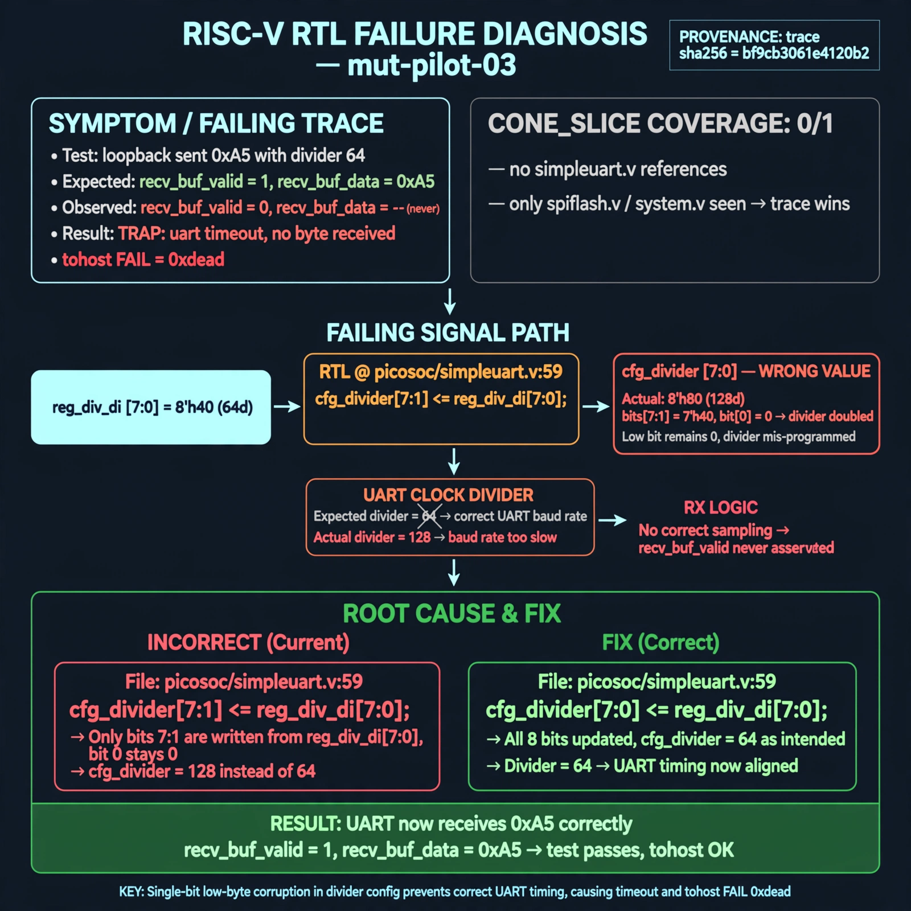

# Afterglow run report: mut-live-03-v3

case `mut-pilot-03` | status **GREEN** | mode `live` | seed `42`

wall start `2026-10-27T01:36:39Z` | wall end `2026-10-27T01:37:40Z` | time-to-green `60.9s`

retries `0` | human_touches `0` | diagnosed `True` | fixed_unaided `True` | patch_source `model-verbatim`

## Verdicts (from sim, not typed)

- BEFORE: tohost=FAIL 0xdead checksum=e82517390f8726caabcc777759a3dbb48c59fd1d160e409515f1b95dfe3d420c cycles=22023 seed=42 pass=False
- AFTER: tohost=PASS checksum=5c8f58d0f0818c97d014d2f851a6140882bd1efc96a2537047806252c0c2caf9 cycles=2652 seed=42 pass=True

## Diagnosis (verbatim from api/text_response.json)

```
Loopback sent 0xa5 with divider 64 but recv_buf_valid/recv_buf_data never delivered 0xa5, giving TRAP: uart timeout, no byte received and tohost FAIL 0xdead. CONE_SLICE has coverage 0/1 with no simpleuart.v refs (only spiflash.v/system.v), so trace wins. Root cause at picosoc/simpleuart.v:59 `cfg_divider[ 7: 1] <= reg_div_di[ 7: 0]` corrupts the low byte so divider 64 is mis-programmed and RX/TX timing never aligns.
```

expected re-sim signal: tohost: PASS (FAIL 0xdead cleared), uart loopback 0xa5 received with no timeout

## Patch (2 lines, guard-checked)

```diff
diff --git a/picosoc/simpleuart.v b/picosoc/simpleuart.v
--- a/picosoc/simpleuart.v
+++ b/picosoc/simpleuart.v
@@ -55,9 +55,9 @@
 	always @(posedge clk) begin
 		if (!resetn) begin
 			cfg_divider <= DEFAULT_DIV;
 		end else begin
-			if (reg_div_we[0]) cfg_divider[ 7: 1] <= reg_div_di[ 7: 0];
+			if (reg_div_we[0]) cfg_divider[ 7: 0] <= reg_div_di[ 7: 0];
 			if (reg_div_we[1]) cfg_divider[15: 8] <= reg_div_di[15: 8];
 			if (reg_div_we[2]) cfg_divider[23:16] <= reg_div_di[23:16];
 			if (reg_div_we[3]) cfg_divider[31:24] <= reg_div_di[31:24];
 		end
 	end

```

## Provenance (judge checks)

- prompt file `v3` sha256 `ad529368accaf171e6121a54b2d27547230920a900c7c4e5094d3fff13ca4233`
- input_trace.txt sha256 `bf9cb3061e4120b21381d6dcd36ebddb63b794928e93afd878d75bcf76b91b17` (9 lines, 66 tokens)
- prompt tokens `953` (cap 2500)
- text model `muse-spark-1.3-contributor` latency `24425ms` request `chatcmpl-01a17b00-f892-74ae-b427-ea16b59b3424`
- image model `muse-image-1.0` latency `35984ms` request `a01ee54a-5ebb-4894-84c6-55281f951b4f` status `ok`
- image prompt sha256 `cccefe52fb0bda6e1100539b53c705cd4faed368369e28cebc4babb9519eb4fe`, trace sha `bf9cb3061e4120b21381d6dcd36ebddb63b794928e93afd878d75bcf76b91b17` (see api/image_request.json)

## Explanation diagram



## Bundle completeness

- present (12): artifacts/input_trace.txt, artifacts/boot.log, artifacts/boot_after.log, artifacts/verdict_before.json, artifacts/verdict_after.json, api/text_request.json, api/text_response.json, api/image_request.json, api/image_response.json, explain.png, patch.diff, meta.json
- missing (0): none

