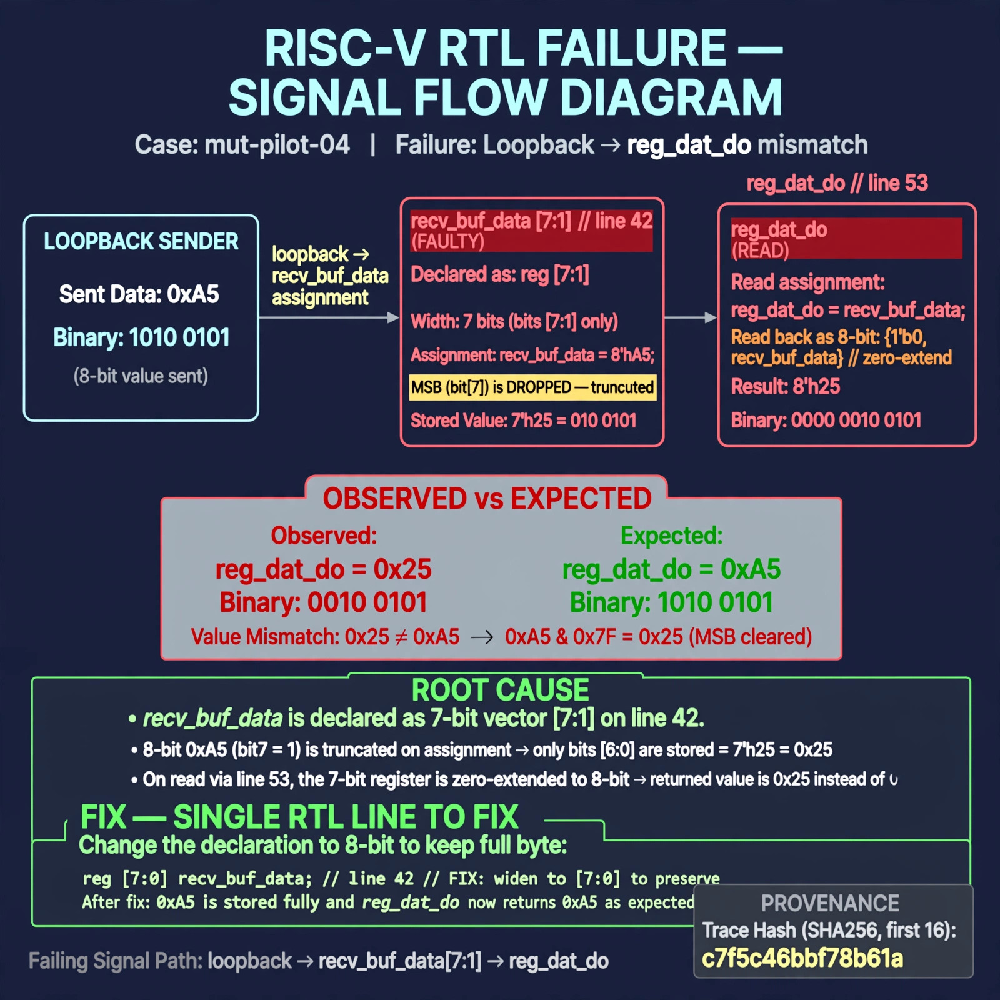

# Afterglow run report: mut-live-04-v2

case `mut-pilot-04` | status **GREEN** | mode `live` | seed `42`

wall start `2026-10-27T01:27:42Z` | wall end `2026-10-27T01:28:35Z` | time-to-green `53.8s`

retries `0` | human_touches `0` | diagnosed `True` | fixed_unaided `True` | patch_source `model-verbatim`

## Verdicts (from sim, not typed)

- BEFORE: tohost=FAIL 0xdead checksum=8b2af01e67af322e16cfa4cad217f40b67f44caf77e903eb7705ced31eb7d9a3 cycles=2652 seed=42 pass=False
- AFTER: tohost=PASS checksum=5c8f58d0f0818c97d014d2f851a6140882bd1efc96a2537047806252c0c2caf9 cycles=2652 seed=42 pass=True

## Diagnosis (verbatim from api/text_response.json)

```
Loopback sent 0xa5 but reg_dat_do returned 0x25 (0xa5 & 0x7F, MSB cleared). recv_buf_data is declared as reg [7:1] on line 42, a 7-bit vector, so an 8-bit receive pattern loses bit[7] on assignment and zero-extends on read via line 53. Widening to [7:0] preserves the full byte.
```

expected re-sim signal: tohost: PASS, uart data match got 0xa5 want 0xa5 with no TRAP

## Patch (2 lines, guard-checked)

```diff
diff --git a/picosoc/simpleuart.v b/picosoc/simpleuart.v
--- a/picosoc/simpleuart.v
+++ b/picosoc/simpleuart.v
@@ -39,7 +39,7 @@
 	reg [3:0] recv_state;
 	reg [31:0] recv_divcnt;
 	reg [7:0] recv_pattern;
-	reg [7:1] recv_buf_data;
+	reg [7:0] recv_buf_data;
 	reg recv_buf_valid;
 
 	reg [9:0] send_pattern;

```

## Provenance (judge checks)

- prompt file `/home/tuncay/afterglow/agent/prompts/v2.txt` sha256 `d31e1ef6b74ddf52ee59e790ebff2f3defa9b03be82e699f45ef620cf8e27a6e`
- input_trace.txt sha256 `c7f5c46bbf78b61a566484e57951e753eb370fc8c146c1ceccbc6eba6a306d9a` (9 lines, 68 tokens)
- prompt tokens `681` (cap 2500)
- text model `muse-spark-1.3-contributor` latency `31655ms` request `chatcmpl-01a17af8-e2b2-7662-b9b9-eb0d84785144`
- image model `muse-image-1.0` latency `21615ms` request `1df031b2-72fa-43f2-a519-bb2a4529cbdc` status `ok`
- image prompt sha256 `bfbb7ef576a56e0a14852c9dbd85652a6bc427b5e6b01a57b0c1d8ae9ad2dec9`, trace sha `c7f5c46bbf78b61a566484e57951e753eb370fc8c146c1ceccbc6eba6a306d9a` (see api/image_request.json)

## Explanation diagram



## Bundle completeness

- present (12): artifacts/input_trace.txt, artifacts/boot.log, artifacts/boot_after.log, artifacts/verdict_before.json, artifacts/verdict_after.json, api/text_request.json, api/text_response.json, api/image_request.json, api/image_response.json, explain.png, patch.diff, meta.json
- missing (0): none

