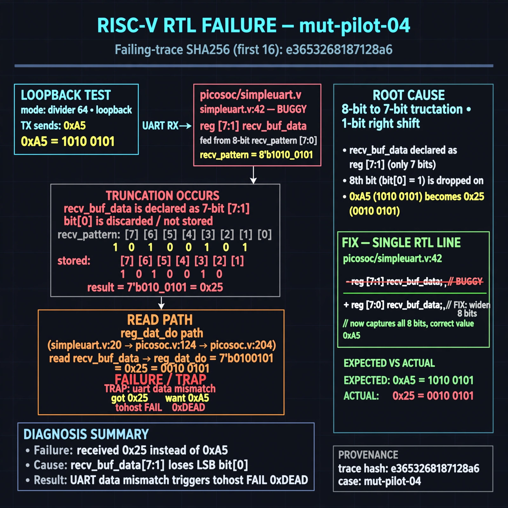

# Afterglow run report: mut-live-04-v3

case `mut-pilot-04` | status **GREEN** | mode `live` | seed `42`

wall start `2026-10-27T01:37:40Z` | wall end `2026-10-27T01:38:26Z` | time-to-green `46.2s`

retries `0` | human_touches `0` | diagnosed `True` | fixed_unaided `True` | patch_source `model-verbatim`

## Verdicts (from sim, not typed)

- BEFORE: tohost=FAIL 0xdead checksum=8b2af01e67af322e16cfa4cad217f40b67f44caf77e903eb7705ced31eb7d9a3 cycles=2652 seed=42 pass=False
- AFTER: tohost=PASS checksum=5c8f58d0f0818c97d014d2f851a6140882bd1efc96a2537047806252c0c2caf9 cycles=2652 seed=42 pass=True

## Diagnosis (verbatim from api/text_response.json)

```
Loopback (divider 64) sent 0xa5 but got 0x25: TRAP: uart data mismatch got 0x25 want 0xa5 with tohost FAIL 0xdead. 0xa5=10100101 vs 0x25=00100101 is an 8-bit to 7-bit truncation / 1-bit right shift. Root cause is picosoc/simpleuart.v:42 `reg [7:1] recv_buf_data` fed from 8-bit recv_pattern and read via reg_dat_do path (picosoc/simpleuart.v:20, picosoc/picosoc.v:124, picosoc/picosoc.v:204), so 0xa5 b[6:0] becomes 0x25.
```

expected re-sim signal: tohost PASS (FAIL 0xdead cleared), TRAP gone, uart loopback 0xa5 matches

## Patch (2 lines, guard-checked)

```diff
diff --git a/picosoc/simpleuart.v b/picosoc/simpleuart.v
--- a/picosoc/simpleuart.v
+++ b/picosoc/simpleuart.v
@@ -39,6 +39,6 @@
 	reg [3:0] recv_state;
 	reg [31:0] recv_divcnt;
 	reg [7:0] recv_pattern;
-	reg [7:1] recv_buf_data;
+	reg [7:0] recv_buf_data;
 	reg recv_buf_valid;
 
 	reg [9:0] send_pattern;

```

## Provenance (judge checks)

- prompt file `v3` sha256 `ad529368accaf171e6121a54b2d27547230920a900c7c4e5094d3fff13ca4233`
- input_trace.txt sha256 `e3653268187128a657e9effd39e475eb6f026391a1c6fb6bc8b3d52a6657f36d` (9 lines, 68 tokens)
- prompt tokens `812` (cap 2500)
- text model `muse-spark-1.3-contributor` latency `24007ms` request `chatcmpl-01a17b01-e507-7235-b350-019fa2b787a5`
- image model `muse-image-1.0` latency `21689ms` request `513cfe40-432e-4c5d-9a76-61771a495c76` status `ok`
- image prompt sha256 `e0785c970e21b5d39e743979bf398124b7e9e6b09fa88d676d1ff64ca75360b7`, trace sha `e3653268187128a657e9effd39e475eb6f026391a1c6fb6bc8b3d52a6657f36d` (see api/image_request.json)

## Explanation diagram



## Bundle completeness

- present (12): artifacts/input_trace.txt, artifacts/boot.log, artifacts/boot_after.log, artifacts/verdict_before.json, artifacts/verdict_after.json, api/text_request.json, api/text_response.json, api/image_request.json, api/image_response.json, explain.png, patch.diff, meta.json
- missing (0): none

