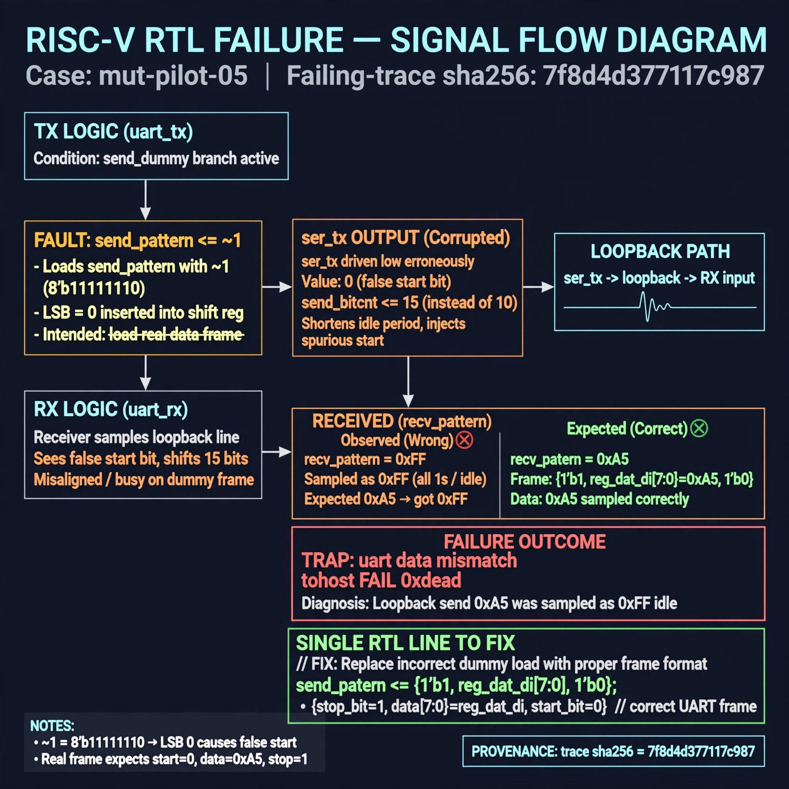

# Afterglow run report: mut-live-05-v2-rerun

case `mut-pilot-05` | status **GREEN** | mode `live` | seed `42`

wall start `2026-10-27T01:39:44Z` | wall end `2026-10-27T01:45:38Z` | time-to-green `353.2s`

retries `1` | human_touches `0` | diagnosed `True` | fixed_unaided `True` | patch_source `model-verbatim`

## Verdicts (from sim, not typed)

- BEFORE: tohost=FAIL 0xdead checksum=9e1b73c13d0a095f6b9512137fc937a720f9b8a80231ffc4b660d6d1459f6985 cycles=2024 seed=42 pass=False
- AFTER: tohost=PASS checksum=5c8f58d0f0818c97d014d2f851a6140882bd1efc96a2537047806252c0c2caf9 cycles=2652 seed=42 pass=True

## Diagnosis (verbatim from api/text_response.json)

```
Loopback send 0xa5 was sampled as 0xff idle, causing TRAP uart data mismatch and tohost FAIL 0xdead. ser_tx is corrupted by the send_dummy branch loading send_pattern <= ~1 whose LSB 0 injects a false start bit with send_bitcnt <= 15 shortening idle. The receiver stays busy/misaligned on the dummy frame when the real {1'b1, reg_dat_di[7:0], 1'b0} frame starts, so recv_pattern samples idle 1s.
```

expected re-sim signal: tohost PASS - tb_picosoc_uart divider 64 loopback 0xa5 received correctly, no TRAP uart data mismatch

## Patch (4 lines, guard-checked)

```diff
diff --git a/picosoc/simpleuart.v b/picosoc/simpleuart.v
--- a/picosoc/simpleuart.v
+++ b/picosoc/simpleuart.v
@@ -118,7 +118,7 @@
 		end else begin
 			if (send_dummy && !send_bitcnt) begin
-				send_pattern <= ~1;
-				send_bitcnt <= 15;
+				send_pattern <= ~0;
+				send_bitcnt <= 16;
 				send_divcnt <= 0;
 				send_dummy <= 0;
 			end else

```

## Provenance (judge checks)

- prompt file `/home/tuncay/afterglow/agent/prompts/v2.txt` sha256 `d31e1ef6b74ddf52ee59e790ebff2f3defa9b03be82e699f45ef620cf8e27a6e`
- input_trace.txt sha256 `7f8d4d377117c98710a76bffb33b9fafa324eca74bb7993a4ca36529a93dbbb8` (9 lines, 68 tokens)
- prompt tokens `717` (cap 2500)
- text model `muse-spark-1.3-contributor` latency `51448ms` request `chatcmpl-01a17b08-9ddc-76ff-ac91-df403e29902b`
- image model `muse-image-1.0` latency `12245ms` request `7c2da5d4-f605-489c-8c38-fe05343b1edd` status `ok`
- image prompt sha256 `fa9550565803cd1c6e0679ac4cd3f481232ba5e7993ff3d01b549f198b8871be`, trace sha `7f8d4d377117c98710a76bffb33b9fafa324eca74bb7993a4ca36529a93dbbb8` (see api/image_request.json)

## Explanation diagram



## Bundle completeness

- present (12): artifacts/input_trace.txt, artifacts/boot.log, artifacts/boot_after.log, artifacts/verdict_before.json, artifacts/verdict_after.json, api/text_request.json, api/text_response.json, api/image_request.json, api/image_response.json, explain.png, patch.diff, meta.json
- missing (0): none

