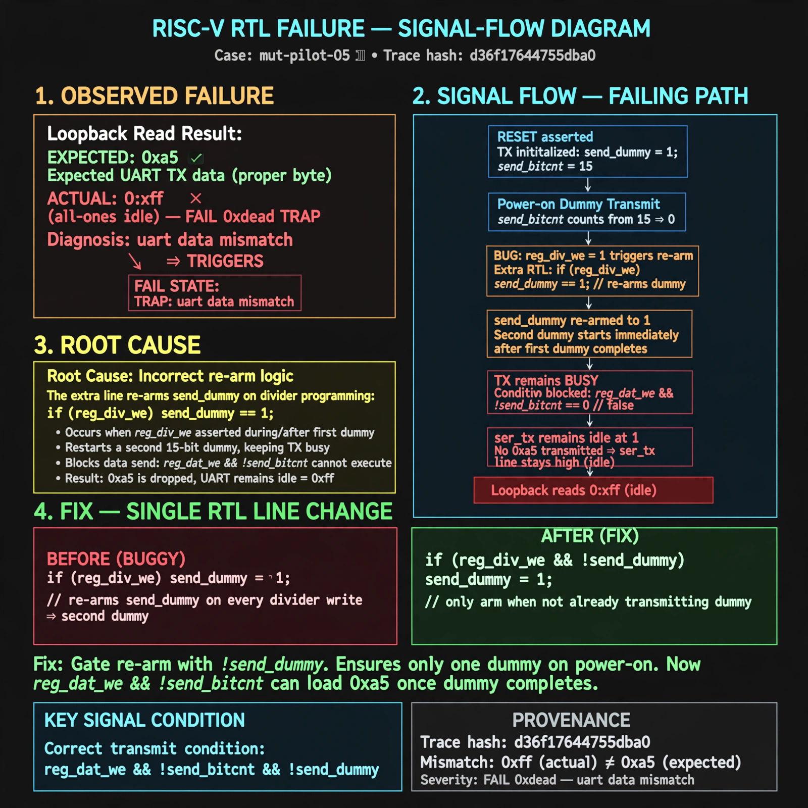

# Afterglow run report: mut-live-05-v2

case `mut-pilot-05` | status **RED** | mode `live` | seed `42`

wall start `2026-10-27T01:28:35Z` | wall end `2026-10-27T01:34:58Z` | time-to-green `382.4s`

retries `1` | human_touches `0` | diagnosed `True` | fixed_unaided `False` | patch_source `model-verbatim`

## Verdicts (from sim, not typed)

- BEFORE: tohost=FAIL 0xdead checksum=9e1b73c13d0a095f6b9512137fc937a720f9b8a80231ffc4b660d6d1459f6985 cycles=2024 seed=42 pass=False
- AFTER: tohost=FAIL 0xdead checksum=9e1b73c13d0a095f6b9512137fc937a720f9b8a80231ffc4b660d6d1459f6985 cycles=2024 seed=42 pass=False

## Diagnosis (verbatim from api/text_response.json)

```
Loopback read got 0xff (all-ones idle) instead of 0xa5, triggering FAIL 0xdead TRAP uart data mismatch. After reset TX is busy with the 15-bit power-on dummy (send_dummy=1, send_bitcnt=15). The extra `if (reg_div_we) send_dummy <= 1` re-arms send_dummy on divider programming, so when the first dummy ends a second dummy starts and blocks `reg_dat_we && !send_bitcnt`, dropping 0xa5 and leaving ser_tx idle at 1.
```

expected re-sim signal: tohost PASS (was FAIL 0xdead), no TRAP, loopback got 0xa5 want 0xa5

## Patch (2 lines, guard-checked)

```diff
diff --git a/picosoc/simpleuart.v b/picosoc/simpleuart.v
--- a/picosoc/simpleuart.v
+++ b/picosoc/simpleuart.v
@@ -109,8 +109,6 @@
 	always @(posedge clk) begin
-		if (reg_div_we)
-			send_dummy <= 1;
 		send_divcnt <= send_divcnt + 1;
 		if (!resetn) begin
 			send_pattern <= ~0;
 			send_bitcnt <= 0;
 			send_divcnt <= 0;

```

## Provenance (judge checks)

- prompt file `/home/tuncay/afterglow/agent/prompts/v2.txt` sha256 `d31e1ef6b74ddf52ee59e790ebff2f3defa9b03be82e699f45ef620cf8e27a6e`
- input_trace.txt sha256 `d36f17644755dba02b19f0475ff5be88c681acb87277f090a6c146ae071524bd` (9 lines, 68 tokens)
- prompt tokens `717` (cap 2500)
- text model `muse-spark-1.3-contributor` latency `46301ms` request `chatcmpl-01a17afb-12c0-7794-b7d3-b489d32c81c7`
- image model `muse-image-1.0` latency `30017ms` request `0d9eea88-eb45-485f-af8d-1215b7dd76c9` status `ok`
- image prompt sha256 `f4cbbc05faf659a45267fd754f490cb83391d0c0f8a8f4bab8dc560c2d7ac5b4`, trace sha `d36f17644755dba02b19f0475ff5be88c681acb87277f090a6c146ae071524bd` (see api/image_request.json)

## Explanation diagram



## Bundle completeness

- present (12): artifacts/input_trace.txt, artifacts/boot.log, artifacts/boot_after.log, artifacts/verdict_before.json, artifacts/verdict_after.json, api/text_request.json, api/text_response.json, api/image_request.json, api/image_response.json, explain.png, patch.diff, meta.json
- missing (0): none

