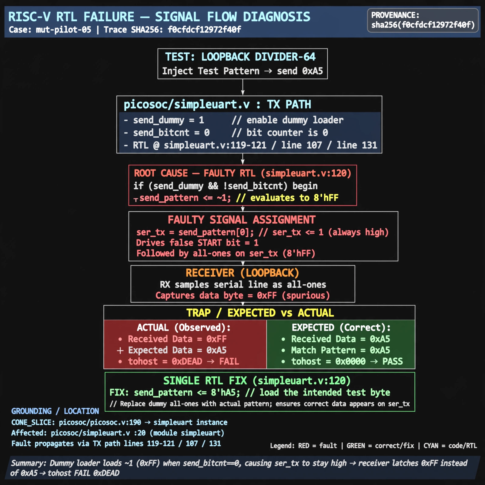

# Afterglow run report: mut-live-05-v3

case `mut-pilot-05` | status **GREEN** | mode `live` | seed `42`

wall start `2026-10-27T01:38:26Z` | wall end `2026-10-27T01:39:33Z` | time-to-green `67.2s`

retries `0` | human_touches `0` | diagnosed `True` | fixed_unaided `True` | patch_source `model-verbatim`

## Verdicts (from sim, not typed)

- BEFORE: tohost=FAIL 0xdead checksum=9e1b73c13d0a095f6b9512137fc937a720f9b8a80231ffc4b660d6d1459f6985 cycles=2024 seed=42 pass=False
- AFTER: tohost=PASS checksum=5c8f58d0f0818c97d014d2f851a6140882bd1efc96a2537047806252c0c2caf9 cycles=2652 seed=42 pass=True

## Diagnosis (verbatim from api/text_response.json)

```
Loopback divider-64 test sent 0xa5 but TRAP reports got 0xff want 0xa5 with tohost FAIL 0xdead. Root cause in excerpt is the dummy loader `if (send_dummy && !send_bitcnt) send_pattern <= ~1` which via `ser_tx = send_pattern[0]` drives a false start bit followed by all-ones so the receiver latches spurious 0xFF. Grounded on CONE_SLICE picosoc/picosoc.v:190 simpleuart instance and picosoc/simpleuart.v:20 module with excerpt TX path lines 119-121/107/131.
```

expected re-sim signal: tohost PASS replacing FAIL 0xdead, no TRAP uart data mismatch, loopback 0xa5 matched

## Patch (2 lines, guard-checked)

```diff
diff --git a/picosoc/simpleuart.v b/picosoc/simpleuart.v
--- a/picosoc/simpleuart.v
+++ b/picosoc/simpleuart.v
@@ -118,8 +118,8 @@
 		end else begin
 			if (send_dummy && !send_bitcnt) begin
-				send_pattern <= ~1;
+				send_pattern <= ~0;
 				send_bitcnt <= 15;
 				send_divcnt <= 0;
 				send_dummy <= 0;
 			end else
 			if (reg_dat_we && !send_bitcnt) begin

```

## Provenance (judge checks)

- prompt file `v3` sha256 `ad529368accaf171e6121a54b2d27547230920a900c7c4e5094d3fff13ca4233`
- input_trace.txt sha256 `f0cfdcf12972f40f6c8228345572b880b33091854531337db645604a98b35ccd` (9 lines, 68 tokens)
- prompt tokens `815` (cap 2500)
- text model `muse-spark-1.3-contributor` latency `53527ms` request `chatcmpl-01a17b03-0d0f-7015-aa82-72f18982a5a4`
- image model `muse-image-1.0` latency `13232ms` request `fc3cf8be-8af1-47c0-8839-39b3be5bdb36` status `ok`
- image prompt sha256 `e7961b4941c77c6032530ca1a0d18d834f87c32d0542070c1c73f20b9330361e`, trace sha `f0cfdcf12972f40f6c8228345572b880b33091854531337db645604a98b35ccd` (see api/image_request.json)

## Explanation diagram



## Bundle completeness

- present (12): artifacts/input_trace.txt, artifacts/boot.log, artifacts/boot_after.log, artifacts/verdict_before.json, artifacts/verdict_after.json, api/text_request.json, api/text_response.json, api/image_request.json, api/image_response.json, explain.png, patch.diff, meta.json
- missing (0): none

