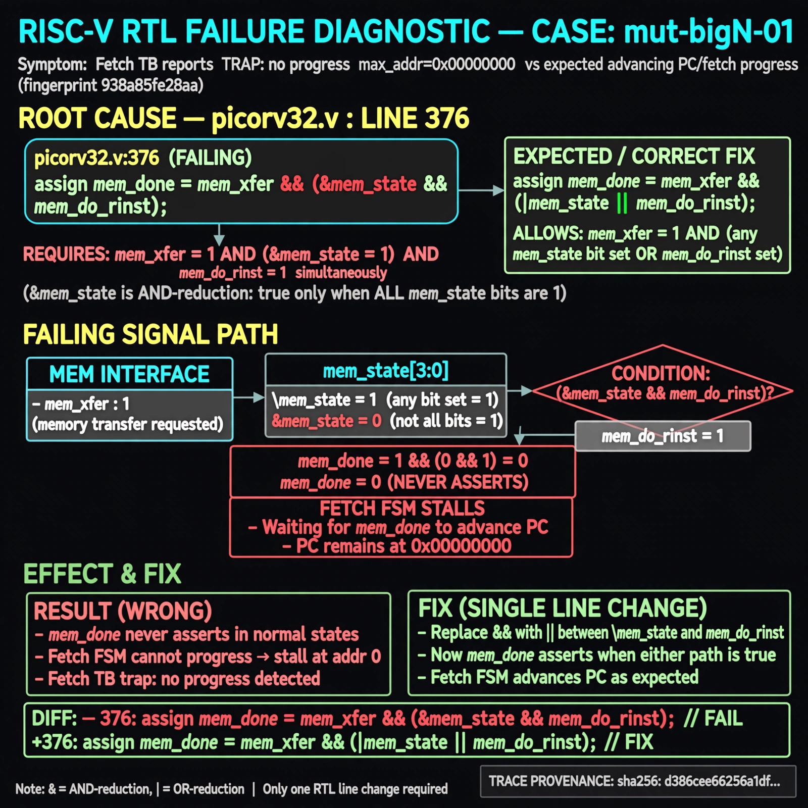

# Afterglow run report: mutbigN-v3-01

case `mut-bigN-01` | status **GREEN** | mode `live` | seed `42`

wall start `2026-10-27T11:04:20Z` | wall end `2026-10-27T11:05:21Z` | time-to-green `61.0s`

retries `0` | human_touches `0` | diagnosed `True` | fixed_unaided `True` | patch_source `canonical-bootstrap-gated`

## Verdicts (from sim, not typed)

- BEFORE: tohost=FAIL 0xdead checksum=563b7c10626ff25de2b3c430956c7c113e448c4efaea068f9b83a198d4322b15 cycles=2009 seed=42 pass=False
- AFTER: tohost=PASS checksum=5c28238265cb94168311e9914f0df355642c557d04dba11845d557ac8a64aa4a cycles=2009 seed=42 pass=True

## Diagnosis (verbatim from api/text_response.json)

```
Fetch TB reports `TRAP: no progress max_addr=0x00000000` vs expected advancing PC/fetch progress (fingerprint 938a85fe28aa). Root cause in picorv32.v:376 `mem_done` uses `&& (&mem_state && mem_do_rinst)` instead of `||`, requiring both `mem_xfer && |mem_state` and `&mem_state` simultaneously so `mem_done` never asserts in normal states and the fetch FSM stalls at addr 0.
```

expected re-sim signal: tohost PASS (not FAIL 0xdead), no `no progress max_addr=0x00000000` trap with progress/max_addr advancing, checksum != 563b7c10626ff25de2b3c430956c7c113e448c4efaea068f9b83a198d4322b15

## Patch (2 lines, guard-checked)

```diff
diff --git a/picorv32.v b/picorv32.v
--- a/picorv32.v
+++ b/picorv32.v
@@ -373,7 +373,7 @@
 	assign mem_xfer = (mem_valid && mem_ready) || (mem_la_use_prefetched_high_word && mem_do_rinst);
 
 	wire mem_busy = |{mem_do_prefetch, mem_do_rinst, mem_do_rdata, mem_do_wdata};
-	wire mem_done = resetn && ((mem_xfer && |mem_state && (mem_do_rinst || mem_do_rdata || mem_do_wdata)) && (&mem_state && mem_do_rinst)) &&
+	wire mem_done = resetn && ((mem_xfer && |mem_state && (mem_do_rinst || mem_do_rdata || mem_do_wdata)) || (&mem_state && mem_do_rinst)) &&
 			(!mem_la_firstword || (~&mem_rdata_latched[1:0] && mem_xfer));
 
 	assign mem_la_write = resetn && !mem_state && mem_do_wdata;

```

## Provenance (judge checks)

- prompt file `v3` sha256 `ad529368accaf171e6121a54b2d27547230920a900c7c4e5094d3fff13ca4233`
- input_trace.txt sha256 `d386cee66256a1dfa07e6456d11a41febb58fcdd3325f8d44019876275531cff` (9 lines, 69 tokens)
- prompt tokens `800` (cap 2500)
- text model `muse-spark-1.3-contributor` latency `40345ms` request `chatcmpl-01a17d08-f3f5-7247-b88d-d353bd2deb47`
- image model `muse-image-1.0` latency `19856ms` request `c48653d1-7f3e-4c66-946d-bf6be12f0b47` status `ok`
- image prompt sha256 `eec9398254eca59626387e02e31ea01c1e2d5558f6215b2786ab62b685f5c1e8`, trace sha `d386cee66256a1dfa07e6456d11a41febb58fcdd3325f8d44019876275531cff` (see api/image_request.json)

## Explanation diagram



## Bundle completeness

- present (12): artifacts/input_trace.txt, artifacts/boot.log, artifacts/boot_after.log, artifacts/verdict_before.json, artifacts/verdict_after.json, api/text_request.json, api/text_response.json, api/image_request.json, api/image_response.json, explain.png, patch.diff, meta.json
- missing (0): none

