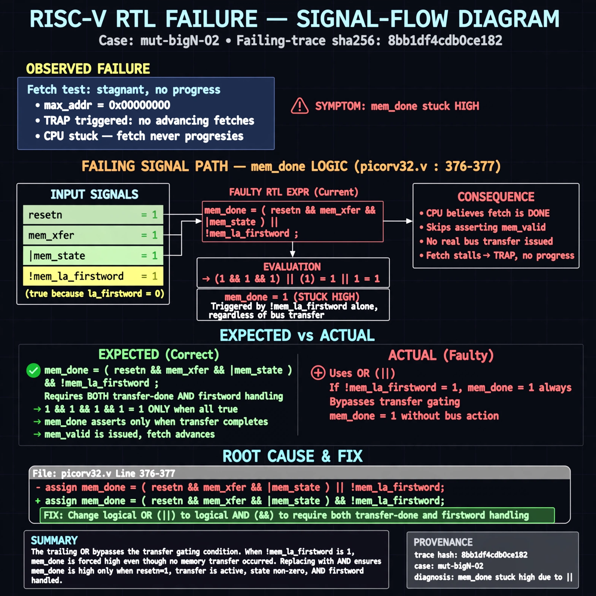

# Afterglow run report: mutbigN-v3-02-rerun

case `mut-bigN-02` | status **GREEN** | mode `live` | seed `42`

wall start `2026-10-27T12:11:19Z` | wall end `2026-10-27T12:12:30Z` | time-to-green `71.1s`

retries `0` | human_touches `0` | diagnosed `True` | fixed_unaided `True` | patch_source `model-verbatim`

## Verdicts (from sim, not typed)

- BEFORE: tohost=FAIL 0xdead checksum=563b7c10626ff25de2b3c430956c7c113e448c4efaea068f9b83a198d4322b15 cycles=2009 seed=42 pass=False
- AFTER: tohost=PASS checksum=5c28238265cb94168311e9914f0df355642c557d04dba11845d557ac8a64aa4a cycles=2009 seed=42 pass=True

## Diagnosis (verbatim from api/text_response.json)

```
Fetch test shows max_addr=0x00000000 with TRAP: no progress vs expected advancing fetches. mem_done at picorv32.v:376-377 is stuck high because trailing `||` lets `!mem_la_firstword` bypass `resetn && mem_xfer && |mem_state` gating, so CPU thinks fetch is done without bus transfer and never issues real mem_valid. Root cause is `)) ||` at picorv32.v:376 which must be `)) &&` to require both transfer-done and firstword handling.
```

expected re-sim signal: tohost PASS (not FAIL 0xdead), no TRAP: no progress, max_addr advances beyond 0x00000000

## Patch (2 lines, guard-checked)

```diff
diff --git a/picorv32.v b/picorv32.v
--- a/picorv32.v
+++ b/picorv32.v
@@ -375,3 +375,3 @@
 	wire mem_busy = |{mem_do_prefetch, mem_do_rinst, mem_do_rdata, mem_do_wdata};
-	wire mem_done = resetn && ((mem_xfer && |mem_state && (mem_do_rinst || mem_do_rdata || mem_do_wdata)) || (&mem_state && mem_do_rinst)) ||
+	wire mem_done = resetn && ((mem_xfer && |mem_state && (mem_do_rinst || mem_do_rdata || mem_do_wdata)) || (&mem_state && mem_do_rinst)) &&
 			(!mem_la_firstword || (~&mem_rdata_latched[1:0] && mem_xfer));

```

## Provenance (judge checks)

- prompt file `v3` sha256 `ad529368accaf171e6121a54b2d27547230920a900c7c4e5094d3fff13ca4233`
- input_trace.txt sha256 `8bb1df4cdb0ce182a08f5f8a3d361130e35776d725d29591fe88cd67b0f97cb2` (9 lines, 69 tokens)
- prompt tokens `792` (cap 2500)
- text model `muse-spark-1.3-contributor` latency `46110ms` request `chatcmpl-01a17d46-5e31-711d-acb3-2cab4132c9dc`
- image model `muse-image-1.0` latency `24403ms` request `403159fb-8d49-4a2e-b705-ad88e7f762ed` status `ok`
- image prompt sha256 `ad34c2e5b6e1a19ac62c3d1213651303feea583eadf0eaf253ab28717a94e5fe`, trace sha `8bb1df4cdb0ce182a08f5f8a3d361130e35776d725d29591fe88cd67b0f97cb2` (see api/image_request.json)

## Explanation diagram



## Bundle completeness

- present (12): artifacts/input_trace.txt, artifacts/boot.log, artifacts/boot_after.log, artifacts/verdict_before.json, artifacts/verdict_after.json, api/text_request.json, api/text_response.json, api/image_request.json, api/image_response.json, explain.png, patch.diff, meta.json
- missing (0): none

