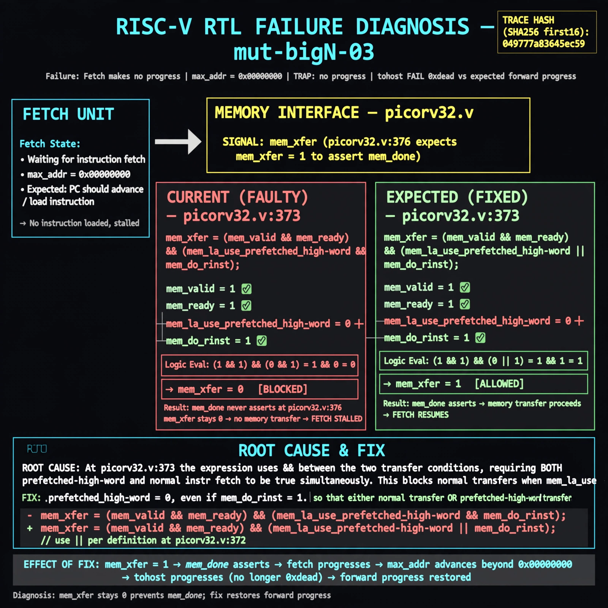

# Afterglow run report: mutbigN-v3-03

case `mut-bigN-03` | status **GREEN** | mode `live` | seed `42`

wall start `2026-10-27T11:09:51Z` | wall end `2026-10-27T11:10:48Z` | time-to-green `56.5s`

retries `0` | human_touches `0` | diagnosed `True` | fixed_unaided `True` | patch_source `model-verbatim`

## Verdicts (from sim, not typed)

- BEFORE: tohost=FAIL 0xdead checksum=563b7c10626ff25de2b3c430956c7c113e448c4efaea068f9b83a198d4322b15 cycles=2009 seed=42 pass=False
- AFTER: tohost=PASS checksum=5c28238265cb94168311e9914f0df355642c557d04dba11845d557ac8a64aa4a cycles=2009 seed=42 pass=True

## Diagnosis (verbatim from api/text_response.json)

```
Fetch makes no progress (max_addr=0x00000000 with TRAP: no progress max_addr=0x00000000 and tohost FAIL 0xdead vs expected forward progress). mem_xfer stays 0 so mem_done at picorv32.v:376 never asserts. Root cause at picorv32.v:373 where mem_xfer is (mem_valid && mem_ready) && (mem_la_use_prefetched_high_word && mem_do_rinst) instead of ||, blocking both normal transfers and prefetched-high-word use defined at picorv32.v:372.
```

expected re-sim signal: tohost PASS (not FAIL 0xdead), no TRAP: no progress max_addr=0x00000000 with forward progress

## Patch (2 lines, guard-checked)

```diff
diff --git a/picorv32.v b/picorv32.v
--- a/picorv32.v
+++ b/picorv32.v
@@ -372,5 +372,5 @@
 	wire mem_la_use_prefetched_high_word = COMPRESSED_ISA && mem_la_firstword && prefetched_high_word && !clear_prefetched_high_word;
-	assign mem_xfer = (mem_valid && mem_ready) && (mem_la_use_prefetched_high_word && mem_do_rinst);
+	assign mem_xfer = (mem_valid && mem_ready) || (mem_la_use_prefetched_high_word && mem_do_rinst);
 
 	wire mem_busy = |{mem_do_prefetch, mem_do_rinst, mem_do_rdata, mem_do_wdata};
 	wire mem_done = resetn && ((mem_xfer && |mem_state && (mem_do_rinst || mem_do_rdata || mem_do_wdata)) || (&mem_state && mem_do_rinst)) &&

```

## Provenance (judge checks)

- prompt file `v3` sha256 `ad529368accaf171e6121a54b2d27547230920a900c7c4e5094d3fff13ca4233`
- input_trace.txt sha256 `049777a83645ec598cb341c8c40c0ad2d841641dd84e233141aff8b08c80e251` (9 lines, 69 tokens)
- prompt tokens `792` (cap 2500)
- text model `muse-spark-1.3-contributor` latency `26465ms` request `chatcmpl-01a17d0d-cb78-7683-a458-508b7addf4c5`
- image model `muse-image-1.0` latency `29378ms` request `f0942787-569e-4d7f-a269-616bea2418b6` status `ok`
- image prompt sha256 `b36ad322d9f9706ef7da9f9e7f0b67c7ac1b6e81b794c40f281310b8e1b31b16`, trace sha `049777a83645ec598cb341c8c40c0ad2d841641dd84e233141aff8b08c80e251` (see api/image_request.json)

## Explanation diagram



## Bundle completeness

- present (12): artifacts/input_trace.txt, artifacts/boot.log, artifacts/boot_after.log, artifacts/verdict_before.json, artifacts/verdict_after.json, api/text_request.json, api/text_response.json, api/image_request.json, api/image_response.json, explain.png, patch.diff, meta.json
- missing (0): none

