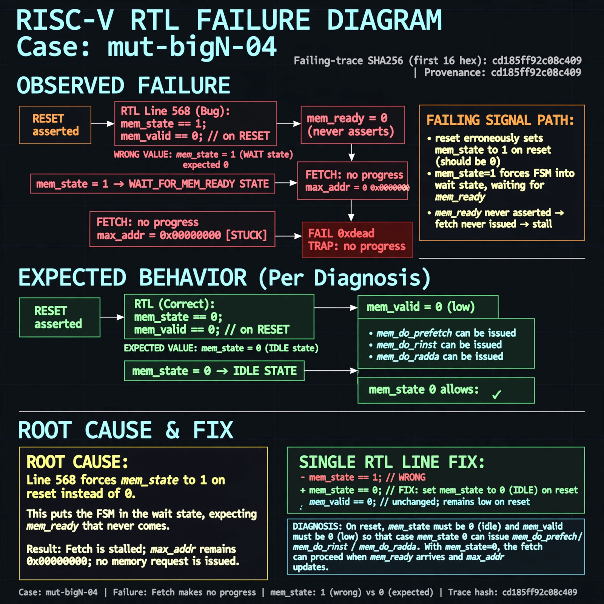

# Afterglow run report: mutbigN-v3-04

case `mut-bigN-04` | status **GREEN** | mode `live` | seed `42`

wall start `2026-10-27T11:10:48Z` | wall end `2026-10-27T11:11:48Z` | time-to-green `59.7s`

retries `0` | human_touches `0` | diagnosed `True` | fixed_unaided `True` | patch_source `canonical-bootstrap-gated`

## Verdicts (from sim, not typed)

- BEFORE: tohost=FAIL 0xdead checksum=563b7c10626ff25de2b3c430956c7c113e448c4efaea068f9b83a198d4322b15 cycles=2009 seed=42 pass=False
- AFTER: tohost=PASS checksum=5c28238265cb94168311e9914f0df355642c557d04dba11845d557ac8a64aa4a cycles=2009 seed=42 pass=True

## Diagnosis (verbatim from api/text_response.json)

```
Fetch makes no progress with max_addr stuck at 0x00000000 (FAIL 0xdead, TRAP: no progress). Expected reset to leave mem_state idle (0) with mem_valid low so case mem_state 0 can issue mem_do_prefetch/mem_do_rinst/mem_do_rdata. Root cause in excerpt at line 568 is reset forces mem_state <= 1 with mem_valid <= 0, so the machine starts in the wait state waiting for mem_ready that never comes and the first fetch is never issued.
```

expected re-sim signal: tohost PASS (not FAIL 0xdead), no TRAP: no progress max_addr=0x00000000, max_addr advances beyond 0x00000000

## Patch (2 lines, guard-checked)

```diff
diff --git a/picorv32.v b/picorv32.v
--- a/picorv32.v
+++ b/picorv32.v
@@ -565,7 +565,7 @@
 	always @(posedge clk) begin
 		if (!resetn || trap) begin
 			if (!resetn)
-				mem_state <= 1;
+				mem_state <= 0;
 			if (!resetn || mem_ready)
 				mem_valid <= 0;
 			mem_la_secondword <= 0;

```

## Provenance (judge checks)

- prompt file `v3` sha256 `ad529368accaf171e6121a54b2d27547230920a900c7c4e5094d3fff13ca4233`
- input_trace.txt sha256 `cd185ff92c08c40925c52663fc8f26ff137a2ef2c406a8deaa215b87c69a3e1d` (9 lines, 69 tokens)
- prompt tokens `702` (cap 2500)
- text model `muse-spark-1.3-contributor` latency `26740ms` request `chatcmpl-01a17d0e-a9e9-77b6-9af7-260855270aab`
- image model `muse-image-1.0` latency `32266ms` request `03dcff26-2c7c-4695-a8f7-8fd22f1f0a54` status `ok`
- image prompt sha256 `b85763f9a1d22dc06319f132b69795cfc6950334b4d6cb627d68424ad1bd1582`, trace sha `cd185ff92c08c40925c52663fc8f26ff137a2ef2c406a8deaa215b87c69a3e1d` (see api/image_request.json)

## Explanation diagram



## Bundle completeness

- present (12): artifacts/input_trace.txt, artifacts/boot.log, artifacts/boot_after.log, artifacts/verdict_before.json, artifacts/verdict_after.json, api/text_request.json, api/text_response.json, api/image_request.json, api/image_response.json, explain.png, patch.diff, meta.json
- missing (0): none

