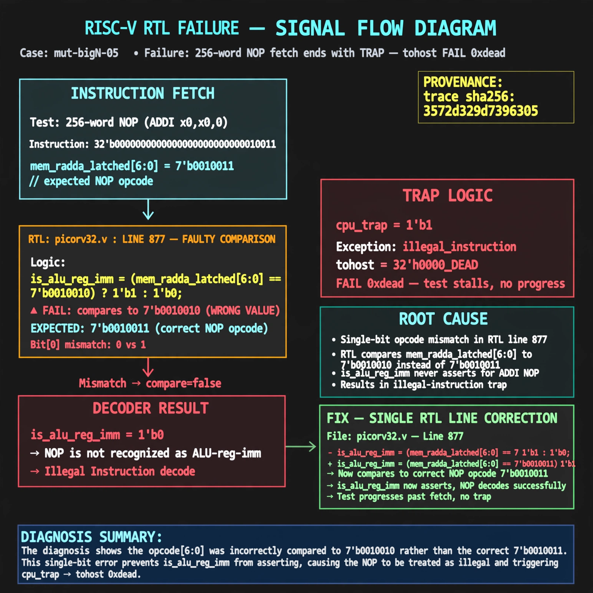

# Afterglow run report: mutbigN-v3-05

case `mut-bigN-05` | status **GREEN** | mode `live` | seed `42`

wall start `2026-10-27T11:11:48Z` | wall end `2026-10-27T11:13:12Z` | time-to-green `84.6s`

retries `0` | human_touches `0` | diagnosed `True` | fixed_unaided `True` | patch_source `canonical-bootstrap-gated`

## Verdicts (from sim, not typed)

- BEFORE: tohost=FAIL 0xdead checksum=c2a7a4d6295484feeb9ec1ea9381732b8e39a7ccd1997c7d70f6454da2fb4659 cycles=2009 seed=42 pass=False
- AFTER: tohost=PASS checksum=5c28238265cb94168311e9914f0df355642c557d04dba11845d557ac8a64aa4a cycles=2009 seed=42 pass=True

## Diagnosis (verbatim from api/text_response.json)

```
256-word NOP (ADDI x0,x0,0, opcode 7'b0010011) fetch test ends with TRAP: cpu trap asserted and tohost FAIL 0xdead instead of progress. is_alu_reg_imm never asserts because picorv32.v:877 compares mem_rdata_latched[6:0] to 7'b0010010 vs expected 7'b0010011, so NOP decodes as illegal. The single-bit opcode mismatch causes the illegal-instruction trap.
```

expected re-sim signal: tohost PASS with no TRAP: cpu trap asserted, checksum != c2a7a4d6295484feeb9ec1ea9381732b8e39a7ccd1997c7d70f6454da2fb4659

## Patch (2 lines, guard-checked)

```diff
diff --git a/picorv32.v b/picorv32.v
--- a/picorv32.v
+++ b/picorv32.v
@@ -874,7 +874,7 @@
 			is_beq_bne_blt_bge_bltu_bgeu <= mem_rdata_latched[6:0] == 7'b1100011;
 			is_lb_lh_lw_lbu_lhu          <= mem_rdata_latched[6:0] == 7'b0000011;
 			is_sb_sh_sw                  <= mem_rdata_latched[6:0] == 7'b0100011;
-			is_alu_reg_imm               <= mem_rdata_latched[6:0] == 7'b0010010;
+			is_alu_reg_imm               <= mem_rdata_latched[6:0] == 7'b0010011;
 			is_alu_reg_reg               <= mem_rdata_latched[6:0] == 7'b0110011;
 
 			{ decoded_imm_j[31:20], decoded_imm_j[10:1], decoded_imm_j[11], decoded_imm_j[19:12], decoded_imm_j[0] } <= $signed({mem_rdata_latched[31:12], 1'b0});

```

## Provenance (judge checks)

- prompt file `v3` sha256 `ad529368accaf171e6121a54b2d27547230920a900c7c4e5094d3fff13ca4233`
- input_trace.txt sha256 `3572d329d7396305a14501ba79725de0b32a5787aab69ba832aa3aa2219c3974` (9 lines, 69 tokens)
- prompt tokens `786` (cap 2500)
- text model `muse-spark-1.3-contributor` latency `43480ms` request `chatcmpl-01a17d0f-d4c5-74ea-b609-257444623027`
- image model `muse-image-1.0` latency `40522ms` request `777a3be8-299f-4138-a128-7f3ff3a4039f` status `ok`
- image prompt sha256 `ae5be9caf58382e020a5f1b839b3a881b92d12428ce9dba93959b342e797886e`, trace sha `3572d329d7396305a14501ba79725de0b32a5787aab69ba832aa3aa2219c3974` (see api/image_request.json)

## Explanation diagram



## Bundle completeness

- present (12): artifacts/input_trace.txt, artifacts/boot.log, artifacts/boot_after.log, artifacts/verdict_before.json, artifacts/verdict_after.json, api/text_request.json, api/text_response.json, api/image_request.json, api/image_response.json, explain.png, patch.diff, meta.json
- missing (0): none

