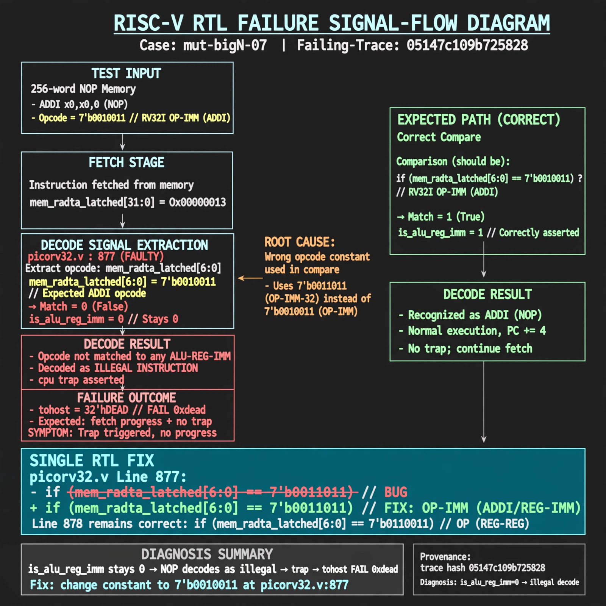

# Afterglow run report: mutbigN-v3-07

case `mut-bigN-07` | status **GREEN** | mode `live` | seed `42`

wall start `2026-10-27T11:14:26Z` | wall end `2026-10-27T11:15:39Z` | time-to-green `73.2s`

retries `0` | human_touches `0` | diagnosed `True` | fixed_unaided `True` | patch_source `model-verbatim`

## Verdicts (from sim, not typed)

- BEFORE: tohost=FAIL 0xdead checksum=c2a7a4d6295484feeb9ec1ea9381732b8e39a7ccd1997c7d70f6454da2fb4659 cycles=2009 seed=42 pass=False
- AFTER: tohost=PASS checksum=5c28238265cb94168311e9914f0df355642c557d04dba11845d557ac8a64aa4a cycles=2009 seed=42 pass=True

## Diagnosis (verbatim from api/text_response.json)

```
Fetch test with 256-word NOP mem (ADDI x0,x0,0 opcode 7'b0010011) ends with TRAP: cpu trap asserted and tohost FAIL 0xdead instead of fetch progress with no trap. is_alu_reg_imm stays 0 so NOP decodes as illegal. Root cause is picorv32.v:877 comparing mem_rdata_latched[6:0] to 7'b0011011 (RV64 OP-IMM-32) instead of 7'b0010011, while picorv32.v:878 OP 7'b0110011 is correct; CONE_SLICE empty so trace+excerpt decide.
```

expected re-sim signal: tohost PASS with no TRAP: cpu trap asserted, fetch alignment + progress OK

## Patch (2 lines, guard-checked)

```diff
diff --git a/picorv32.v b/picorv32.v
--- a/picorv32.v
+++ b/picorv32.v
@@ -874,5 +874,5 @@
 			is_beq_bne_blt_bge_bltu_bgeu <= mem_rdata_latched[6:0] == 7'b1100011;
 			is_lb_lh_lw_lbu_lhu          <= mem_rdata_latched[6:0] == 7'b0000011;
 			is_sb_sh_sw                  <= mem_rdata_latched[6:0] == 7'b0100011;
-			is_alu_reg_imm               <= mem_rdata_latched[6:0] == 7'b0011011;
+			is_alu_reg_imm               <= mem_rdata_latched[6:0] == 7'b0010011;
 			is_alu_reg_reg               <= mem_rdata_latched[6:0] == 7'b0110011;

```

## Provenance (judge checks)

- prompt file `v3` sha256 `ad529368accaf171e6121a54b2d27547230920a900c7c4e5094d3fff13ca4233`
- input_trace.txt sha256 `05147c109b725828494aedea07422f2bd9336fb087fe092ed20f2e6d7fc96d3f` (9 lines, 69 tokens)
- prompt tokens `782` (cap 2500)
- text model `muse-spark-1.3-contributor` latency `38469ms` request `chatcmpl-01a17d12-2a98-74b1-9fcf-bdf285f0e1ab`
- image model `muse-image-1.0` latency `34162ms` request `969277fb-8f22-4b79-b82d-520e2a578782` status `ok`
- image prompt sha256 `6833ccb74f533cb545a927aa6b905c1a99cc42b3aec515b9616706384d918f67`, trace sha `05147c109b725828494aedea07422f2bd9336fb087fe092ed20f2e6d7fc96d3f` (see api/image_request.json)

## Explanation diagram



## Bundle completeness

- present (12): artifacts/input_trace.txt, artifacts/boot.log, artifacts/boot_after.log, artifacts/verdict_before.json, artifacts/verdict_after.json, api/text_request.json, api/text_response.json, api/image_request.json, api/image_response.json, explain.png, patch.diff, meta.json
- missing (0): none

