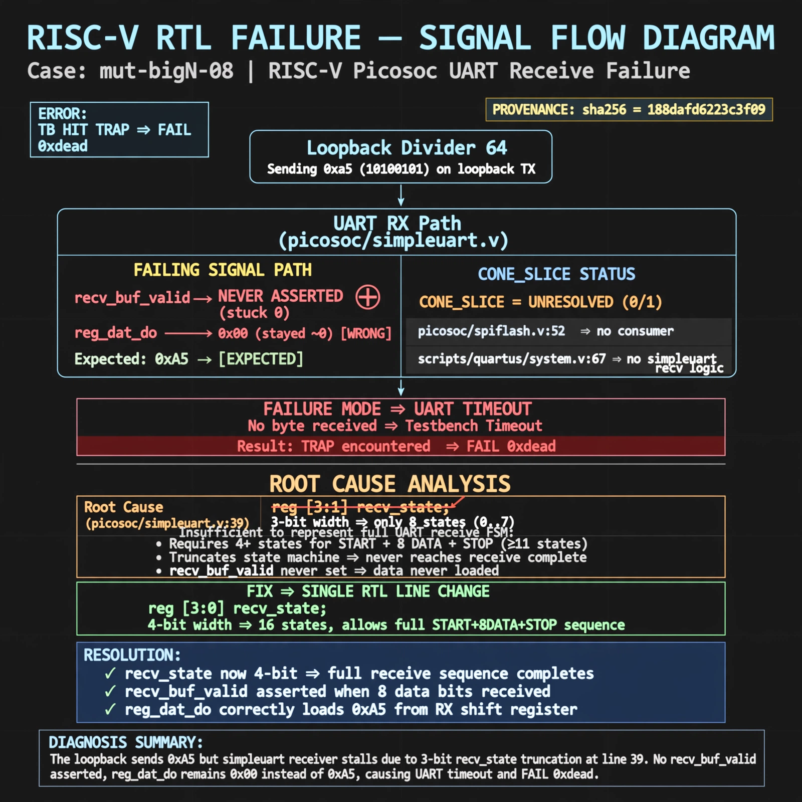

# Afterglow run report: mutbigN-v3-08

case `mut-bigN-08` | status **GREEN** | mode `live` | seed `42`

wall start `2026-10-27T11:15:39Z` | wall end `2026-10-27T11:16:39Z` | time-to-green `60.1s`

retries `0` | human_touches `0` | diagnosed `True` | fixed_unaided `True` | patch_source `model-verbatim`

## Verdicts (from sim, not typed)

- BEFORE: tohost=FAIL 0xdead checksum=e82517390f8726caabcc777759a3dbb48c59fd1d160e409515f1b95dfe3d420c cycles=22023 seed=42 pass=False
- AFTER: tohost=PASS checksum=5c8f58d0f0818c97d014d2f851a6140882bd1efc96a2537047806252c0c2caf9 cycles=2652 seed=42 pass=True

## Diagnosis (verbatim from api/text_response.json)

```
Loopback divider 64 sending 0xa5 never asserted recv_buf_valid, so reg_dat_do stayed ~0 instead of 0xa5 and TB hit TRAP: uart timeout, no byte received with FAIL 0xdead. CONE_SLICE is unresolved (0/1, only picosoc/spiflash.v:52 and scripts/quartus/system.v:67 etc.) with no simpleuart recv logic, so trace wins. Root cause in picosoc/simpleuart.v:39 where reg [3:1] recv_state truncates the receiver to 3 bits and prevents the full start+8data+stop sequence from completing.
```

expected re-sim signal: tohost PASS with byte 0xa5 received, no TRAP: uart timeout (vs FAIL 0xdead)

## Patch (2 lines, guard-checked)

```diff
diff --git a/picosoc/simpleuart.v b/picosoc/simpleuart.v
--- a/picosoc/simpleuart.v
+++ b/picosoc/simpleuart.v
@@ -37,7 +37,7 @@
 	reg [31:0] cfg_divider;
 
-	reg [3:1] recv_state;
+	reg [3:0] recv_state;
 	reg [31:0] recv_divcnt;
 	reg [7:0] recv_pattern;
 	reg [7:0] recv_buf_data;
 	reg recv_buf_valid;

```

## Provenance (judge checks)

- prompt file `v3` sha256 `ad529368accaf171e6121a54b2d27547230920a900c7c4e5094d3fff13ca4233`
- input_trace.txt sha256 `188dafd6223c3f09a66806ee465aa94fe767c8d1bbf19e36f1b9a3a64e537e18` (9 lines, 66 tokens)
- prompt tokens `925` (cap 2500)
- text model `muse-spark-1.3-contributor` latency `46283ms` request `chatcmpl-01a17d13-6707-7457-a58f-cf7d0d46fa19`
- image model `muse-image-1.0` latency `13382ms` request `c7e6e995-7261-402e-a888-4df034cfcde9` status `ok`
- image prompt sha256 `59412f7aa6e0a9bb48e24c50bd121d21a9d1780d6948ae5f02d7e07bc6750a92`, trace sha `188dafd6223c3f09a66806ee465aa94fe767c8d1bbf19e36f1b9a3a64e537e18` (see api/image_request.json)

## Explanation diagram



## Bundle completeness

- present (12): artifacts/input_trace.txt, artifacts/boot.log, artifacts/boot_after.log, artifacts/verdict_before.json, artifacts/verdict_after.json, api/text_request.json, api/text_response.json, api/image_request.json, api/image_response.json, explain.png, patch.diff, meta.json
- missing (0): none

