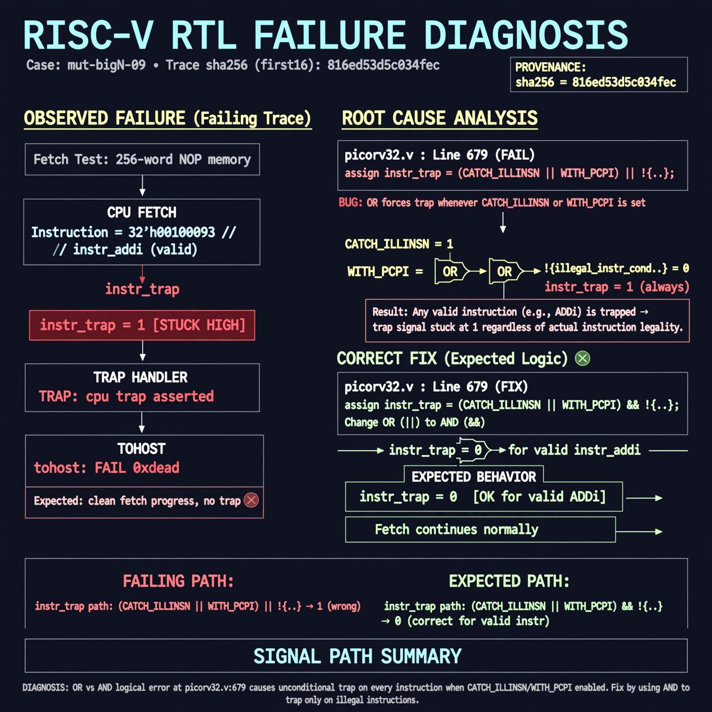

# Afterglow run report: mutbigN-v3-09

case `mut-bigN-09` | status **GREEN** | mode `live` | seed `42`

wall start `2026-10-27T11:16:39Z` | wall end `2026-10-27T11:17:28Z` | time-to-green `48.8s`

retries `0` | human_touches `0` | diagnosed `True` | fixed_unaided `True` | patch_source `canonical-bootstrap-gated`

## Verdicts (from sim, not typed)

- BEFORE: tohost=FAIL 0xdead checksum=c2a7a4d6295484feeb9ec1ea9381732b8e39a7ccd1997c7d70f6454da2fb4659 cycles=2009 seed=42 pass=False
- AFTER: tohost=PASS checksum=5c28238265cb94168311e9914f0df355642c557d04dba11845d557ac8a64aa4a cycles=2009 seed=42 pass=True

## Diagnosis (verbatim from api/text_response.json)

```
Fetch test with 256-word NOP mem traps immediately with `TRAP: cpu trap asserted` and `tohost: FAIL 0xdead` instead of clean fetch progress with no trap. instr_trap is stuck at 1 even for valid instr_addi. Root cause at picorv32.v:679 where `assign instr_trap = (CATCH_ILLINSN || WITH_PCPI) || !{...}` uses OR, so when CATCH_ILLINSN/WITH_PCPI is set it forces trap on every instruction; it must be AND to trap only on illegal instructions.
```

expected re-sim signal: tohost PASS with no TRAP: cpu trap asserted on NOP fetch test

## Patch (2 lines, guard-checked)

```diff
diff --git a/picorv32.v b/picorv32.v
--- a/picorv32.v
+++ b/picorv32.v
@@ -676,7 +676,7 @@
 	reg is_alu_reg_reg;
 	reg is_compare;
 
-	assign instr_trap = (CATCH_ILLINSN || WITH_PCPI) || !{instr_lui, instr_auipc, instr_jal, instr_jalr,
+	assign instr_trap = (CATCH_ILLINSN || WITH_PCPI) && !{instr_lui, instr_auipc, instr_jal, instr_jalr,
 			instr_beq, instr_bne, instr_blt, instr_bge, instr_bltu, instr_bgeu,
 			instr_lb, instr_lh, instr_lw, instr_lbu, instr_lhu, instr_sb, instr_sh, instr_sw,
 			instr_addi, instr_slti, instr_sltiu, instr_xori, instr_ori, instr_andi, instr_slli, instr_srli, instr_srai,

```

## Provenance (judge checks)

- prompt file `v3` sha256 `ad529368accaf171e6121a54b2d27547230920a900c7c4e5094d3fff13ca4233`
- input_trace.txt sha256 `816ed53d5c034fecb7cfdfbbc9d1a371deee9d7d4417d06ada5a395b5f937ad6` (9 lines, 69 tokens)
- prompt tokens `722` (cap 2500)
- text model `muse-spark-1.3-contributor` latency `31788ms` request `chatcmpl-01a17d14-19e5-762e-a543-935717e7192a`
- image model `muse-image-1.0` latency `16383ms` request `5483a216-bd32-4f71-afe0-f329a5ad7333` status `ok`
- image prompt sha256 `8757efbad4a3b8fad40f59de339618843f515765b1ed043bc6d8dd5a0ad24125`, trace sha `816ed53d5c034fecb7cfdfbbc9d1a371deee9d7d4417d06ada5a395b5f937ad6` (see api/image_request.json)

## Explanation diagram



## Bundle completeness

- present (12): artifacts/input_trace.txt, artifacts/boot.log, artifacts/boot_after.log, artifacts/verdict_before.json, artifacts/verdict_after.json, api/text_request.json, api/text_response.json, api/image_request.json, api/image_response.json, explain.png, patch.diff, meta.json
- missing (0): none

