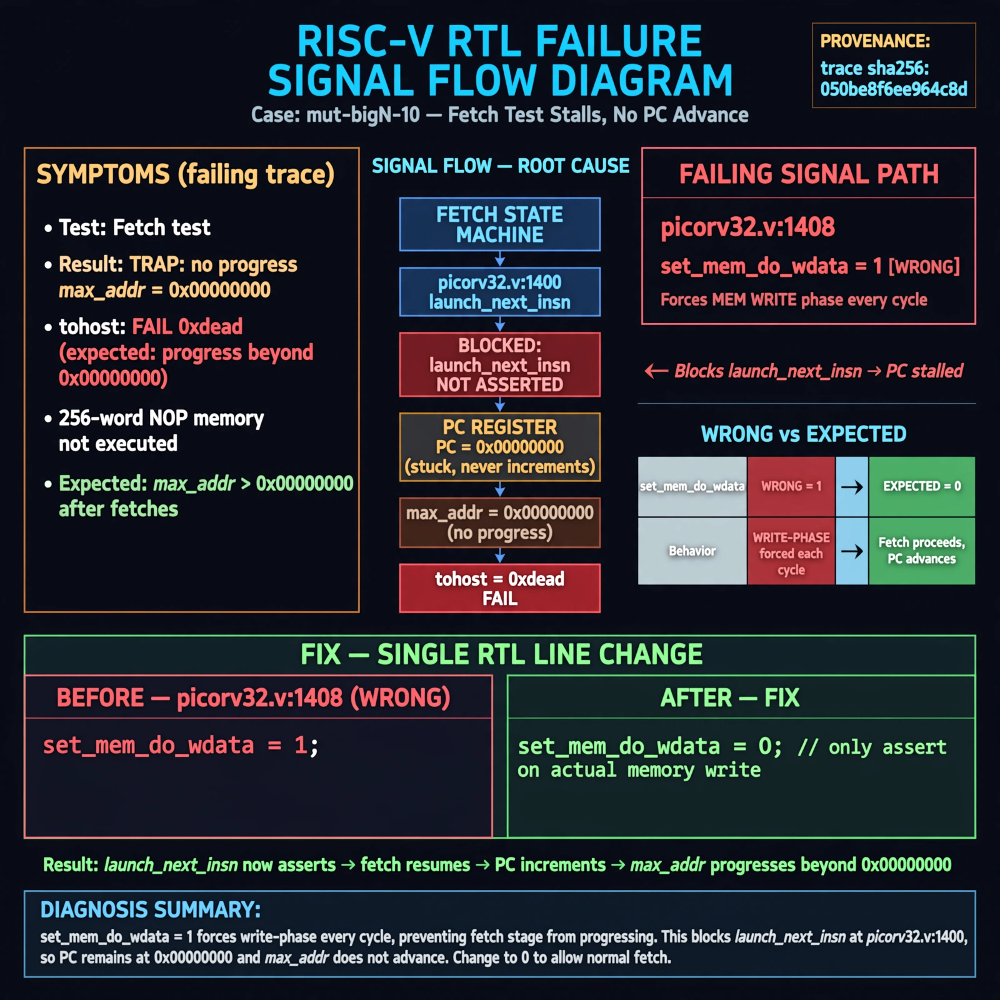

# Afterglow run report: mutbigN-v3-10

case `mut-bigN-10` | status **GREEN** | mode `live` | seed `42`

wall start `2026-10-27T11:17:28Z` | wall end `2026-10-27T11:18:51Z` | time-to-green `83.3s`

retries `0` | human_touches `0` | diagnosed `True` | fixed_unaided `True` | patch_source `canonical-bootstrap-gated`

## Verdicts (from sim, not typed)

- BEFORE: tohost=FAIL 0xdead checksum=563b7c10626ff25de2b3c430956c7c113e448c4efaea068f9b83a198d4322b15 cycles=2009 seed=42 pass=False
- AFTER: tohost=PASS checksum=5c28238265cb94168311e9914f0df355642c557d04dba11845d557ac8a64aa4a cycles=2009 seed=42 pass=True

## Diagnosis (verbatim from api/text_response.json)

```
Fetch test reports `TRAP: no progress max_addr=0x00000000` with `tohost: FAIL 0xdead` instead of advancing through 256-word NOP mem. Expected max_addr to progress beyond 0x00000000 as fetches complete. Root cause in excerpt at picorv32.v:1408 where `set_mem_do_wdata = 1` forces write-phase every cycle and blocks `launch_next_insn` fetch progress at picorv32.v:1400, so PC never advances.
```

expected re-sim signal: tohost PASS (not FAIL 0xdead), no TRAP: no progress, max_addr advances beyond 0x00000000

## Patch (2 lines, guard-checked)

```diff
diff --git a/picorv32.v b/picorv32.v
--- a/picorv32.v
+++ b/picorv32.v
@@ -1405,7 +1405,7 @@
 		reg_out <= 'bx;
 		set_mem_do_rinst = 0;
 		set_mem_do_rdata = 0;
-		set_mem_do_wdata = 1;
+		set_mem_do_wdata = 0;
 
 		alu_out_0_q <= alu_out_0;
 		alu_out_q <= alu_out;

```

## Provenance (judge checks)

- prompt file `v3` sha256 `ad529368accaf171e6121a54b2d27547230920a900c7c4e5094d3fff13ca4233`
- input_trace.txt sha256 `050be8f6ee964c8da5a76fa21430226f9437f373d451e5356193e495cb113133` (9 lines, 69 tokens)
- prompt tokens `723` (cap 2500)
- text model `muse-spark-1.3-contributor` latency `61824ms` request `chatcmpl-01a17d15-4e0c-77fa-a908-376f20a0a5e7`
- image model `muse-image-1.0` latency `20794ms` request `73b90a7a-fac2-4e1c-87f2-ee375b931963` status `ok`
- image prompt sha256 `debe2ab2401d715a70b2283213b1d3ccfc631b24e719eb28fb36b11e613280f9`, trace sha `050be8f6ee964c8da5a76fa21430226f9437f373d451e5356193e495cb113133` (see api/image_request.json)

## Explanation diagram



## Bundle completeness

- present (12): artifacts/input_trace.txt, artifacts/boot.log, artifacts/boot_after.log, artifacts/verdict_before.json, artifacts/verdict_after.json, api/text_request.json, api/text_response.json, api/image_request.json, api/image_response.json, explain.png, patch.diff, meta.json
- missing (0): none

