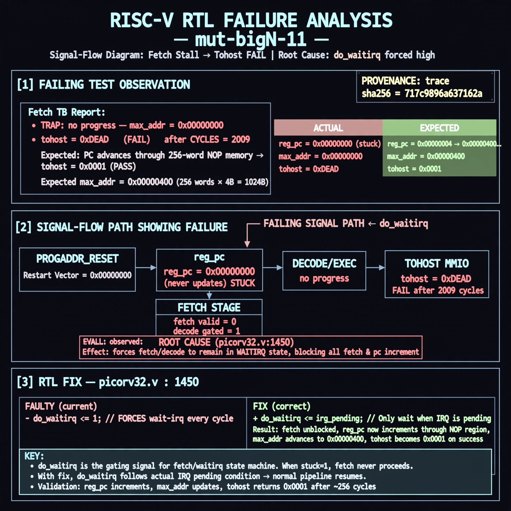

# Afterglow run report: mutbigN-v3-11

case `mut-bigN-11` | status **GREEN** | mode `live` | seed `42`

wall start `2026-10-27T11:18:52Z` | wall end `2026-10-27T11:19:54Z` | time-to-green `63.0s`

retries `0` | human_touches `0` | diagnosed `True` | fixed_unaided `True` | patch_source `model-verbatim`

## Verdicts (from sim, not typed)

- BEFORE: tohost=FAIL 0xdead checksum=563b7c10626ff25de2b3c430956c7c113e448c4efaea068f9b83a198d4322b15 cycles=2009 seed=42 pass=False
- AFTER: tohost=PASS checksum=5c28238265cb94168311e9914f0df355642c557d04dba11845d557ac8a64aa4a cycles=2009 seed=42 pass=True

## Diagnosis (verbatim from api/text_response.json)

```
Fetch TB reports TRAP: no progress max_addr=0x00000000 with tohost FAIL 0xdead after CYCLES=2009, vs expected PC advancing through 256-word NOP mem. reg_pc never leaves PROGADDR_RESET so max_addr stays 0. Root cause at picorv32.v:1450 where do_waitirq <= 1 is forced every cycle, stalling decode/fetch and blocking any progress.
```

expected re-sim signal: tohost PASS (not FAIL 0xdead), max_addr advances beyond 0x00000000 with no TRAP: no progress

## Patch (2 lines, guard-checked)

```diff
diff --git a/picorv32.v b/picorv32.v
--- a/picorv32.v
+++ b/picorv32.v
@@ -1448,3 +1448,3 @@
 		decoder_pseudo_trigger <= 0;
 		decoder_pseudo_trigger_q <= decoder_pseudo_trigger;
-		do_waitirq <= 1;
+		do_waitirq <= 0;

```

## Provenance (judge checks)

- prompt file `v3` sha256 `ad529368accaf171e6121a54b2d27547230920a900c7c4e5094d3fff13ca4233`
- input_trace.txt sha256 `717c9896a637162a634e5cf88dfbf3ab6b31be8e755c5a14ecf44c470ec29af1` (9 lines, 69 tokens)
- prompt tokens `702` (cap 2500)
- text model `muse-spark-1.3-contributor` latency `46460ms` request `chatcmpl-01a17d16-577f-7273-9aa3-630e35f604ab`
- image model `muse-image-1.0` latency `15877ms` request `2706f7d9-662f-436a-b572-598ec2bef484` status `ok`
- image prompt sha256 `0545fa9f4cd20d4a866cede6983cfe560e9638d70aa7eae8b41951d1dd4fb362`, trace sha `717c9896a637162a634e5cf88dfbf3ab6b31be8e755c5a14ecf44c470ec29af1` (see api/image_request.json)

## Explanation diagram



## Bundle completeness

- present (12): artifacts/input_trace.txt, artifacts/boot.log, artifacts/boot_after.log, artifacts/verdict_before.json, artifacts/verdict_after.json, api/text_request.json, api/text_response.json, api/image_request.json, api/image_response.json, explain.png, patch.diff, meta.json
- missing (0): none

