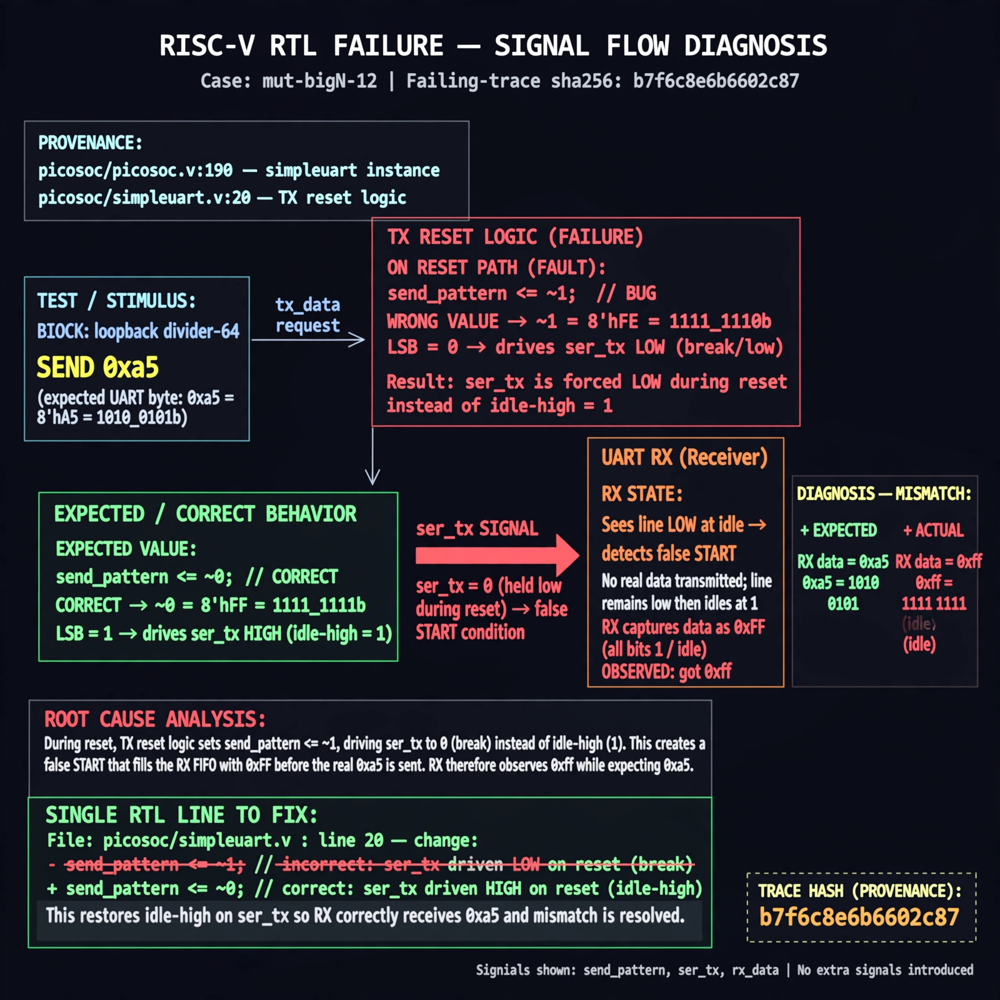

# Afterglow run report: mutbigN-v3-12

case `mut-bigN-12` | status **GREEN** | mode `live` | seed `42`

wall start `2026-10-27T11:19:55Z` | wall end `2026-10-27T11:22:37Z` | time-to-green `162.9s`

retries `1` | human_touches `0` | diagnosed `True` | fixed_unaided `True` | patch_source `model-verbatim`

## Verdicts (from sim, not typed)

- BEFORE: tohost=FAIL 0xdead checksum=9e1b73c13d0a095f6b9512137fc937a720f9b8a80231ffc4b660d6d1459f6985 cycles=2024 seed=42 pass=False
- AFTER: tohost=PASS checksum=5c8f58d0f0818c97d014d2f851a6140882bd1efc96a2537047806252c0c2caf9 cycles=2652 seed=42 pass=True

## Diagnosis (verbatim from api/text_response.json)

```
Loopback divider-64 send 0xa5 fails with TRAP: uart data mismatch got 0xff want 0xa5, i.e. RX saw idle 0xff instead of data. Root cause is TX reset send_pattern <= ~1 (LSB 0 break) instead of ~0 idle-high, driving ser_tx low through reset and causing a false start that fills RX with 0xff before real data. Provenance picosoc/picosoc.v:190 simpleuart instance and picosoc/simpleuart.v:20 module pins this to TX reset logic.
```

expected re-sim signal: tohost PASS (not FAIL 0xdead), no TRAP: uart data mismatch, uart loopback 0xa5 matches

## Patch (2 lines, guard-checked)

```diff
diff --git a/picosoc/simpleuart.v b/picosoc/simpleuart.v
--- a/picosoc/simpleuart.v
+++ b/picosoc/simpleuart.v
@@ -113,5 +113,5 @@
 		if (!resetn) begin
-			send_pattern <= ~1;
+			send_pattern <= ~0;
 			send_bitcnt <= 0;
 			send_divcnt <= 0;
 			send_dummy <= 1;

```

## Provenance (judge checks)

- prompt file `v3` sha256 `ad529368accaf171e6121a54b2d27547230920a900c7c4e5094d3fff13ca4233`
- input_trace.txt sha256 `b7f6c8e6b6602c875438d28036acea4afa8626526e6428c9b45ff76748b6a989` (9 lines, 68 tokens)
- prompt tokens `853` (cap 2500)
- text model `muse-spark-1.3-contributor` latency `71409ms` request `chatcmpl-01a17d18-addf-70a3-b519-0f94e5599dfe`
- image model `muse-image-1.0` latency `25028ms` request `9ebe113c-2819-46a7-9178-470c86b27131` status `ok`
- image prompt sha256 `811b4b8e94e8430ce745d628f20b31795b74af3caed32c54b2981a01d087ff2d`, trace sha `b7f6c8e6b6602c875438d28036acea4afa8626526e6428c9b45ff76748b6a989` (see api/image_request.json)

## Explanation diagram



## Bundle completeness

- present (12): artifacts/input_trace.txt, artifacts/boot.log, artifacts/boot_after.log, artifacts/verdict_before.json, artifacts/verdict_after.json, api/text_request.json, api/text_response.json, api/image_request.json, api/image_response.json, explain.png, patch.diff, meta.json
- missing (0): none

