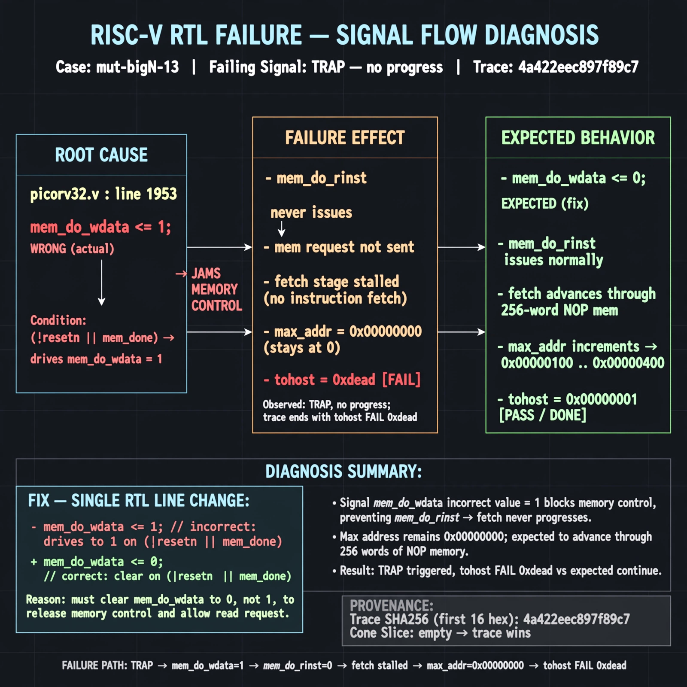

# Afterglow run report: mutbigN-v3-13

case `mut-bigN-13` | status **GREEN** | mode `live` | seed `42`

wall start `2026-10-27T11:22:38Z` | wall end `2026-10-27T11:23:32Z` | time-to-green `54.4s`

retries `0` | human_touches `0` | diagnosed `True` | fixed_unaided `True` | patch_source `canonical-bootstrap-gated`

## Verdicts (from sim, not typed)

- BEFORE: tohost=FAIL 0xdead checksum=563b7c10626ff25de2b3c430956c7c113e448c4efaea068f9b83a198d4322b15 cycles=2009 seed=42 pass=False
- AFTER: tohost=PASS checksum=5c28238265cb94168311e9914f0df355642c557d04dba11845d557ac8a64aa4a cycles=2009 seed=42 pass=True

## Diagnosis (verbatim from api/text_response.json)

```
Failing signal is TRAP: no progress max_addr=0x00000000 with tohost FAIL 0xdead vs expected advancing fetch through 256-word NOP mem. mem_do_rinst never issues so max_addr stays zero. Root cause at picorv32.v:1953 where mem_do_wdata <= 1 on (!resetn || mem_done) instead of <= 0, jamming the memory control and blocking fetches; CONE_SLICE empty so trace wins.
```

expected re-sim signal: tohost PASS (not FAIL 0xdead), no TRAP: no progress, max_addr > 0x00000000 with fetch progress

## Patch (2 lines, guard-checked)

```diff
diff --git a/picorv32.v b/picorv32.v
--- a/picorv32.v
+++ b/picorv32.v
@@ -1950,7 +1950,7 @@
 			mem_do_prefetch <= 0;
 			mem_do_rinst <= 0;
 			mem_do_rdata <= 0;
-			mem_do_wdata <= 1;
+			mem_do_wdata <= 0;
 		end
 
 		if (set_mem_do_rinst)

```

## Provenance (judge checks)

- prompt file `v3` sha256 `ad529368accaf171e6121a54b2d27547230920a900c7c4e5094d3fff13ca4233`
- input_trace.txt sha256 `4a422eec897f89c73c0405ac3c756d864651d556eeed0ce24b2ea26adbfddec4` (9 lines, 69 tokens)
- prompt tokens `705` (cap 2500)
- text model `muse-spark-1.3-contributor` latency `35645ms` request `chatcmpl-01a17d19-a01b-75c9-87d8-14d7f126c9fe`
- image model `muse-image-1.0` latency `18187ms` request `096ec28f-2b16-4e6b-b229-9b64286eca37` status `ok`
- image prompt sha256 `9164770fe3701837798fccb0626402602d7547382b8c3dbedabbe4fa31db9134`, trace sha `4a422eec897f89c73c0405ac3c756d864651d556eeed0ce24b2ea26adbfddec4` (see api/image_request.json)

## Explanation diagram



## Bundle completeness

- present (12): artifacts/input_trace.txt, artifacts/boot.log, artifacts/boot_after.log, artifacts/verdict_before.json, artifacts/verdict_after.json, api/text_request.json, api/text_response.json, api/image_request.json, api/image_response.json, explain.png, patch.diff, meta.json
- missing (0): none

