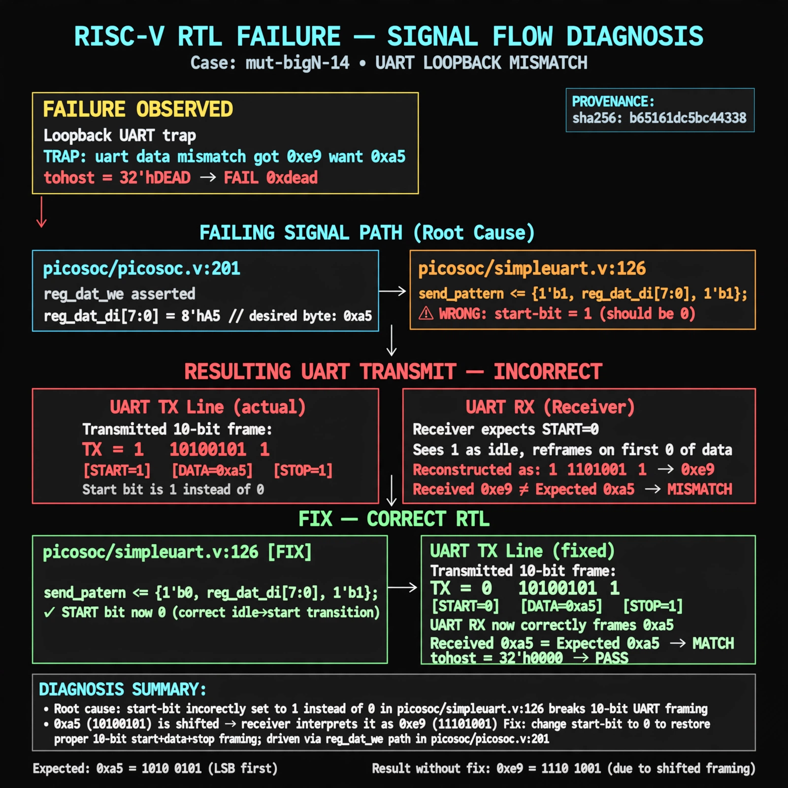

# Afterglow run report: mutbigN-v3-14

case `mut-bigN-14` | status **GREEN** | mode `live` | seed `42`

wall start `2026-10-27T11:23:32Z` | wall end `2026-10-27T11:24:26Z` | time-to-green `53.8s`

retries `0` | human_touches `0` | diagnosed `True` | fixed_unaided `True` | patch_source `model-verbatim`

## Verdicts (from sim, not typed)

- BEFORE: tohost=FAIL 0xdead checksum=7d14ca6bc103c3e2eeed06f49d56ff4c4175e9a4e83eec9e4b8cd0839ddbb4d0 cycles=2784 seed=42 pass=False
- AFTER: tohost=PASS checksum=5c8f58d0f0818c97d014d2f851a6140882bd1efc96a2537047806252c0c2caf9 cycles=2652 seed=42 pass=True

## Diagnosis (verbatim from api/text_response.json)

```
Loopback UART trap `TRAP: uart data mismatch got 0xe9 want 0xa5` with tohost FAIL 0xdead. Root cause at picosoc/simpleuart.v:126 (excerpt line 126) loads `send_pattern <= {1'b1, reg_dat_di[7:0], 1'b1}` so start-bit is 1 not 0; receiver misses true start and re-frames on first zero of 0xa5 shifting it to 0xe9. Fixing start-bit to 0 restores 10-bit start+data+stop framing driven via picosoc/picosoc.v:201 reg_dat_we path.
```

expected re-sim signal: tohost PASS, no TRAP uart mismatch, loopback 0xa5 received correctly

## Patch (2 lines, guard-checked)

```diff
diff --git a/picosoc/simpleuart.v b/picosoc/simpleuart.v
--- a/picosoc/simpleuart.v
+++ b/picosoc/simpleuart.v
@@ -125,7 +125,7 @@
 			end else
 			if (reg_dat_we && !send_bitcnt) begin
-				send_pattern <= {1'b1, reg_dat_di[7:0], 1'b1};
+				send_pattern <= {1'b1, reg_dat_di[7:0], 1'b0};
 				send_bitcnt <= 10;
 				send_divcnt <= 0;
 			end else

```

## Provenance (judge checks)

- prompt file `v3` sha256 `ad529368accaf171e6121a54b2d27547230920a900c7c4e5094d3fff13ca4233`
- input_trace.txt sha256 `b65161dc5bc44338ab3d3e855a7bf1bb603348d7bd54bf9b7c28b1a1f91e67a2` (9 lines, 68 tokens)
- prompt tokens `815` (cap 2500)
- text model `muse-spark-1.3-contributor` latency `23890ms` request `chatcmpl-01a17d1a-46a3-720f-bd1a-0211c25656ce`
- image model `muse-image-1.0` latency `29485ms` request `d03d0cbb-a256-4e1f-a165-9f2edb9a8d15` status `ok`
- image prompt sha256 `0d8c619964ffd8642977441bf8a518af47a336d622e2adf7468ed09332dda5fa`, trace sha `b65161dc5bc44338ab3d3e855a7bf1bb603348d7bd54bf9b7c28b1a1f91e67a2` (see api/image_request.json)

## Explanation diagram



## Bundle completeness

- present (12): artifacts/input_trace.txt, artifacts/boot.log, artifacts/boot_after.log, artifacts/verdict_before.json, artifacts/verdict_after.json, api/text_request.json, api/text_response.json, api/image_request.json, api/image_response.json, explain.png, patch.diff, meta.json
- missing (0): none

