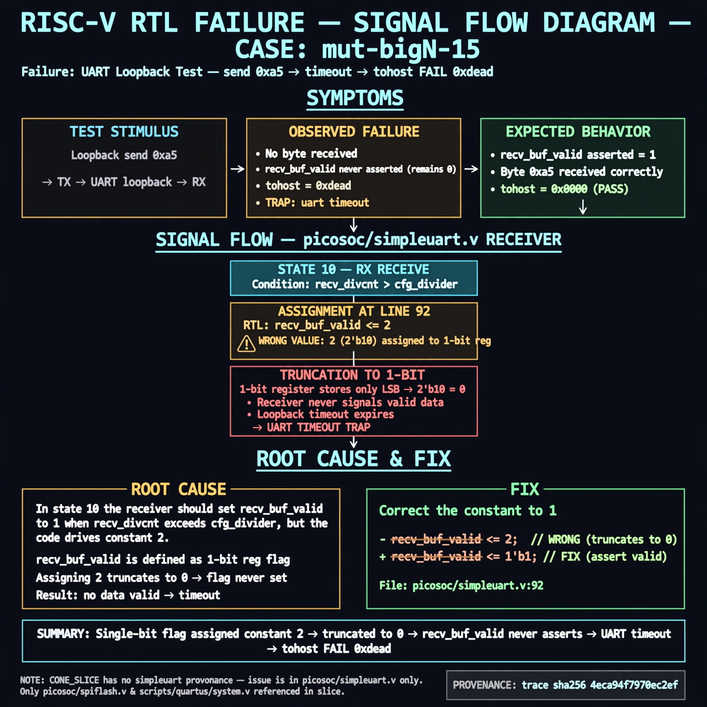

# Afterglow run report: mutbigN-v3-15

case `mut-bigN-15` | status **GREEN** | mode `live` | seed `42`

wall start `2026-10-27T11:24:26Z` | wall end `2026-10-27T11:25:15Z` | time-to-green `48.7s`

retries `0` | human_touches `0` | diagnosed `True` | fixed_unaided `True` | patch_source `model-verbatim`

## Verdicts (from sim, not typed)

- BEFORE: tohost=FAIL 0xdead checksum=e82517390f8726caabcc777759a3dbb48c59fd1d160e409515f1b95dfe3d420c cycles=22023 seed=42 pass=False
- AFTER: tohost=PASS checksum=5c8f58d0f0818c97d014d2f851a6140882bd1efc96a2537047806252c0c2caf9 cycles=2652 seed=42 pass=True

## Diagnosis (verbatim from api/text_response.json)

```
Loopback send 0xa5 ends in TRAP: uart timeout, no byte received with tohost FAIL 0xdead, so recv_buf_valid never asserted. In state 10 the receiver should set recv_buf_valid to 1 when recv_divcnt exceeds cfg_divider, but picosoc/simpleuart.v:92 drives recv_buf_valid <= 2 which truncates to 0 for a 1-bit flag. This single wrong constant explains the timeout; CONE_SLICE has no simpleuart provenance only picosoc/spiflash.v and scripts/quartus/system.v refs so trace plus excerpt govern.
```

expected re-sim signal: tohost PASS with uart byte 0xa5 received, no TRAP: uart timeout, no byte received

## Patch (2 lines, guard-checked)

```diff
diff --git a/picosoc/simpleuart.v b/picosoc/simpleuart.v
--- a/picosoc/simpleuart.v
+++ b/picosoc/simpleuart.v
@@ -89,7 +89,7 @@
 				10: begin
 					if (recv_divcnt > cfg_divider) begin
 						recv_buf_data <= recv_pattern;
-						recv_buf_valid <= 2;
+						recv_buf_valid <= 1;
 						recv_state <= 0;
 					end
 				end

```

## Provenance (judge checks)

- prompt file `v3` sha256 `ad529368accaf171e6121a54b2d27547230920a900c7c4e5094d3fff13ca4233`
- input_trace.txt sha256 `4eca94f7970ec2efede1a9c655cc0b16992fed5d8114352aa6d77dde571e6ced` (9 lines, 66 tokens)
- prompt tokens `925` (cap 2500)
- text model `muse-spark-1.3-contributor` latency `34199ms` request `chatcmpl-01a17d1b-4199-7503-b32a-0ec43d8e059f`
- image model `muse-image-1.0` latency `14047ms` request `f6c51dc7-9123-441a-8b4f-753c78f3168d` status `ok`
- image prompt sha256 `fc4c6749d1c831629648122ab916a6df85c1b0567097cadb93260d8167dd04ab`, trace sha `4eca94f7970ec2efede1a9c655cc0b16992fed5d8114352aa6d77dde571e6ced` (see api/image_request.json)

## Explanation diagram



## Bundle completeness

- present (12): artifacts/input_trace.txt, artifacts/boot.log, artifacts/boot_after.log, artifacts/verdict_before.json, artifacts/verdict_after.json, api/text_request.json, api/text_response.json, api/image_request.json, api/image_response.json, explain.png, patch.diff, meta.json
- missing (0): none

