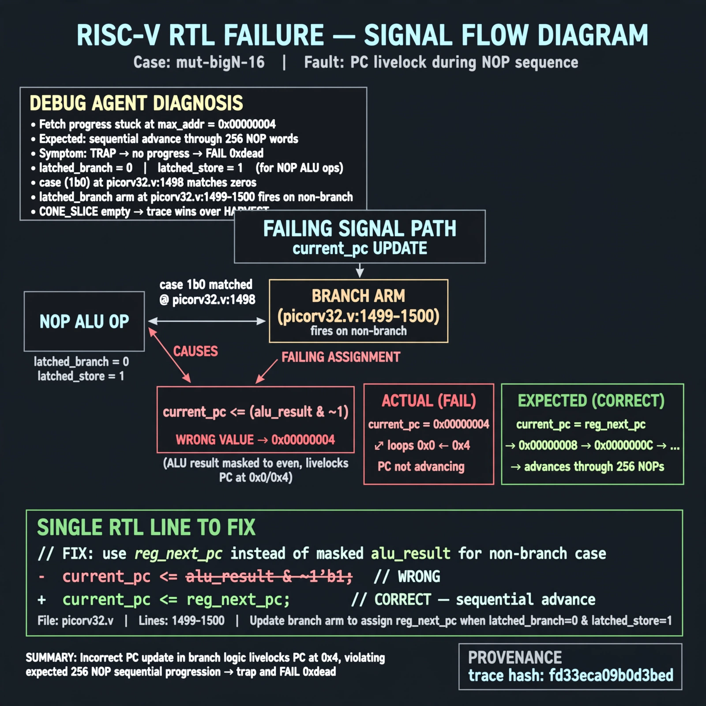

# Afterglow run report: mutbigN-v3-16-rerun

case `mut-bigN-16` | status **GREEN** | mode `live` | seed `42`

wall start `2026-10-27T12:12:31Z` | wall end `2026-10-27T12:15:08Z` | time-to-green `157.9s`

retries `0` | human_touches `0` | diagnosed `True` | fixed_unaided `True` | patch_source `model-verbatim`

## Verdicts (from sim, not typed)

- BEFORE: tohost=FAIL 0xdead checksum=9bf5d2591144696f56ca014343e1655f97020c36292daceaf3f26e732301574d cycles=2009 seed=42 pass=False
- AFTER: tohost=PASS checksum=5c28238265cb94168311e9914f0df355642c557d04dba11845d557ac8a64aa4a cycles=2009 seed=42 pass=True

## Diagnosis (verbatim from api/text_response.json)

```
Fetch progress stuck at max_addr=0x00000004 vs expected sequential advance through 256 NOP words, causing TRAP no progress and FAIL 0xdead. With latched_branch=0 and latched_store=1 for NOP ALU ops, case (1b0) at picorv32.v:1498 matches zeros so the latched_branch arm at picorv32.v:1499-1500 fires on non-branch and sets current_pc to ALU result masked with ~1 instead of reg_next_pc. This livelocks PC around 0x0/0x4 explaining no progress; CONE_SLICE empty so trace wins over HARVEST.
```

expected re-sim signal: tohost PASS not FAIL 0xdead, no TRAP no progress, max_addr advances beyond 0x00000004 through full NOP region

## Patch (2 lines, guard-checked)

```diff
diff --git a/picorv32.v b/picorv32.v
--- a/picorv32.v
+++ b/picorv32.v
@@ -1497,3 +1497,3 @@
 				(* parallel_case *)
-				case (1'b0)
+				case (1'b1)
 					latched_branch: begin

```

## Provenance (judge checks)

- prompt file `v3` sha256 `ad529368accaf171e6121a54b2d27547230920a900c7c4e5094d3fff13ca4233`
- input_trace.txt sha256 `fd33eca09b0d3bed7b950628b0437496efec424d528ab366f21a77b6ca7472f2` (9 lines, 69 tokens)
- prompt tokens `716` (cap 2500)
- text model `muse-spark-1.3-contributor` latency `61475ms` request `chatcmpl-01a17d48-e80a-7494-9051-3854005c3807`
- image model `muse-image-1.0` latency `16052ms` request `40783c13-2e98-418b-819f-ee9f0fef1914` status `ok`
- image prompt sha256 `388b5f27fae7710d40498d6f6420530b563d17b984e1b1dcd29b5a9a34b4f00c`, trace sha `fd33eca09b0d3bed7b950628b0437496efec424d528ab366f21a77b6ca7472f2` (see api/image_request.json)

## Explanation diagram



## Bundle completeness

- present (12): artifacts/input_trace.txt, artifacts/boot.log, artifacts/boot_after.log, artifacts/verdict_before.json, artifacts/verdict_after.json, api/text_request.json, api/text_response.json, api/image_request.json, api/image_response.json, explain.png, patch.diff, meta.json
- missing (0): none

