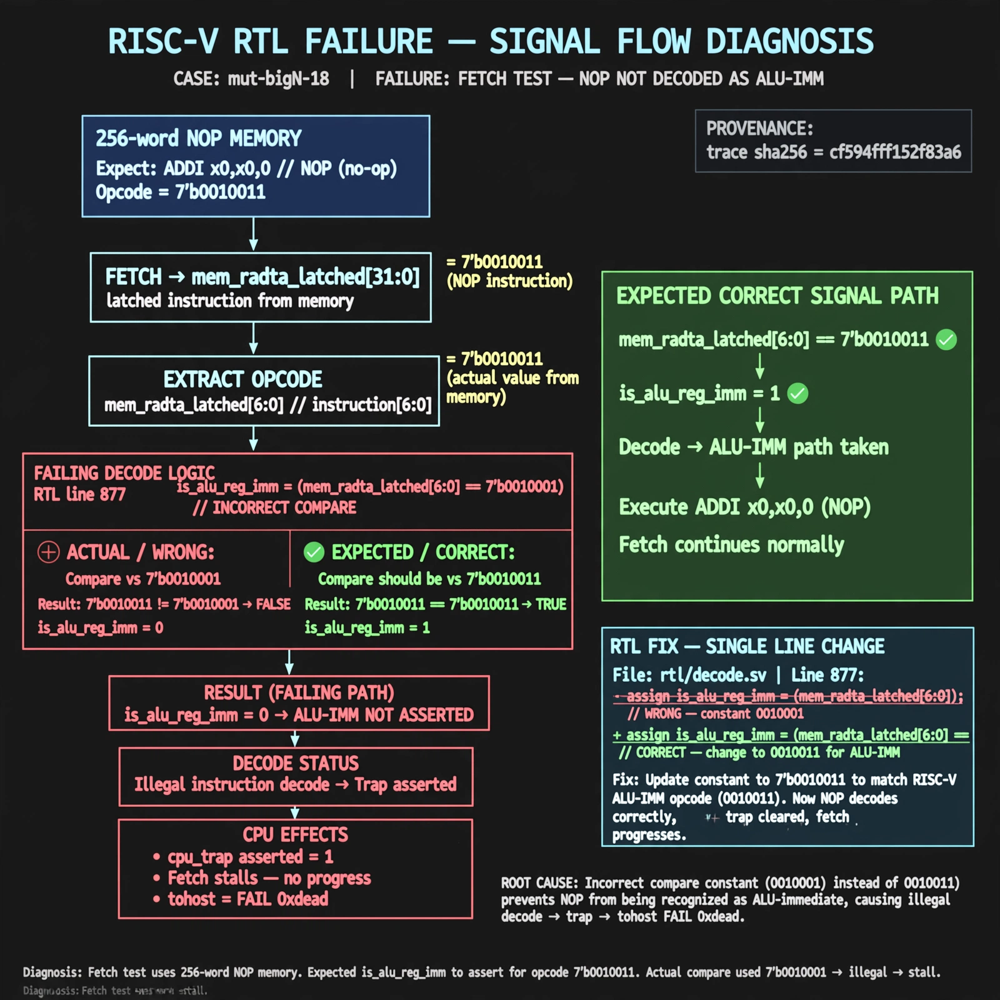

# Afterglow run report: mutbigN-v3-18

case `mut-bigN-18` | status **GREEN** | mode `live` | seed `42`

wall start `2026-10-27T11:30:47Z` | wall end `2026-10-27T11:32:09Z` | time-to-green `82.0s`

retries `0` | human_touches `0` | diagnosed `True` | fixed_unaided `True` | patch_source `model-verbatim`

## Verdicts (from sim, not typed)

- BEFORE: tohost=FAIL 0xdead checksum=c2a7a4d6295484feeb9ec1ea9381732b8e39a7ccd1997c7d70f6454da2fb4659 cycles=2009 seed=42 pass=False
- AFTER: tohost=PASS checksum=5c28238265cb94168311e9914f0df355642c557d04dba11845d557ac8a64aa4a cycles=2009 seed=42 pass=True

## Diagnosis (verbatim from api/text_response.json)

```
Fetch test uses 256-word NOP memory (ADDI x0,x0,0 with opcode 7'b0010011) but trace shows TRAP: cpu trap asserted and tohost FAIL 0xdead. Expected is_alu_reg_imm to assert for mem_rdata_latched[6:0]==7'b0010011, but line 877 compares to 7'b0010001 so NOP never decodes as ALU-imm. The illegal decode causes the trap and stalls fetch progress.
```

expected re-sim signal: tohost PASS with no TRAP: cpu trap asserted

## Patch (2 lines, guard-checked)

```diff
diff --git a/picorv32.v b/picorv32.v
--- a/picorv32.v
+++ b/picorv32.v
@@ -877,1 +877,1 @@
-			is_alu_reg_imm               <= mem_rdata_latched[6:0] == 7'b0010001;
+			is_alu_reg_imm               <= mem_rdata_latched[6:0] == 7'b0010011;

```

## Provenance (judge checks)

- prompt file `v3` sha256 `ad529368accaf171e6121a54b2d27547230920a900c7c4e5094d3fff13ca4233`
- input_trace.txt sha256 `cf594fff152f83a6c895322dd7549359721b14cc7dd2df72156c84ad5adffad9` (9 lines, 69 tokens)
- prompt tokens `778` (cap 2500)
- text model `muse-spark-1.3-contributor` latency `46414ms` request `chatcmpl-01a17d21-42f6-7694-9ed2-8685d5e7bb71`
- image model `muse-image-1.0` latency `34997ms` request `76482c60-a922-4742-84a1-e34013ee3625` status `ok`
- image prompt sha256 `fa0f972de6ae5271a6d0fc8a4d332ee6c447217a47a719b3b94488de65de0b07`, trace sha `cf594fff152f83a6c895322dd7549359721b14cc7dd2df72156c84ad5adffad9` (see api/image_request.json)

## Explanation diagram



## Bundle completeness

- present (12): artifacts/input_trace.txt, artifacts/boot.log, artifacts/boot_after.log, artifacts/verdict_before.json, artifacts/verdict_after.json, api/text_request.json, api/text_response.json, api/image_request.json, api/image_response.json, explain.png, patch.diff, meta.json
- missing (0): none

