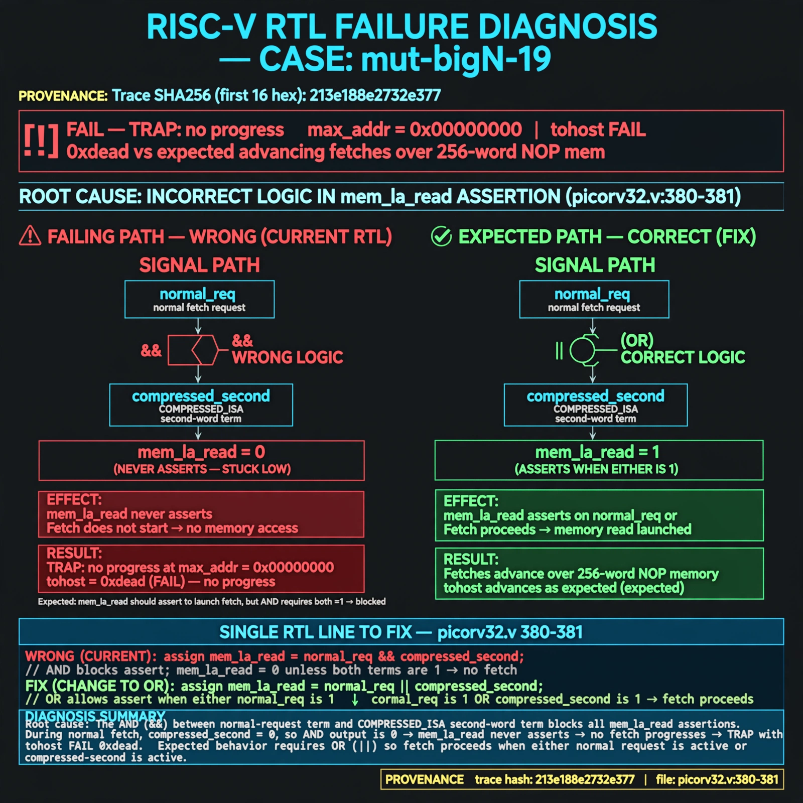

# Afterglow run report: mutbigN-v3-19

case `mut-bigN-19` | status **GREEN** | mode `live` | seed `42`

wall start `2026-10-27T11:32:09Z` | wall end `2026-10-27T11:33:12Z` | time-to-green `62.4s`

retries `0` | human_touches `0` | diagnosed `True` | fixed_unaided `True` | patch_source `model-verbatim`

## Verdicts (from sim, not typed)

- BEFORE: tohost=FAIL 0xdead checksum=563b7c10626ff25de2b3c430956c7c113e448c4efaea068f9b83a198d4322b15 cycles=2009 seed=42 pass=False
- AFTER: tohost=PASS checksum=5c28238265cb94168311e9914f0df355642c557d04dba11845d557ac8a64aa4a cycles=2009 seed=42 pass=True

## Diagnosis (verbatim from api/text_response.json)

```
Trace shows TRAP: no progress max_addr=0x00000000 with tohost FAIL 0xdead vs expected advancing fetches over 256-word NOP mem. mem_la_read at picorv32.v:380-381 never asserts so no fetch progresses. Root cause is AND (&&) joining the normal-request term and the COMPRESSED_ISA second-word term instead of OR (||), blocking all mem_la_read asserts.
```

expected re-sim signal: tohost PASS (not FAIL 0xdead), no TRAP: no progress max_addr=0x00000000, max_addr advances with fetch progress

## Patch (2 lines, guard-checked)

```diff
diff --git a/picorv32.v b/picorv32.v
--- a/picorv32.v
+++ b/picorv32.v
@@ -379,4 +379,4 @@
 	assign mem_la_write = resetn && !mem_state && mem_do_wdata;
-	assign mem_la_read = resetn && ((!mem_la_use_prefetched_high_word && !mem_state && (mem_do_rinst || mem_do_prefetch || mem_do_rdata)) &&
+	assign mem_la_read = resetn && ((!mem_la_use_prefetched_high_word && !mem_state && (mem_do_rinst || mem_do_prefetch || mem_do_rdata)) ||
 			(COMPRESSED_ISA && mem_xfer && (!last_mem_valid ? mem_la_firstword : mem_la_firstword_reg) && !mem_la_secondword && &mem_rdata_latched[1:0]));
 	assign mem_la_addr = (mem_do_prefetch || mem_do_rinst) ? {next_pc[31:2] + mem_la_firstword_xfer, 2'b00} : {reg_op1[31:2], 2'b00};

```

## Provenance (judge checks)

- prompt file `v3` sha256 `ad529368accaf171e6121a54b2d27547230920a900c7c4e5094d3fff13ca4233`
- input_trace.txt sha256 `213e188e2732e377209720f4c222a5f5064daf6a58617e344e65d105e2c5d1de` (9 lines, 69 tokens)
- prompt tokens `796` (cap 2500)
- text model `muse-spark-1.3-contributor` latency `32419ms` request `chatcmpl-01a17d22-4cee-70ec-854e-b738074a7dc3`
- image model `muse-image-1.0` latency `29316ms` request `1f64fd84-dec3-4b58-ac63-1e46dc625d9f` status `ok`
- image prompt sha256 `8268d33f2ccd8ba5961a14ba345eb8c6b86c8e389d13adef128a5d7ff62fdf9d`, trace sha `213e188e2732e377209720f4c222a5f5064daf6a58617e344e65d105e2c5d1de` (see api/image_request.json)

## Explanation diagram



## Bundle completeness

- present (12): artifacts/input_trace.txt, artifacts/boot.log, artifacts/boot_after.log, artifacts/verdict_before.json, artifacts/verdict_after.json, api/text_request.json, api/text_response.json, api/image_request.json, api/image_response.json, explain.png, patch.diff, meta.json
- missing (0): none

