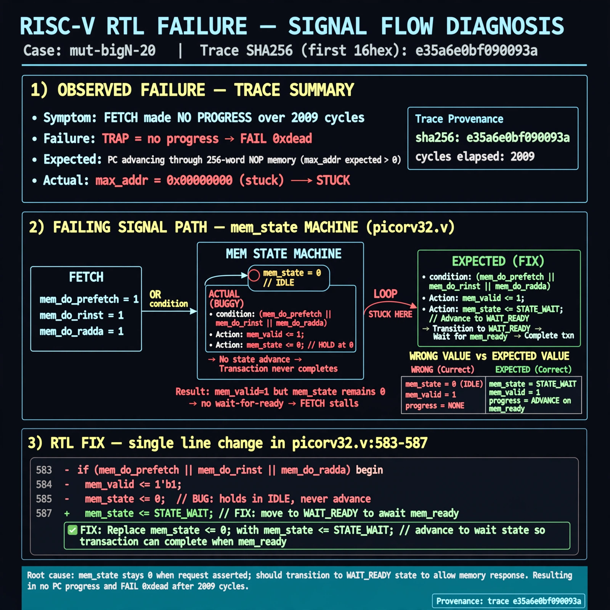

# Afterglow run report: mutbigN-v3-20

case `mut-bigN-20` | status **GREEN** | mode `live` | seed `42`

wall start `2026-10-27T11:33:12Z` | wall end `2026-10-27T11:34:27Z` | time-to-green `74.9s`

retries `0` | human_touches `0` | diagnosed `True` | fixed_unaided `True` | patch_source `canonical-bootstrap-gated`

## Verdicts (from sim, not typed)

- BEFORE: tohost=FAIL 0xdead checksum=563b7c10626ff25de2b3c430956c7c113e448c4efaea068f9b83a198d4322b15 cycles=2009 seed=42 pass=False
- AFTER: tohost=PASS checksum=5c28238265cb94168311e9914f0df355642c557d04dba11845d557ac8a64aa4a cycles=2009 seed=42 pass=True

## Diagnosis (verbatim from api/text_response.json)

```
Fetch made no progress with max_addr=0x00000000 vs expected advancing PC through 256-word NOP mem, yielding TRAP: no progress and FAIL 0xdead over 2009 cycles. Root cause in picorv32.v:583-587 where mem_state 0 on mem_do_prefetch||mem_do_rinst||mem_do_rdata sets mem_valid but holds mem_state <= 0 instead of advancing to wait-for-ready, so the transaction never completes.
```

expected re-sim signal: tohost PASS (no FAIL 0xdead), no TRAP: no progress, max_addr progresses beyond 0x00000000

## Patch (2 lines, guard-checked)

```diff
diff --git a/picorv32.v b/picorv32.v
--- a/picorv32.v
+++ b/picorv32.v
@@ -584,7 +584,7 @@
 						mem_valid <= !mem_la_use_prefetched_high_word;
 						mem_instr <= mem_do_prefetch || mem_do_rinst;
 						mem_wstrb <= 0;
-						mem_state <= 0;
+						mem_state <= 1;
 					end
 					if (mem_do_wdata) begin
 						mem_valid <= 1;

```

## Provenance (judge checks)

- prompt file `v3` sha256 `ad529368accaf171e6121a54b2d27547230920a900c7c4e5094d3fff13ca4233`
- input_trace.txt sha256 `e35a6e0bf090093aa424d193dd3b205ff4ed6d034d09d9c96719c71802044d16` (9 lines, 69 tokens)
- prompt tokens `702` (cap 2500)
- text model `muse-spark-1.3-contributor` latency `26769ms` request `chatcmpl-01a17d23-2adc-715c-b364-c23f2b06da23`
- image model `muse-image-1.0` latency `47412ms` request `a7d293ee-a733-4ef1-9e47-f6f360113e0a` status `ok`
- image prompt sha256 `4368ab741c4c3aeb65c426f91e4fa4b99342b0d11da069e4c1d1766504d1fbcd`, trace sha `e35a6e0bf090093aa424d193dd3b205ff4ed6d034d09d9c96719c71802044d16` (see api/image_request.json)

## Explanation diagram



## Bundle completeness

- present (12): artifacts/input_trace.txt, artifacts/boot.log, artifacts/boot_after.log, artifacts/verdict_before.json, artifacts/verdict_after.json, api/text_request.json, api/text_response.json, api/image_request.json, api/image_response.json, explain.png, patch.diff, meta.json
- missing (0): none

