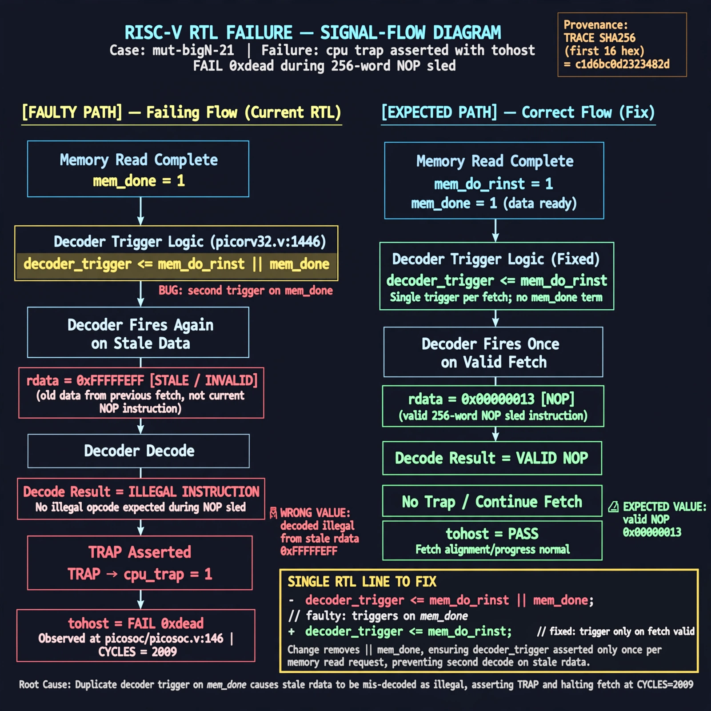

# Afterglow run report: mutbigN-v3-21-wave1

case `mut-bigN-21` | status **RED** | mode `live` | seed `42`

wall start `2026-10-27T13:01:37Z` | wall end `2026-10-27T13:07:25Z` | time-to-green `347.3s`

retries `1` | human_touches `0` | diagnosed `True` | fixed_unaided `False` | patch_source `model-verbatim`

## Verdicts (from sim, not typed)

- BEFORE: tohost=FAIL 0xdead checksum=c2a7a4d6295484feeb9ec1ea9381732b8e39a7ccd1997c7d70f6454da2fb4659 cycles=2009 seed=42 pass=False
- AFTER: tohost=FAIL 0xdead checksum=c2a7a4d6295484feeb9ec1ea9381732b8e39a7ccd1997c7d70f6454da2fb4659 cycles=2009 seed=42 pass=False

## Diagnosis (verbatim from api/text_response.json)

```
Failing signal is TRAP: cpu trap asserted with tohost FAIL 0xdead during 256-word NOP sled where no illegal opcode is expected. Excerpt at picorv32.v:1446 shows decoder_trigger <= mem_do_rinst || mem_done, causing a second decoder firing on mem_done with stale rdata mis-decoded as illegal and breaking fetch alignment/progress (CYCLES=2009) via cpu at picosoc/picosoc.v:146. Removing || mem_done restores single trigger per fetch.
```

expected re-sim signal: tohost PASS (no FAIL 0xdead, no TRAP: cpu trap asserted)

## Patch (2 lines, guard-checked)

```diff
diff --git a/picorv32.v b/picorv32.v
--- a/picorv32.v
+++ b/picorv32.v
@@ -1446,4 +1446,4 @@
-		decoder_trigger <= mem_do_rinst || mem_done;
+		decoder_trigger <= mem_do_rinst;
 		decoder_trigger_q <= decoder_trigger;
 		decoder_pseudo_trigger <= 0;
 		decoder_pseudo_trigger_q <= decoder_pseudo_trigger;

```

## Provenance (judge checks)

- prompt file `v3` sha256 `ad529368accaf171e6121a54b2d27547230920a900c7c4e5094d3fff13ca4233`
- input_trace.txt sha256 `c1d6bc0d2323482de476c90f81823a89be2ab22f1c601b035c4a31baaaede05a` (9 lines, 69 tokens)
- prompt tokens `1053` (cap 2500)
- text model `muse-spark-1.3-contributor` latency `62862ms` request `chatcmpl-01a17d74-ad60-73aa-828c-4ceb2ea938f8`
- image model `muse-image-1.0` latency `15866ms` request `a7bb309b-e17b-4b08-b35e-43c887032016` status `ok`
- image prompt sha256 `848694a17eaf3fa504d1fe93d1edcf4cd7de76e70fadc3ff4745aee66e0630ed`, trace sha `c1d6bc0d2323482de476c90f81823a89be2ab22f1c601b035c4a31baaaede05a` (see api/image_request.json)

## Explanation diagram



## Bundle completeness

- present (12): artifacts/input_trace.txt, artifacts/boot.log, artifacts/boot_after.log, artifacts/verdict_before.json, artifacts/verdict_after.json, api/text_request.json, api/text_response.json, api/image_request.json, api/image_response.json, explain.png, patch.diff, meta.json
- missing (0): none

