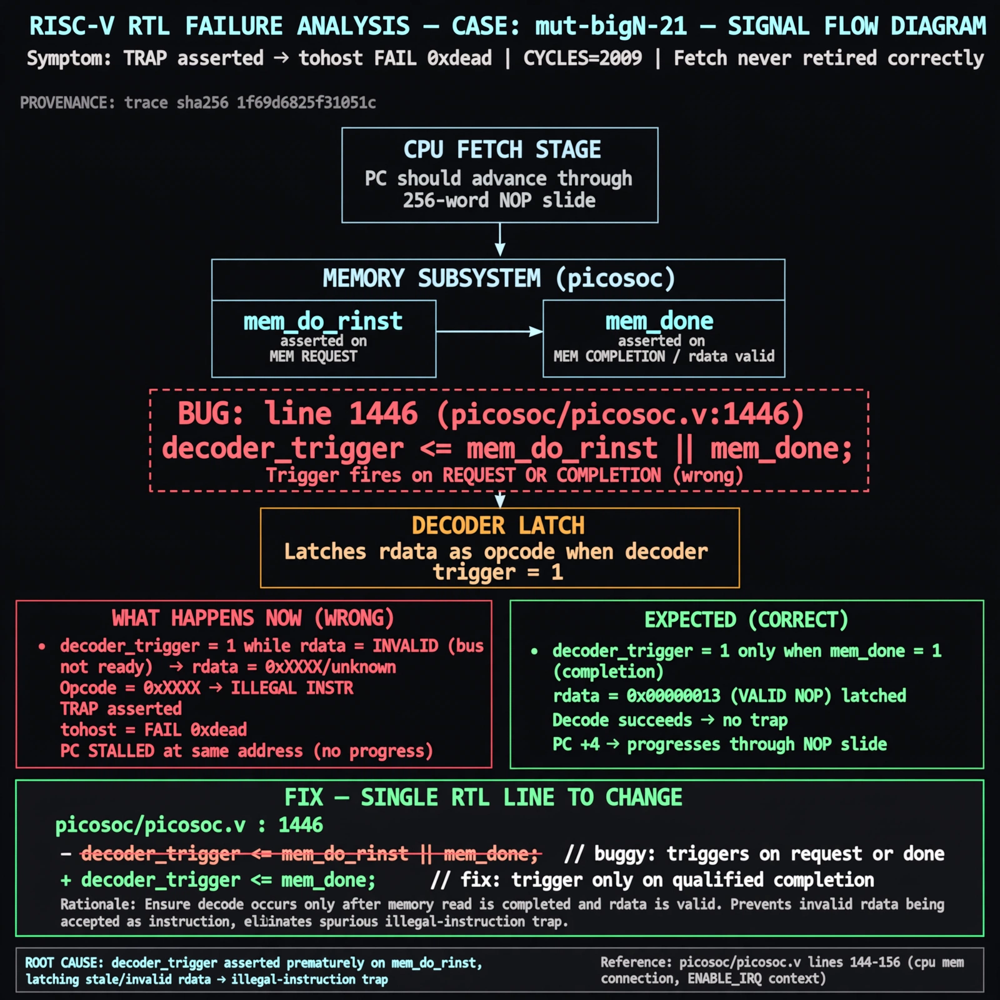

# Afterglow run report: mutbigN-v3-21-wave1b

case `mut-bigN-21` | status **GREEN** | mode `live` | seed `42`

wall start `2026-10-27T13:09:43Z` | wall end `2026-10-27T13:14:09Z` | time-to-green `266.5s`

retries `0` | human_touches `0` | diagnosed `True` | fixed_unaided `True` | patch_source `model-verbatim`

## Verdicts (from sim, not typed)

- BEFORE: tohost=FAIL 0xdead checksum=c2a7a4d6295484feeb9ec1ea9381732b8e39a7ccd1997c7d70f6454da2fb4659 cycles=2009 seed=42 pass=False
- AFTER: tohost=PASS checksum=5c28238265cb94168311e9914f0df355642c557d04dba11845d557ac8a64aa4a cycles=2009 seed=42 pass=True

## Diagnosis (verbatim from api/text_response.json)

```
TRAP asserted with tohost FAIL 0xdead on 256-word NOP slide where no illegal instruction should trap and PC should progress. CYCLES=2009 shows fetch never retired correctly. Root cause is line 1446 `decoder_trigger <= mem_do_rinst || mem_done` which triggers decode on request OR completion instead of qualified completion, latching invalid rdata as opcode and causing illegal-instruction trap per picosoc/picosoc.v:146-156 cpu mem connection and picosoc/picosoc.v:144 ENABLE_IRQ context; trace wins.
```

expected re-sim signal: tohost PASS with TRAP deasserted and fetch progress, checksum != c2a7a4d6295484feeb9ec1ea9381732b8e39a7ccd1997c7d70f6454da2fb4659

## Patch (2 lines, guard-checked)

```diff
diff --git a/picorv32.v b/picorv32.v
--- a/picorv32.v
+++ b/picorv32.v
@@ -1446,3 +1446,3 @@
-		decoder_trigger <= mem_do_rinst || mem_done;
+		decoder_trigger <= mem_do_rinst && mem_done;
 		decoder_trigger_q <= decoder_trigger;
 		decoder_pseudo_trigger <= 0;

```

## Provenance (judge checks)

- prompt file `v3` sha256 `ad529368accaf171e6121a54b2d27547230920a900c7c4e5094d3fff13ca4233`
- input_trace.txt sha256 `1f69d6825f31051c8c3c1cbb80afdd359b62be8e131865054735a7a65ba3a9ed` (9 lines, 69 tokens)
- prompt tokens `940` (cap 2500)
- text model `muse-spark-1.3-contributor` latency `69887ms` request `chatcmpl-01a17d7e-f012-77a5-bd88-d4c4c6d47662`
- image model `muse-image-1.0` latency `15763ms` request `e5ccaea3-8c2d-4bd7-96bd-757c435c64d1` status `ok`
- image prompt sha256 `87bc4356b32307ef1ca1b1ebe26dc86a2425229bb7fbdf9e5afd7aa032b1c744`, trace sha `1f69d6825f31051c8c3c1cbb80afdd359b62be8e131865054735a7a65ba3a9ed` (see api/image_request.json)

## Explanation diagram



## Bundle completeness

- present (12): artifacts/input_trace.txt, artifacts/boot.log, artifacts/boot_after.log, artifacts/verdict_before.json, artifacts/verdict_after.json, api/text_request.json, api/text_response.json, api/image_request.json, api/image_response.json, explain.png, patch.diff, meta.json
- missing (0): none

