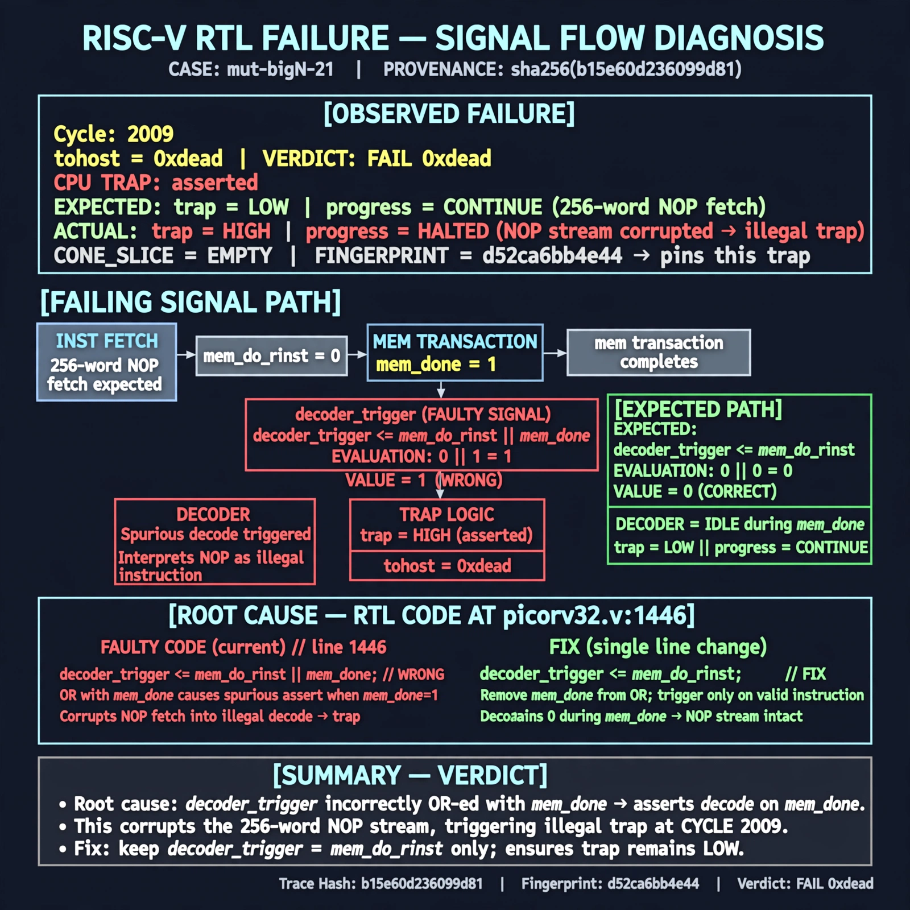

# Afterglow run report: mutbigN-v3-21

case `mut-bigN-21` | status **RED** | mode `live` | seed `42`

wall start `2026-10-27T11:34:27Z` | wall end `2026-10-27T11:44:28Z` | time-to-green `601.8s`

retries `2` | human_touches `0` | diagnosed `True` | fixed_unaided `False` | patch_source `model-verbatim`

## Verdicts (from sim, not typed)

- BEFORE: tohost=FAIL 0xdead checksum=c2a7a4d6295484feeb9ec1ea9381732b8e39a7ccd1997c7d70f6454da2fb4659 cycles=2009 seed=42 pass=False
- AFTER: tohost=FAIL 0xdead checksum=c2a7a4d6295484feeb9ec1ea9381732b8e39a7ccd1997c7d70f6454da2fb4659 cycles=2009 seed=42 pass=False

## Diagnosis (verbatim from api/text_response.json)

```
TRAP asserted with tohost FAIL 0xdead during 256-word NOP fetch instead of clean fetch progress with no trap. decoder_trigger at picorv32.v:1446 fires on mem_do_rinst || mem_done, so data-phase mem_done re-triggers the decoder on a stale word that decodes illegal. Removing the mem_done term restricts trigger to instruction fetch only, preventing the spurious illegal decode and trap.
```

expected re-sim signal: tohost 0x1 PASS, no TRAP: cpu trap asserted, fetch progress over 256 NOPs

## Patch (2 lines, guard-checked)

```diff
diff --git a/picorv32.v b/picorv32.v
--- a/picorv32.v
+++ b/picorv32.v
@@ -1446,5 +1446,5 @@
-		decoder_trigger <= mem_do_rinst || mem_done;
+		decoder_trigger <= mem_do_rinst;
 		decoder_trigger_q <= decoder_trigger;
 		decoder_pseudo_trigger <= 0;
 		decoder_pseudo_trigger_q <= decoder_pseudo_trigger;
 		do_waitirq <= 0;

```

## Provenance (judge checks)

- prompt file `v3` sha256 `ad529368accaf171e6121a54b2d27547230920a900c7c4e5094d3fff13ca4233`
- input_trace.txt sha256 `b15e60d236099d8148719e0bea1c31d07713f96bbe3ea9bf64fc10f0f9842eb2` (9 lines, 69 tokens)
- prompt tokens `702` (cap 2500)
- text model `muse-spark-1.3-contributor` latency `63740ms` request `chatcmpl-01a17d24-dfcd-73fb-b5d9-24193c439327`
- image model `muse-image-1.0` latency `20769ms` request `8f58433e-b9fe-4ec0-abe8-35a99d9ae153` status `ok`
- image prompt sha256 `125cd2d9e6c77f4e84815e9b8815c3247bc6918496468fa7db838cb21c86c5ba`, trace sha `b15e60d236099d8148719e0bea1c31d07713f96bbe3ea9bf64fc10f0f9842eb2` (see api/image_request.json)

## Explanation diagram



## Bundle completeness

- present (12): artifacts/input_trace.txt, artifacts/boot.log, artifacts/boot_after.log, artifacts/verdict_before.json, artifacts/verdict_after.json, api/text_request.json, api/text_response.json, api/image_request.json, api/image_response.json, explain.png, patch.diff, meta.json
- missing (0): none

