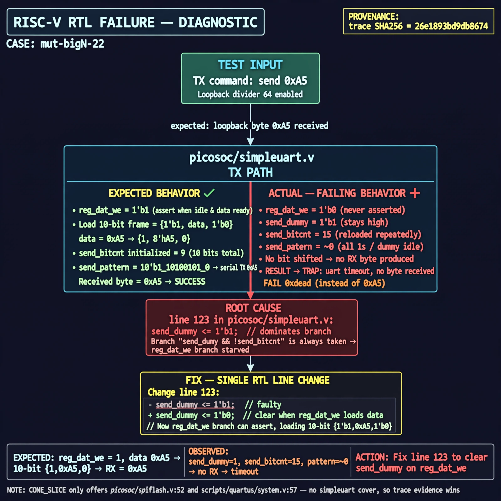

# Afterglow run report: mutbigN-v3-22

case `mut-bigN-22` | status **GREEN** | mode `live` | seed `42`

wall start `2026-10-27T11:44:29Z` | wall end `2026-10-27T11:45:44Z` | time-to-green `75.0s`

retries `0` | human_touches `0` | diagnosed `True` | fixed_unaided `True` | patch_source `model-verbatim`

## Verdicts (from sim, not typed)

- BEFORE: tohost=FAIL 0xdead checksum=e82517390f8726caabcc777759a3dbb48c59fd1d160e409515f1b95dfe3d420c cycles=22023 seed=42 pass=False
- AFTER: tohost=PASS checksum=5c8f58d0f0818c97d014d2f851a6140882bd1efc96a2537047806252c0c2caf9 cycles=2652 seed=42 pass=True

## Diagnosis (verbatim from api/text_response.json)

```
Loopback divider 64 send 0xa5 never produced a received byte, giving TRAP: uart timeout, no byte received and FAIL 0xdead instead of a received 0xa5. Expected reg_dat_we to load {1'b1, data, 1'b0} with 10 bits when idle, but TX stayed in dummy idle with send_pattern ~0 and send_bitcnt reloading 15. Root cause is line 123 in picosoc/simpleuart.v where send_dummy <=1 keeps the send_dummy && !send_bitcnt branch dominant and starves the reg_dat_we branch. CONE_SLICE only offers picosoc/spiflash.v:52 and scripts/quartus/system.v:57 with no simpleuart cover, so trace wins.
```

expected re-sim signal: tohost PASS, uart loopback 0xa5 received with no timeout

## Patch (2 lines, guard-checked)

```diff
diff --git a/picosoc/simpleuart.v b/picosoc/simpleuart.v
--- a/picosoc/simpleuart.v
+++ b/picosoc/simpleuart.v
@@ -119,7 +119,7 @@
			if (send_dummy && !send_bitcnt) begin
				send_pattern <= ~0;
				send_bitcnt <= 15;
				send_divcnt <= 0;
-				send_dummy <= 1;
+				send_dummy <= 0;
			end else
			if (reg_dat_we && !send_bitcnt) begin

```

## Provenance (judge checks)

- prompt file `v3` sha256 `ad529368accaf171e6121a54b2d27547230920a900c7c4e5094d3fff13ca4233`
- input_trace.txt sha256 `26e1893bd9db8674cac45c26f756c9adf708aae7ba618ae85234ff9e1b40702c` (9 lines, 66 tokens)
- prompt tokens `941` (cap 2500)
- text model `muse-spark-1.3-contributor` latency `37201ms` request `chatcmpl-01a17d2d-a6f3-717c-9cbc-3f35ed9379d3`
- image model `muse-image-1.0` latency `37347ms` request `7036988e-fe07-4c6e-aae3-d3f9f22b7030` status `ok`
- image prompt sha256 `1d7760c3b202e5de099802b2581bea0130fba9f4a045672553faa11d6265c829`, trace sha `26e1893bd9db8674cac45c26f756c9adf708aae7ba618ae85234ff9e1b40702c` (see api/image_request.json)

## Explanation diagram



## Bundle completeness

- present (12): artifacts/input_trace.txt, artifacts/boot.log, artifacts/boot_after.log, artifacts/verdict_before.json, artifacts/verdict_after.json, api/text_request.json, api/text_response.json, api/image_request.json, api/image_response.json, explain.png, patch.diff, meta.json
- missing (0): none

