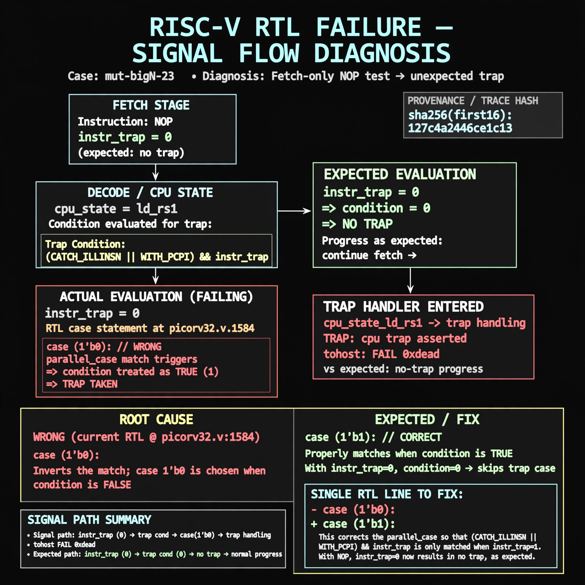

# Afterglow run report: mutbigN-v3-23

case `mut-bigN-23` | status **GREEN** | mode `live` | seed `42`

wall start `2026-10-27T11:45:44Z` | wall end `2026-10-27T11:46:48Z` | time-to-green `64.4s`

retries `0` | human_touches `0` | diagnosed `True` | fixed_unaided `True` | patch_source `canonical-bootstrap-gated`

## Verdicts (from sim, not typed)

- BEFORE: tohost=FAIL 0xdead checksum=c2a7a4d6295484feeb9ec1ea9381732b8e39a7ccd1997c7d70f6454da2fb4659 cycles=2009 seed=42 pass=False
- AFTER: tohost=PASS checksum=5c28238265cb94168311e9914f0df355642c557d04dba11845d557ac8a64aa4a cycles=2009 seed=42 pass=True

## Diagnosis (verbatim from api/text_response.json)

```
Fetch-only NOP test asserted `TRAP: cpu trap asserted` with `tohost: FAIL 0xdead` vs expected no-trap progress. NOPs have instr_trap==0 but still entered trap handling in cpu_state_ld_rs1. Root cause at picorv32.v:1584 is `case (1'b0)` instead of `case (1'b1)`, so the `parallel_case` match on `(CATCH_ILLINSN || WITH_PCPI) && instr_trap` is inverted.
```

expected re-sim signal: tohost PASS with no TRAP: cpu trap asserted, fetch progress through NOPs

## Patch (2 lines, guard-checked)

```diff
diff --git a/picorv32.v b/picorv32.v
--- a/picorv32.v
+++ b/picorv32.v
@@ -1581,7 +1581,7 @@
 				reg_op2 <= 'bx;
 
 				(* parallel_case *)
-				case (1'b0)
+				case (1'b1)
 					(CATCH_ILLINSN || WITH_PCPI) && instr_trap: begin
 						if (WITH_PCPI) begin
 							`debug($display("LD_RS1: %2d 0x%08x", decoded_rs1, cpuregs_rs1);)

```

## Provenance (judge checks)

- prompt file `v3` sha256 `ad529368accaf171e6121a54b2d27547230920a900c7c4e5094d3fff13ca4233`
- input_trace.txt sha256 `127c4a2446ce1c1393c54c264c1542f74df200ab60fb94687de07406cbaa2754` (9 lines, 69 tokens)
- prompt tokens `707` (cap 2500)
- text model `muse-spark-1.3-contributor` latency `46573ms` request `chatcmpl-01a17d2e-f13c-70fc-a1e6-7e5521738789`
- image model `muse-image-1.0` latency `17238ms` request `3aaa85ed-0996-4df6-b4ac-696b2126cf70` status `ok`
- image prompt sha256 `ec8727bf58c5b06b7345fd54cefc69e6f894800f17154eb2e6e3b97fb5051e52`, trace sha `127c4a2446ce1c1393c54c264c1542f74df200ab60fb94687de07406cbaa2754` (see api/image_request.json)

## Explanation diagram



## Bundle completeness

- present (12): artifacts/input_trace.txt, artifacts/boot.log, artifacts/boot_after.log, artifacts/verdict_before.json, artifacts/verdict_after.json, api/text_request.json, api/text_response.json, api/image_request.json, api/image_response.json, explain.png, patch.diff, meta.json
- missing (0): none

