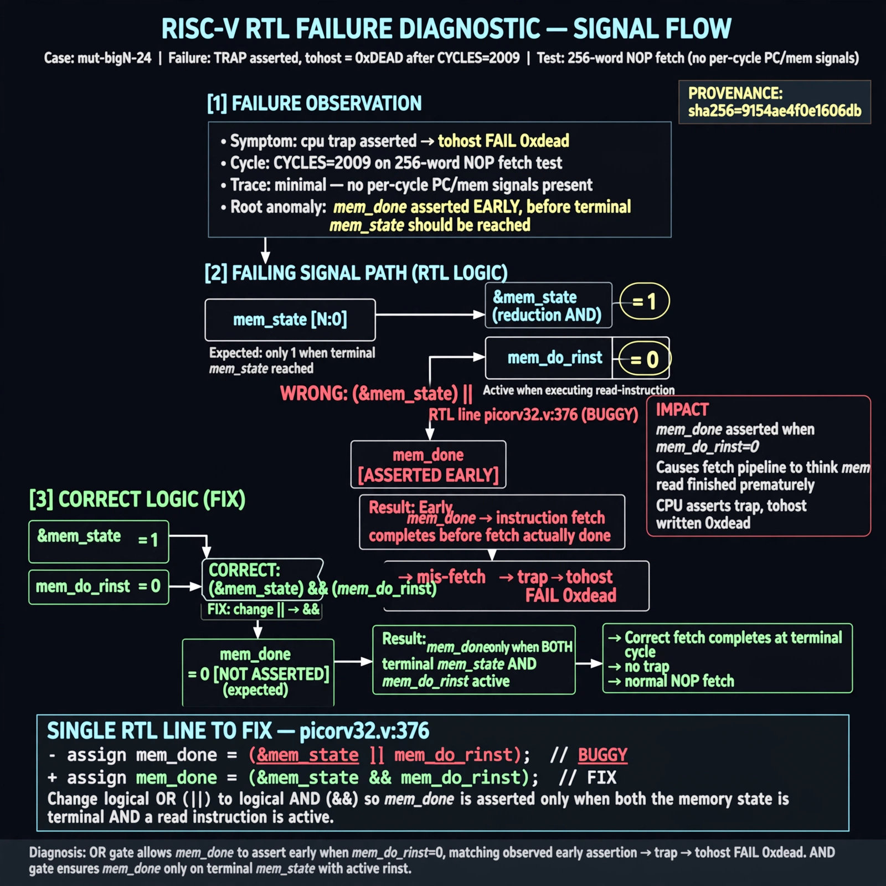

# Afterglow run report: mutbigN-v3-24

case `mut-bigN-24` | status **GREEN** | mode `live` | seed `42`

wall start `2026-10-27T11:46:48Z` | wall end `2026-10-27T11:47:40Z` | time-to-green `51.5s`

retries `0` | human_touches `0` | diagnosed `True` | fixed_unaided `True` | patch_source `model-verbatim`

## Verdicts (from sim, not typed)

- BEFORE: tohost=FAIL 0xdead checksum=c2a7a4d6295484feeb9ec1ea9381732b8e39a7ccd1997c7d70f6454da2fb4659 cycles=2009 seed=42 pass=False
- AFTER: tohost=PASS checksum=5c28238265cb94168311e9914f0df355642c557d04dba11845d557ac8a64aa4a cycles=2009 seed=42 pass=True

## Diagnosis (verbatim from api/text_response.json)

```
Trace is minimal/unclear: only TRAP: cpu trap asserted and tohost FAIL 0xdead after CYCLES=2009 on 256-word NOP fetch test with no per-cycle PC/mem signals. mem_done is asserted early vs expected only on terminal mem_state with active rinst, causing mis-fetch and trap. Root cause in excerpt picorv32.v:376 uses (&mem_state || mem_do_rinst) instead of (&mem_state && mem_do_rinst).
```

expected re-sim signal: tohost PASS (not FAIL 0xdead), no TRAP: cpu trap asserted

## Patch (2 lines, guard-checked)

```diff
diff --git a/picorv32.v b/picorv32.v
--- a/picorv32.v
+++ b/picorv32.v
@@ -375,3 +375,3 @@
 	wire mem_busy = |{mem_do_prefetch, mem_do_rinst, mem_do_rdata, mem_do_wdata};
-	wire mem_done = resetn && ((mem_xfer && |mem_state && (mem_do_rinst || mem_do_rdata || mem_do_wdata)) || (&mem_state || mem_do_rinst)) &&
+	wire mem_done = resetn && ((mem_xfer && |mem_state && (mem_do_rinst || mem_do_rdata || mem_do_wdata)) || (&mem_state && mem_do_rinst)) &&
 			(!mem_la_firstword || (~&mem_rdata_latched[1:0] && mem_xfer));

```

## Provenance (judge checks)

- prompt file `v3` sha256 `ad529368accaf171e6121a54b2d27547230920a900c7c4e5094d3fff13ca4233`
- input_trace.txt sha256 `9154ae4f0e1606db60b9a12bf643ae7e5c70cfeea36be4b773ed8e68018ae932` (9 lines, 69 tokens)
- prompt tokens `791` (cap 2500)
- text model `muse-spark-1.3-contributor` latency `31512ms` request `chatcmpl-01a17d2f-b246-7581-86c4-e93994d60568`
- image model `muse-image-1.0` latency `19342ms` request `61ef5804-6259-48dc-81f3-5128b209d161` status `ok`
- image prompt sha256 `b0e245def39f41dfc8b4d09cf7f1f68b709ccdc59e32cc846740db4b1311cf08`, trace sha `9154ae4f0e1606db60b9a12bf643ae7e5c70cfeea36be4b773ed8e68018ae932` (see api/image_request.json)

## Explanation diagram



## Bundle completeness

- present (12): artifacts/input_trace.txt, artifacts/boot.log, artifacts/boot_after.log, artifacts/verdict_before.json, artifacts/verdict_after.json, api/text_request.json, api/text_response.json, api/image_request.json, api/image_response.json, explain.png, patch.diff, meta.json
- missing (0): none

